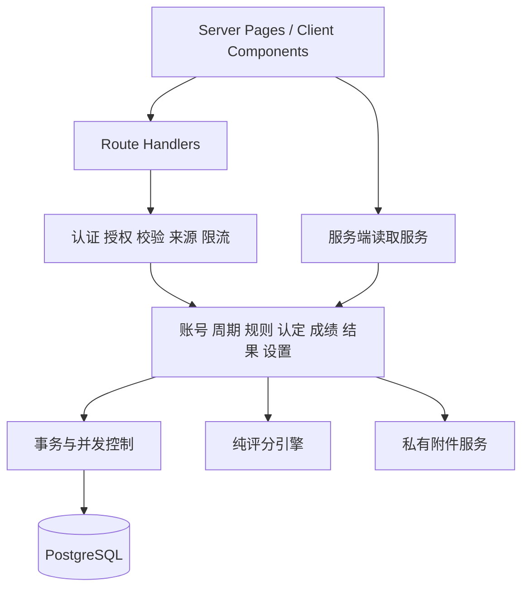

# 系统架构

日期：2026-10-20。状态：企业目标架构v0.1；当前边界与改造目标分别标注。

## 固定技术栈

以package.json为事实：Next.js16.4.2、React19.3.1、TypeScript~5.9.3、Prisma7.10.1、pg8.16.3、NextAuth4.24.15、Zod4.3.6；shadcn/ui、Base UI、Tailwind4、lucide-react继续使用。PostgreSQL为真实数据存储，附件继续使用受控私有本地目录。现有架构不更换框架、不引入第二后端、不另建项目；新增库必须有必要性、许可和安全评估。

## 模块与依赖

Route Handler只负责HTTP输入/输出和入口授权，业务服务在事务内再次检查当前会话、对象归属、阶段和修订。不能仅以导航隐藏保护功能。Server Component调用服务同样遵守对象授权，不绕过服务复用数据库查询拼装敏感结果。

评分引擎不依赖Next、Prisma、学校名称或用户会话，输入是已验证规则和十进制数据，输出可解释明细。模板与主题不能改变运算实现。

## 当前可复用基础

- `src/server/auth.ts`与`authorization.ts`：会话与HTTP授权边界，需继续审查覆盖。
- `accounts.ts`：adminTransaction模式；`terms.ts`：termTransaction同周期锁与事务内鉴权。
- `spreadsheet.ts`与各import服务：有界解析、预览快照与幂等提交基础。
- `src/lib/scoring/`：schema、迭代验证及精确运算。
- `http.ts`、`rate-limit.ts`与私有evidence服务：统一错误、来源、限制和下载基础。

实际代码不存在`src/server/schemes.ts`，评分保存当前位于terms.ts；后续文档不得引用不存在的实现文件。

## 事务与一致性目标

当前termTransaction使用周期advisory lock、15秒超时，适合短写入，不适合全范围长时间重算。未来计算任务分离“固定输入身份→准备候选→原子发布”，发布只持有短锁，校验规则/输入/范围修订一致。不同事务必须固定加锁顺序，涉及账号和周期的操作不得交叉取锁导致死锁。

跨请求幂等依赖持久批次身份、请求哈希、状态和结果；不能依赖按钮disabled或内存Map。乐观revision避免旧页面覆盖。失败事务不产生半批业务事实；磁盘文件与数据库无分布式事务，通过隔离上传、引用确认和可重试清理协调，不把写文件成功等同业务提交成功。

## 设置、缓存和资源

目标设置分草稿与已发布修订，服务端只向页面输出公开展示字段。每请求读取或按发布修订缓存，发布后统一失效；不能跨用户缓存权限结果。品牌资源与学生证明分命名空间/访问策略，公开Logo不能借用私有证明下载接口暴露材料。动态metadata由Server Component生成，私有业务noindex与访问控制并行，robots不是安全边界。

## 兼容与迁移

保留现有API客户端与Term.scheme读取，新增能力通过可回填的新表/字段落地；先审查孤立记录和数据质量，再补约束。不直接改历史迁移。expand→backfill→verify→switch→contract分阶段执行；不能把应用降级等同数据库已安全回退。

当前业务路由按action POST分派，可以在明确契约后逐步增加资源化接口；旧入口兼容期应有统一服务实现，不能两条入口分别维护不同规则。

## 非功能要求

授权在每次敏感操作重新检查；列表使用有界分页；重算/导入等重操作有限额与可观测状态。容量、响应时间、RPO/RTO目标应在测量和部署资源明确后核准，不能凭“企业级”编造已达到的数值。审计、指标和日志不记录密码、令牌、材料正文或完整隐私数据。生产运行、Docker部署和隔离恢复分别验收，当前均不能由开发构建替代。
