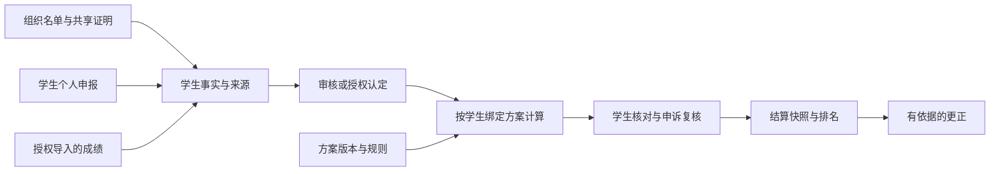

# 高校综合测评管理系统：产品设计方案

> 历史方案：用户已于2026-10-19明确改为毕设精简范围。当前以[高校综合测评系统-毕设精简方案](../../requirements/高校综合测评系统-毕设精简方案.md)为准；下文的多套学生方案、独立复核角色、公式编排及复杂版本迁移等不再作为首版要求。

版本：v1.0，2026-10-19。状态：已根据需求访谈整理，并完成独立可实施性审阅，供用户整体确认；本文件规划产品，不代表软件已实现。

## 1. 定位与首版目标

系统将学生表现和成果的采集、认定、计分、核对、申诉及结算连接起来，减少重复填表、重复提交证明和手工汇总。学校通过测评方案配置自己的分类和制度。

第一版在本校或一个学院真实试运行。数据和权限从开始就按学校隔离，同校可使用多套方案；不要求首版同时运营多所学校的商业入驻业务。

核心关系是：**事实说明学生完成了什么，认定说明哪些事实被学校接受，方案说明这些事实如何计分，结算保存当时的结果与依据。**

成功标准是：学生能查清每笔分数的来源，组织能批量提交名单并复用证明，审核人员能处理自己的待办，管理员能得到与核准规则一致、可追溯的结算结果和导出文件。

### 1.1 用户已确认的决定

| 事项 | 首版决定 |
|---|---|
| 使用范围 | 本校或学院先试点，核心支持其他学校配置使用 |
| 记录来源 | 学生个人申报、组织批量认定、管理员导入成绩 |
| 账号 | 管理员导入组织和学生名单，学生激活；组织账号由邀请或审批开通，学号在学校内唯一 |
| 活动 | 信息展示、参与名单导入、证明认定；不做平台内报名 |
| 评分配置 | 表单配置分类、分值、权重、条件和上限，辅以受限制的公式编辑和试算 |
| 多套方案 | 不同学院、年级可用不同方案；每名学生在同一周期绑定一套明确版本 |
| 审核 | 普通认定一次审核，申诉由其他授权人员复核；可信组织可以按授权免审 |
| 规则变更 | 已发布版本不变；创建新版本，试算差异后确认重算 |
| 外部成绩 | CSV／Excel 导入、列对应、错误提示和导入前预览；自动教务同步后续实现 |
| 周期流程 | 申报或批量认定 → 审核 → 学生核对与申诉 → 最终结算 |
| 结算后修正 | 保留快照，以有理由、可追溯的更正处理 |
| 排名 | 按班级、专业、年级等范围配置，只比较同周期同方案版本 |
| 学生可见内容 | 本人分数、明细、名次和有权访问的材料；不能查看其他学生证明 |
| 公示 | 首版不向全体学生公开其他人的成绩清单 |

下文对计算顺序、异常处理、页面和工程结构的具体安排，是设计者基于以上决定提出的默认方案，供整体审阅，不冒充学校已经确定的制度。

整体审阅时请特别留意四项默认行为：次数上限默认选贡献较高记录；同分并列跳号；必需成绩缺失或有未决申诉时阻止结算；核对截止后未点击确认的学生保留“逾期未确认”标识，但在无其他阻断项时允许结算。这些均可在确认设计基线时调整。

### 1.2 首版范围与后续边界

首版包括学校与组织管理、角色授权、方案版本、测评周期、活动展示、名单与成绩导入、共享材料、个人申报、认定审核、试算计分、学生核对、申诉更正、排名、结果导出及操作记录。

后续再考虑报名与候补、扫码签到、校园统一认证、教务自动同步、任意审批流程编排、任意表单设计器、AI 判分、全校成绩公示、奖学金名额分配和跨校平台运营。当前排名不自动决定奖学金资格或获奖名单。

“支持不同学校”指学校可通过现有规则能力配置制度；超出首版支持的计算类型时，应明确显示不支持并扩展规则能力，不能用任意代码执行来承诺所有制度都无需开发。

## 2. 角色、组织和数据范围

角色可以兼任。学校、学院、专业、年级、班级是可配置组织或学生属性，不把某校组织名称写进代码。

| 角色 | 主要操作 | 数据范围 |
|---|---|---|
| 学生 | 查看活动、个人申报、材料补充、查分、核对、申诉 | 本人记录及有权查看的活动与共享证明 |
| 活动组织人员 | 发布和维护活动、导入名单、提交证明、跟进认定结果 | 被授权组织的活动和所提交批次，不拥有学生完整测评档案 |
| 审核人员 | 查看材料、通过、退回、驳回认定 | 被分配的学院、班级、评分项等范围 |
| 复核人员 | 处理申诉、决定维持或修正、填写理由 | 被分配的申诉范围；与该案原审核人员分开 |
| 学院管理员 | 管理学院成员、周期、可管理方案、审核分配和统计 | 授权学院，不能越权调整其他学院或校级锁定方案 |
| 学校管理员 | 管理本校组织、方案、角色、可信组织、结算与更正 | 本校；可下放部分权限和范围 |
| 平台维护人员 | 维护学校实例、系统运行与备份 | 维护权限不自动授予业务材料读取权 |

授权同时检查“操作权限”和“数据范围”，也适用于附件下载、导入、导出、后台任务和直接请求地址。同一个人切换页面或角色不能改变这些限制。跨校资源不能通过猜编号访问。

审核分配按对象范围与评分项配置；发布周期前检查是否有可处理的审核人。多条授权都能处理时，由待办领取与处理锁防止重复决定；没有审核人的记录进入管理员待办，不自动通过。提交者及该条认定的学生本人均不能审核该条记录；没有合适的独立人员时由管理员另行分配。

可信组织的免审授权写明学校、组织、适用事实类型、适用对象和有效期。免审仍执行名单匹配、规则资格、重复检测、材料与截止时间校验；不授予任意调分、扣分、结算或越权读取材料的能力。撤销授权影响后续提交，既有认定通过专门的审查或更正处理。

账号登录首版建议使用学校标识、学号或受邀账号及密码。激活使用一次性凭据，由学校分发；不使用生日或公开学号作为默认密码。密码找回由已验证联系方式或授权管理员处理并留痕。组织账号的开通与角色授予均由学校授权人员完成。

## 3. 核心业务对象

| 概念 | 含义与重要约束 |
|---|---|
| 学校 | 数据、成员与制度的隔离单位 |
| 组织及成员 | 学院、班级、活动组织等关系；成员变更留历史 |
| 成果类型 | 学校定义的事实类别，如志愿服务、竞赛获奖、证书；与最终评分分类分开 |
| 活动 | 真实活动的信息及参与要求，可产生多名学生的参与记录 |
| 学生事实 | 学生、活动或成果、发生时间、身份、等级、时长等，不直接等同于分数 |
| 申报／认定 | 对事实的提交、审核、退回、通过或撤销记录，带来源与操作者 |
| 材料版本 | 个人或共享证明的确定内容，已提交版本不被新文件覆盖 |
| 测评方案版本 | 分类树、输入、计分规则、汇总关系、范围与显示口径的确定集合 |
| 测评周期 | 参加对象、事实有效期间、各阶段截止时间和所用方案 |
| 学生周期绑定 | 学生在本周期的组织快照和唯一适用方案版本 |
| 计算结果版本 | 基于确定输入与方案生成的明细、合计和计算解释 |
| 结算快照／更正 | 结算结果及其依据；更正链接前后版本与批准记录 |

第一版以“学生＋周期”为一次综合测评的唯一入口，不在同一周期给一个学生套两套总分。学期与学年均可作为周期，但同类综合测评周期的事实窗口默认不得对同一学生重叠；需要学年汇总时作为独立明确的汇总规划，不让同一事实自动重复计分。

转专业、转班或学院改名不改写已结算的组织快照。未结算周期的成员和方案变更需管理员显式迁移、试算差异并通知受影响学生。

## 4. 评分配置：本系统的核心

### 4.1 配置结构

管理员先建分类树，再为叶子项设置输入与计分规则，最后配置逐层汇总。分类可自由命名和增减，父子层级不固定为某校的“德智体美劳”或某几项工程。

例如一所学校可以配置“基础素质／发展素质”，另一所可以配置“学业／实践／创新／公共服务”。这些都是方案内容。分类树与计算依赖应有稳定标识，改名称不打断已有引用。

一个评分项包含：适用对象、允许的事实或成绩来源、资格条件、计算方式、材料要求、重复政策、上下限、汇总位置和说明。审核权限单独授权，不由学生选择评分项自动取得。

### 4.2 首版支持的规则能力

| 能力 | 配置方式或示例 |
|---|---|
| 固定分 | 合格记录每项2分 |
| 按次／数量／时长 | 每小时0.5分、每次1分；单位、有效范围和计分上限明确 |
| 身份、级别及奖项表 | 参与者／组织者，校级／省级，一／二／三等奖对应分值 |
| 条件选择 | 多个条件按全部或任一满足组合，支持相等、集合、数值区间和日期区间 |
| 阶梯与区间 | 达到指定时长或等级后采用对应分值；区间重叠校验 |
| 类别汇总 | 求和、加权求和、最高项；指定节点封顶或保底 |
| 次数及互斥 | 最多计N次、互斥组取最高、同成果不重复计分 |
| 外部成绩换算 | 导入原始成绩，按明确公式转换后参加汇总 |
| 扣分 | 定义正数扣减额及扣减节点，明确是加权前扣还是总分扣 |
| 授权人工认定 | 仅在明确允许人工分值的项中使用，限制范围并要求依据、理由和独立审核 |

同一规则的多个计分条件若可能同时命中，必须明确选择方式，例如“按顺序首个命中”“取最高”或“允许累加”。缺少选择方式时不能发布，避免后台顺序意外决定分数。

权重在“加权平均”模式下需满足总和要求，在“加权求和”模式下由制度定义系数，不强制所有系数相加都等于1。分母为零、引用不存在、循环引用、单位不一致、必需输入缺失等情况显示具体错误，不产出看似有效的零分。

首版不提供同学互评系统。制度中的固定基础分或经授权认定的非活动指标，可配置为独立输入；互评投票、复杂百分位标准化和名额配额另行扩展。

最多计N次时，默认按单条潜在贡献从高到低选择，贡献相同时按完成时间、稳定记录标识排序。例如2、5、8分三条记录最多计两次，默认计13分。方案也可明确选择按完成时间优先，入选及未入选原因都展示。

累计时长／数量限额需要独立的分配策略。首版共享数量池只接受单位一致的线性计分记录，默认按完成时间先后分配，也可配置按单位分值优先。最后一条可以只计剩余额度，并按实际分配数量重新计分；原始完成时长不被改写。例：限额10小时，先完成8小时×1分，再完成6小时×2分，按时间策略计8＋2×2＝12分；按单位分值策略计6×2＋4＝16分。非线性或不可部分计入的成果不能直接套用该共享数量池，应改用次数／分数上限，或作为后续规则能力扩展。

### 4.3 受限制公式与计算解释

公式只使用已声明的数字变量、节点引用、四则运算、比较及 `IF`、`MIN`、`MAX`、`SUM`、`ROUND` 等白名单函数。发布前检查类型、依赖和边界样例。不能执行 JavaScript、SQL、系统命令或任意网络请求。

每个节点明确执行顺序，常用顺序为：事实资格筛选 → 合并重复来源 → 计算单条潜在分值 → 按规则执行互斥与次数选择 → 分配可计时长／数量并重算对应单条分值 → 汇总 → 节点上下限 → 节点权重 → 上层汇总。扣分在其被配置的节点参与运算。这里按声明顺序执行，不隐含求全局最高分的组合优化。需要不同顺序时，通过明确的子节点表达，不能把封顶、扣减和权重顺序隐含在栏目名称中。

计算使用十进制运算，内部至少保留8位小数；默认最终显示2位、四舍五入，中间节点只有显式配置 `ROUND` 才按显示精度舍入。学校可在支持范围内配置最终精度。默认排名按最终正式显示分数判断同分，不用隐藏小数打破并列。

结果展示原始记录、适用规则、单条分值、是否计入、封顶前后、加权后、扣减与最终合计。例如显示“服务12小时 × 0.5 = 6分；本项上限5分，计入5分”，而不是只显示一个无法解释的5分。

### 4.4 试算与发布

方案状态：草稿 → 校验通过 → 发布 → 停用。发布后内容不变，停用不影响历史解释。草稿可以复制已发布版本，修改后形成新版本。

试算既可输入模拟学生，也可在权限范围内引用真实数据。模拟结果标明模拟，不写入正式成绩。发布至少保存一组校方核准的典型样例和边界样例；仅有汇总表时，不能声称已经还原学校完整制度。

在评周期换版本时，选择受影响学生，展示新旧明细、总分、资格和排名差异。确认操作绑定本次输入与版本快照；数据又发生变化时差异预览失效，需重新试算。失败时旧结果继续有效，不出现半个班已更新、半个班仍用旧版本的正式发布状态。

学生绑定版本迁移后，旧结果仍可追溯，新版本生成新的结果及核对任务；已结算周期只通过更正生成新快照，不直接覆盖。

**迁移时的旧认定复用规则：**已核实的客观事实可以复用，但新版本必须重新检查资格、材料完整性、计分条件和互斥关系。依据既有已认定属性即可确定的条件直接重算；缺少新属性、要求新证明或改变事实认定口径时，生成补充或复核任务，不能把旧审核结论直接当作满足新要求。

人工分值仅在评分项稳定标识、计分含义、允许区间和认定依据均未改变时可复用；否则交由独立授权人员重新认定。新增的材料和认定保留来源及版本，不篡改旧方案当时使用的依据。

迁移准备期间，旧方案及其当前正式结果继续有效，候选结果显示待补充／待复核。存在这些阻断项时不能完成版本切换；补齐后重新试算差异再确认迁移，也可取消迁移。新条件明确不符合而无需补证的事实保留有效历史认定，但在候选方案下不计分并给出原因。

### 4.5 跨校配置验证：仅为模拟，不是学校真实细则

使用完全相同的程序分别配置两套方案：

| 样例 | 方案甲 | 方案乙 |
|---|---|---|
| 分类 | 学业、服务 | 学业、实践 |
| 计分 | 服务每小时0.5分，上限10分 | 实践每小时1分，上限20分 |
| 汇总 | 学业×0.8＋服务原始分 | 学业×0.7＋实践原始分 |
| 相同输入 | 学业90分、有效服务12小时 | 学业90分、有效实践12小时 |
| 预期结果 | 72＋6＝78 | 63＋12＝75 |

再以30小时检查封顶，结果分别为82与83。另以“8分封顶后乘0.5＝4分”对比“先乘0.5再封顶8分＝5分”的原始10分案例，验证计算顺序。换分类、系数和适用对象不修改业务代码；真实试点仍需学校核准制度和样例。

## 5. 活动展示、名单和共享证明

### 5.1 活动发布

活动字段包括名称、简介、举办组织、时间地点、活动类型、参与对象、人数限制说明、联系人、外部通知说明和计分依据。参与对象可按学院、专业、年级等表达。

活动展示范围与计分资格分开配置；首版没有报名计数、抢名额或候补逻辑，人数限制是说明信息，实际资格由认定规则验证。

发布者选成果类型和客观属性，系统按适用方案展示对应评分项及预计计分方式。不同方案分值不同时分别说明或提示“按你的测评方案计算”，不展示一个对所有人都保证相同的分数。只有事先获批、规则允许的活动专属分值才能作为输入，普通发布者不能随意填写总评加分。

建议活动发布权限由管理员授予组织人员；获得权限后可发布信息，认定名单仍单独审核。活动状态为草稿、已发布、已结束、已撤下；撤下展示不自动撤销已经认定的参与事实。

### 5.2 名单导入

提供 CSV 与 XLSX 模板，首版写入格式限定为这两种；旧 XLS 汇总表可作为参考和人工整理来源，不承诺直接变成活动认定数据。CSV 处理常见编码和表头，学号按文本保留前导零。

最小列为学号；按活动和规则需要增加参与身份、完成时长、获奖级别、名次或完成日期。姓名只用于校验提示，不凭同名自动合并身份；学校由当前授权上下文确定，不允许导入列把记录写进其他学校。

流程：上传 → 列对应 → 逐行校验 → 预览参与人及预计评分 → 确认生成认定批次 → 审核。必需列、未知学号、重复学生、非法单位、日期越界和不符合对象限制的行明确报错，修正后再提交完整批次，不静默跳过。审核可对批次中的记录分别通过、退回或驳回。

同一活动、同一学生及同一参与事项具有稳定去重标识；重试请求、重复上传同一名单不能重复加分。确有多次参加时，以不同场次或事项区分，并按方案次数上限计算。修正已提交名单生成新修订，保留旧批次与差异。

### 5.3 共享证明

证明归属于活动认定批次，学生参与记录引用其确定版本，避免每人重复上传。名单、审核记录与对学生展示的活动证明分别授权；含其他学生个人信息的内部名单不作为公开活动附件。

参与学生看到同一份经确认可共享的证明，但看不到其他人的个人材料和完整名单。需要个体补充证明时，可在个人认定记录上追加材料。

建议首版接收 JPG、PNG、WebP 和 PDF，单图10MB、PDF20MB、单次最多10份，部署时可配置限额。附件私有保存，下载经过权限检查；已审核材料不能被新上传内容原地覆盖。更新产生材料版本，影响依据时触发重审。归档和更正仍能回看当时材料。

## 6. 个人申报、审核和防重复

学生选择周期、成果类型或可申报评分项，填写真实信息并上传证明；可引用本人已认定的官方活动记录，不必重新提交一份相同参与事实。

申报状态：草稿 → 待审核 → 已认定／退回补充／驳回。草稿和退回状态可编辑；待审核可撤回；已认定记录的关键字段修改需生成修订并重审。原认定在修订通过前保持原状态，撤销须有授权和理由。

审核人员看到事实、材料、规则、预计得分、冲突提示和历史。审核决定认定事实是否成立；计分由规则执行，只有人工评分项允许审核人输入分值。退回用于可补正材料，驳回用于不予认定，两者均需理由。

重复检测分三层：

1. 同一学生的同一活动或成果存在多个来源时，关联为一个事实，保留个人与组织来源，不叠加同一项分数。
2. 同一赛事的不同级别、同一成果跨类别等，使用成果组及规则互斥关系决定取最高或允许叠加。
3. 文件相同只是检查线索。不得仅靠图片哈希拒绝认定；共享证明被多人使用是正常情况。

模糊重复和相互矛盾的事实进入异常待办，未经处理的冲突不进入最终有效成绩。通过单条证明推断无法确认的成果关系时，需要审核人核实并记录处理结果。

## 7. 周期、成绩导入、核对和更正

### 7.1 周期组织

周期配置学生范围、事实有效起止、申报截止、审核截止、核对与申诉截止，以及各学生适用方案版本。有效期默认按事实完成时间判定；跨学期活动默认归完成所在周期，例外由管理员明确认定并留痕，不能自动计入两个周期。

学生范围及其组织、方案绑定在启动时形成快照。方案范围冲突或学生找不到方案时阻止该学生进入有效测评，管理员明确解决后继续，不按“最近编辑的方案”猜测选择。

| 阶段 | 可进行的操作与转移条件 |
|---|---|
| 准备 | 配组织、方案、名单、审核人和日期，校验后开启 |
| 开放申报与认定 | 个人申报、官方名单、成绩导入；审核同步进行 |
| 仅审核 | 停止新普通申报，继续审核；退回补充按明确补充截止处理 |
| 学生核对与申诉 | 发布可核对结果；接受确认、漏项和计分异议，复核后通知受影响者 |
| 结算 | 检查待审、未决申诉、冲突和必需成绩，再生成快照与最终排名 |
| 已结算 | 查询、导出；后续修正走更正，不重新开放普通编辑 |

阶段可以按日期提醒，由有权限的管理员确认切换；不能因为时间到就跳过未完成审核。允许授权管理员登记逾期补交或延期，但须写明对象、理由和期限，并重新安排受影响学生的核对。

### 7.2 外部成绩

学业、体育等成绩由有权限人员按学校、学生、周期及指标导入。明确原始分量纲、允许范围、缺考或免测标记，以及是否必需；不把“无成绩”“免测”和0分混为一谈。

导入预览提供新增、重复和修正清单。授权管理员确认后作为可信数据来源；修正已有成绩生成修订记录，不静默覆盖。只有方案明确配置的缺失或免测换算规则可以给出替代值，否则显示待补数据并阻止最终结算。

### 7.3 学生核对与申诉

学生区分“已认定的当前分数”“待审记录的预计影响”和“已结算分数”，不将待审分数加进正式排名。核对页可以查看每条结果及规则说明，提交漏记、事实不符或计算问题。

申诉交给原审核人以外的授权复核人；认可申诉后更正事实或规则适用，再由系统重算，不能仅改最终总分。规则本身存在问题时由学校管理员发起版本变更。

核对绑定结果版本。结果发生变化后，旧确认保留为历史，并要求受影响者重新核对。截止后仍未点击确认的学生标记“逾期未确认”，不能伪装成已确认；若不存在其他阻断项，可以按学校已发布的周期说明结算。待决申诉、必需成绩缺失或未完成审核不能被“逾期未确认”掩盖。

### 7.4 结算后更正

更正提出者填写原因、材料及影响范围，由独立授权人员批准。重算并生成新的结果及结算修订，保留前一快照、规则版本和审核记录；改变他人排名时同步更新同一排名组并通知受影响者。

更正后导出明确版本、生成时间和有效状态。旧文件可追溯，但后续下载默认取得当前有效版本。更正不是一个任意修改总分的入口。

## 8. 排名、展示、通知和导出

排名组由周期、方案版本和选定范围共同确定。同周期不同方案或版本的学生不混排；组内存在未解决的必需数据时显示数据不完整，不将其假定为0分生成完整排名。

默认按正式显示总分降序，同分并列并跳号，例如1、2、2、4；首版不设隐藏的小数或学号顺序来打破并列，也不自动分配奖学金。学校如需业务上的额外排序标准，应先确认并补充规则。

核对阶段的排名标明“暂定，可能随复核变化”；结算排名关联快照。学生只看本人名次、排名范围和该范围有效人数，不开放其他人的成绩明细与证明。

站内通知覆盖审核退回、认定通过或驳回、补充期限、核对开放、申诉结果、方案迁移及结算更正。首版不依赖短信、微信公众号或邮箱外部通道；管理员能查看待办和未完成核对名单，学校承担必要的线下通知组织工作。

导出首版提供 XLSX 综合汇总、分项明细、认定与审核记录清单；支持选择有权限的组织范围与可用列。通用导出模板可配置列名称和顺序，活动证明仍按权限单独访问。任意学校旧版多层合并表头的逐格复刻，以及 Word 材料册，不列为通用首版自动排版能力。

导出注明周期、方案与结果版本，数字与学号类型正确，文本按文本写出，避免把活动名称等内容解释成表格公式。待审、缺失、未确认与已结算标识分别呈现。

## 9. 各角色页面结构建议

| 入口 | 页面与重点内容 |
|---|---|
| 学生工作台 | 当前周期、已认定分数、待审与退回、核对／申诉提醒、个人名次 |
| 活动广场 | 卡片、时间和对象筛选、活动详情、适用计分说明，无报名按钮 |
| 我的记录 | 官方认定、个人申报、成绩来源、状态、证明和计分解释 |
| 我的测评 | 分类树、原始分和贡献分、上限、未计入原因、结果版本、核对入口 |
| 组织工作台 | 活动维护、名单模板与导入、共享证明、批次认定进度 |
| 审核工作台 | 待办、材料和规则对照、批量处理、冲突、退回及历史 |
| 复核工作台 | 申诉材料、原决定、复核理由、受影响结果与后续通知 |
| 管理后台 | 组织用户、角色范围、可信组织、方案版本、规则试算、周期与成绩导入、结算、排名与导出、审计记录 |

同一身份可兼任多个角色，在一个系统内切换工作入口。学生查分和材料提交兼容手机浏览器；复杂规则配置、审核和批量导入优先适配电脑。具体视觉风格及交互原型留到下一阶段设计。

## 10. 工程组织与试点运行建议

第一版建议采用模块化单体、关系数据库、私有文件存储和后台任务。按身份授权、规则计算、事实认定、周期结果、文件与导入、通知导出划分责任，先保持一个可部署的业务系统。

规则计算接受确定的方案版本和已认定输入，返回结果及解释；试算、正式计分和更正复用同一计算行为。输入、规则与计算器版本一致时结果必须可复现。后台批量导入与重算提供进度、失败原因、重试和防重复机制。

权限贯穿页面、查询、附件和导出，学校标识从已授权的会话取得。规则发布、免审授权、审核、导入修正、版本迁移、结算与更正均保留操作者、时间、理由和前后版本。

附件、数据库和操作记录需要受控备份；试点上线前实际演练恢复，验证历史材料和结算快照可回看。归档后停止普通修改，保留查询与更正能力。具体保存年限和清理规则由试点学校确认后配置，不在产品规划中虚构统一年限。

技术语言、框架、数据库产品、存储供应商、服务器资源和账号分发渠道留给实施方案选择。当前没有确定真实用户量、材料量和部署环境，因此不承诺未经压测的承载人数；实施前基于试点名单规模确定测试负载。

### 10.1 真实试点启动所需材料

- 学校授权的管理员、审核人员和参与学生名单，以及实际组织范围。
- 本周期正式测评细则、必要解释与校方确认的计算样例；现有汇总表只能作为结构参考。
- 学业、体育等输入的来源和缺失／免测处理口径。
- 学校确认的周期时间、申诉职责、账号分发和材料保存规则。
- 部署环境及备份恢复责任人。

这些是投用准备事项，可以与开发并行落实，不要求用户现在重复回答，也不能在缺少制度核准时把模拟模板作为正式计分制度上线。

## 11. 建议建设顺序

| 阶段 | 可验证的成果 |
|---|---|
| 1. 身份与学校范围 | 导入一学院名单，学生激活，各角色在授权范围内查询和操作 |
| 2. 规则与计算 | 配置两套不同方案，以样例验证试算、解释、版本发布和学生绑定 |
| 3. 官方活动闭环 | 发布活动，导入名单，共享证明，审核后学生能看到认定及得分 |
| 4. 个人申报闭环 | 个人申报、补充与驳回，和官方名单相遇时不重复计分 |
| 5. 学期结算闭环 | 导入成绩、核对、申诉、排名、结算、更正和导出 |
| 6. 试点验收 | 用真实脱敏样例对账，检查越权、防重复、异常恢复和备份恢复 |

各阶段都处理本阶段权限与数据一致性，不能等到最后才补权限。前几阶段是内部可验证增量，完整学期流程通过后才作为真实测评工具投用。本方案不依据未知团队规模虚构开发周数。

## 12. 首版验收清单

| 场景 | 必须达到的结果 |
|---|---|
| 不同学校同学号 | 身份和数据分别归属，不串记录；附件及导出也不能跨校读取 |
| 同校多方案 | 同活动对不同绑定方案学生产生各自分数，且不混排 |
| 方案冲突 | 学生匹配两套方案或未匹配时明确提示，不自行挑一套 |
| 不同制度配置 | 两套模拟方案与校方核准样例无需修改业务代码即可表达 |
| 多层运算 | 封顶、权重和扣分的顺序可解释；典型值和边界值与独立预期一致 |
| 次数与数量选择 | 2、5、8分最多两次默认计13分；共享时长示例按所选策略分别得到12或16分 |
| 不合法公式 | 循环引用、未知变量、除零和必需输入缺失不能发布有效结果 |
| 组织批量认定 | 共享证明只上传一次，生成各人记录；名单错误定位到行 |
| 重复上传及重试 | 不重复建立有效事实或重复加分；批次状态能追溯 |
| 官方与个人重复 | 同一学生同一成果合并依据，保留来源，只按规则计一次 |
| 共享材料权限 | 参与者看共享证明，不能看其他学生个人材料或内部完整名单 |
| 审核与免审 | 自审被阻止；普通认定需审核；免审仍受规则与授权范围约束 |
| 缺失成绩 | 无成绩、免测与0分区分；无明确换算规则时阻止结算 |
| 规则版本变更 | 能预览变化；过期预览不能直接执行；发布新结果不覆盖旧依据 |
| 换版新增要求 | 缺新材料或需重认定人工分值时生成待办并阻止迁移，旧正式结果仍有效 |
| 核对与申诉 | 原审核人之外的人员复核；结果变化后原确认不冒充新确认 |
| 结算与更正 | 有未决阻断项不能结算；更正留前后快照并更新受影响排名 |
| 排名可比性 | 同周期同版本同范围，同分并列；学生只看自己名次 |
| 导出 | 与选定结果快照对账一致，注明版本，学号前导零保留 |
| 归档及恢复 | 历史规则、材料和结果可追溯，备份经过恢复验证 |

## 13. 参考资料与证据边界

用户提供的《2024-2025学年上期综合素质测评成绩细则总表》仅含工作表“22学1”，A1:AJ55。D2:O4 表明基础性素质及其内部比例；J3:M4 列示学业与体育；D3、H4、S4、X4、AC4 有分类封顶；AH3:AH4 为独立扣分栏；AJ3:AJ4 为学生签字确认。

该表支持“多来源、分层权重、节点封顶、独立扣分、学生确认”的抽象。它没有给出完整逐项加分规则或审核制度，原始公式文本也未取得；本方案没有把缓存数值或栏目名称推断为学校正式计分公式。文中的模拟制度、权限默认值和计算样例均与学校真实细则区分。
