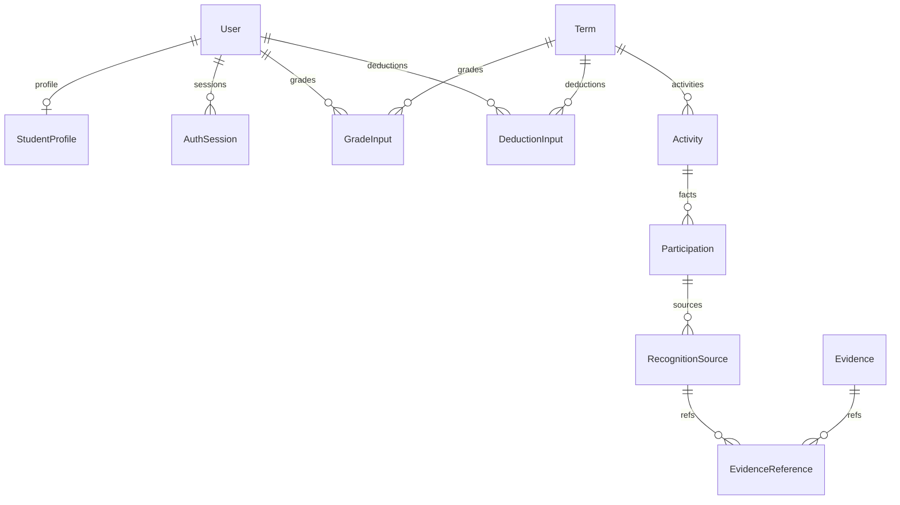

# 数据模型与迁移设计

日期：2026-10-20。关联：ENT-01～18。下方旧字典和目标草案保留作历史；当前以prisma/schema.prisma及已部署12项迁移为准。结果历史和本轮活动治理已增量迁移，不能将旧草案“尚未执行”视为现状。

## 1. 当前数据库字典

来源：`prisma/schema.prisma`。String无额外标注时为PostgreSQL text；`?`为可空。ID为应用生成cuid，除明确指定外无数据库业务顺序语义。Decimal均为(22,12)。Prisma的@updatedAt为客户端更新行为，不应误称数据库触发器。

| 实体 | 字段与默认 | 约束/索引/关系 |
|---|---|---|
| User | id；login；name；role=ADMIN/PUBLISHER/STUDENT；passwordHash；mustChangePassword=true；disabled=false；authVersion=0；createdAt=now；updatedAt；revision=0 | PK id，unique login；关联sessions、studentProfile、grades、deductions |
| StudentProfile | userId；studentNumber；college；major；className | PK/FK userId→User，删除用户Cascade；unique studentNumber；组织目前只是字符串 |
| AuthSession | id；userId；version；expiresAt；revokedAt?；createdAt=now | FK userId→User，Cascade；index userId |
| AccountImport | id；actorId；rows JSON；snapshot；status=PREVIEW；result JSON?；expiresAt；createdAt=now | index(actorId,createdAt)；actorId当前无FK |
| Term | id；name；phase=CONFIGURATION；scheme JSON；revision=0；inputRevision=0；createdAt=now；updatedAt | phase枚举CONFIGURATION/ACTIVE/CHECKING/LOCKED；关联activities/grades/deductions |
| Activity | id；termId；ownerId；name；organizer；content；requirements；startsAt；endsAt；nodeId；points Decimal；confirmed=false；revision=0；createdAt=now；updatedAt | FK termId→Term；index(termId,ownerId)；ownerId/nodeId当前无FK |
| Participation | id；activityId；studentId；revision=0；createdAt=now | FK activityId→Activity；unique(activityId,studentId)；studentId当前无FK |
| RecognitionSource | id；participationId；submitterId；status=PENDING；reviewReason?；reviewerId?；reviewedAt?；note；revision=0；createdAt=now；updatedAt | FK participationId→Participation；status枚举PENDING/APPROVED/REJECTED；index(submitterId,status)；人员字段无FK |
| Evidence | id；ownerId；name；mime；size Int；sha256；storageKey；createdAt=now | unique storageKey；ownerId当前无FK |
| EvidenceReference | id；evidenceId；sourceId | FK分别→Evidence/RecognitionSource；unique(evidenceId,sourceId) |
| GradeInput | id；termId；studentId；nodeId；value Decimal；revision=0；updatedAt | FK termId→Term、studentId→User；unique(termId,studentId,nodeId) |
| DeductionInput | id；termId；studentId；projectId；amount Decimal；revoked=false；reason；revision=0；updatedAt | FK termId→Term、studentId→User；unique(termId,studentId,projectId) |
| GradeImport | id；termId；actorId；nodeId；rows JSON；reason；snapshot；status=PREVIEW；result JSON?；expiresAt；createdAt=now | index(termId,actorId)；归属当前无FK |
| ParticipationImport | id；termId；activityId；actorId；rows JSON；evidenceIds JSON；note；snapshot；status=PREVIEW；result JSON?；expiresAt；createdAt=now | index(termId,actorId)；归属当前无FK |
| LoginAttempt | key；count=1；expiresAt | PK key，需过期清理 |
| AuditEvent | id；actorId?；action；targetId?；details JSON?；createdAt=now | actorId/targetId当前无FK；无额外查询索引 |

除上表显式Cascade，schema未显式声明的onDelete不能笼统标记级联；应在补充迁移前核查实际migration SQL及数据库约束。timestamps当前为Prisma默认DateTime，API应使用带时区ISO8601；如需要切换timestamptz须先确认历史时区解释，禁止直接改类型导致偏移。

## 2. 目标新增对象（尚未实现）

| 对象 | 关键字段/关系 | 业务约束 |
|---|---|---|
| Organization | id、parentId、code、name、kind、enabled、revision | code唯一、无循环；改名不改变身份；有历史引用不可级联删除 |
| StudentMembership | id、studentId、organizationId、有效区间 | 时间区间与归属政策明确，历史成绩不能依赖当前班名重构 |
| ScopeSnapshot | id、termId、revision、membershipHash、成员清单 | 发布/排名/锁定绑定固定学生和组织范围 |
| Scheme | id、termId、name、scopeId、activeVersionId、revision | 同范围匹配必须唯一且可解释；不以名称决定优先级 |
| SchemeVersion | id、schemeId、version、schemaVersion、content JSON、contentHash、state、createdBy、createdAt、reason | unique(schemeId,version)，生效后不可修改；节点ID稳定 |
| RuleChangePreview | id、termId、actorId、baseVersionId、draftHash、inputRevision、scopeRevision、migration JSON、expiresAt | 绑定预览操作者与全部基线，过期/变更拒绝 |
| CalculationRun | id、termId、schemeVersionId、inputRevision、scopeSnapshotId、state、progress、errorCode、idempotencyKey | 固定输入身份、候选与当前集分离，失败可定位、重试不半生效 |
| ResultSet/StudentResult | 结果集id、runId、发布状态；学生结果studentId、完整性、total、节点精确明细 | unique(resultSetId,studentId)，不完整total为空，完整集原子发布 |
| PersonalProject/Claim | 项目稳定ID、规则版本与分值；申报人、项目、事实关联、提交版本、状态 | 申报不能自定分值；与组织来源关联同一事实，不能双计 |
| ReviewEvent | 对象类型/ID、前后状态、理由、actorId、time、revision | 追加历史，业务当前状态与历史分开；撤销有语义 |
| ResultConfirmation | studentId、resultSetId、resultHash、confirmedAt | 确认绑定结果，不随当前指针自动转移 |
| Appeal | studentId、resultSetId、targetRef、reason、state、resolution、revision | 本人/授权管理员可访问；处理与更正版本关联 |
| SettlementSnapshot | termId、resultSetId、schemeVersions、scope、输入依据、排名/展示映射、hash、lockedAt、actorId | 锁定内容不可变；重开生成关联记录，不覆盖旧快照 |
| SiteSettingsRevision | id、scope、schemaVersion、content、state、baseRevision、createdBy、publishedAt | 草稿/发布分离，服务器校验，公开展示与敏感运行配置分开 |
| BrandAsset | id、storageKey、mime、size、sha256、purpose、state | 与Evidence独立访问策略，禁止任意可执行资源 |
| ImportTemplate | id、kind、version、columns、schemaVersion、sampleRows、enabled | 模板版本与解析约定一致，不能执行用户公式 |

以上对象需在各功能契约完成后细化字段类型、FK和索引再进入迁移；本表不是可直接照抄的最终Prisma schema，未细化实体不得标记数据设计完成。站内通知、细粒度授权与后台任务如需求确立，另给独立字典，不塞入无校验JSON万能表。

## 3. 跨实体不变量

- Participation唯一业务键继续保留；文件哈希不作为参与事实身份。
- GradeInput当前值唯一性继续保留，更正历史独立，不变成累加输入。
- 节点仍在版本JSON时，普通FK无法验证nodeId；服务必须按绑定版本验证，并在变更迁移时完整处理引用，不能声称数据库已保证节点完整性。
- 业务人员一般停用而非物理删除；补FK应选择Restrict或受控匿名化，不能为便利级联删除审计和事实。
- 分数写入前校验精度/范围，不依赖Decimal四舍五入吞掉错误。哈希和审计不代替原始来源权限检查。

## 4. 增量迁移步骤

1. 只读统计现有孤立人员引用、重复/非法组织名、scheme节点引用和状态字符串；报告异常，不自动删记录。
2. 新增可空关系或新表，保留旧字段，部署兼容读写。
3. 有界回填并记录映射；无法确定的组织/人员关系进入人工处理清单，禁止猜测匹配。
4. 校验计数、唯一性、精确总分、附件引用/哈希及旧API行为，再添加NOT NULL/FK/索引。
5. 切换读路径并观察；最后独立版本移除旧字段。当前Term.scheme等数据不能在第一阶段直接丢弃。
6. 回退先停止受影响写入，回退应用需兼容新增表；破坏性contract前必须验证备份及隔离恢复。不得在开发数据库验证破坏性恢复。

## 5. 保留与隐私

密码哈希只在认证边界读取，API/审计不返回；会话标识不进入普通日志。证明、申报与成绩属敏感业务数据，按对象授权访问。具体保留期限、匿名化政策及法定要求待组织确认；未确认前不自动永久删除业务历史，但必须设置临时文件/预览批次的清理流程与审计。

## 2026-10-20活动治理实际增量（已迁移）

- Term增加cohortPublicationId可空字符串、cohortPolicy=CURRENT。重开保留原发布引用并改PREVIOUS，service验证归属，不额外创建第二套制度。
- Activity增加publishedAt、publishRevision=0、scoreMode=FIXED、三组空数组范围。班级数组使用完整路径编码。空数组不是不限，不自动发布旧数据。
- Participation增加registeredAt/by、registrationSnapshot、importBatchId、score Decimal(22,12)、history=[]及学生/登记时间索引；旧事实默认无后台登记。
- RecognitionSource增加origin=LEGACY、importBatchId；新SELF/OWNER/IMPORT明确来源，不根据当前提交者角色回填旧来源。
- PersonalClaim增加activityId可空及学生/活动索引；activityId为服务校验的引用字符串，当前无数据库FK。
- PublicationExtension追加id、publicationId FK、actorId、checkingEndsAt、reason、createdAt及发布/截止索引；ResultPublication增加extensions关系。原发布、PublishedResult、ResultConfirmation与SettlementSnapshot仍保留不可变版本语义。

结果发布/申报/异议/设置的上一批模型已在20261020100000迁移中部署；本批为20261020120000。保护与恢复证据见缺口修复实施与验证，不输出数据库内容或凭据。
