# 序衡 · 高校综合测评管理

## 毕业设计讲解报告

**课题名称：** 面向高校学生综合素质测评的全流程管理系统设计与实现

**系统版本：** v0.3.1

**文档日期：** 2026-10-25

**文档性质：** 系统讲解、业务说明、设计与实现报告

---

> **阅读说明**
>
> 本报告介绍的是“这套系统本身”：它解决什么问题、由哪些角色使用、业务怎样流转、数据怎样组织、核心算法怎样计算、关键功能怎样实现、怎样测试和部署。
>
> 全文以当前已经实现并经过验收的功能为准，不把设计目标写成已有能力，也不以页面占位冒充业务完成。报告中的界面截图来自隔离验收环境，姓名、学号、学院、活动、成绩均为虚构数据，不对应任何真实个人或机构；报告不包含任何真实账号密码、数据库连接串、服务器密钥或证明附件内容。
>
> 阅读顺序建议：第 1～2 章理解“为什么做、为谁做”；第 3～4 章理解“系统怎样分层、数据怎样存”；第 5 章是业务核心；第 6 章解释关键实现；第 7 章用核心截图把页面与业务串联起来；第 8～9 章说明质量与交付；第 10～11 章总结特点、不足和展望。附录提供术语表、权限表、答辩提纲和常见问题，便于直接准备毕业答辩。

---

## 目录

- [摘要](#摘要)
- [第 1 章 项目背景与意义](#第-1-章-项目背景与意义)
- [第 2 章 需求分析](#第-2-章-需求分析)
- [第 3 章 总体设计](#第-3-章-总体设计)
- [第 4 章 数据库设计](#第-4-章-数据库设计)
- [第 5 章 核心业务设计](#第-5-章-核心业务设计)
- [第 6 章 关键实现](#第-6-章-关键实现)
- [第 7 章 核心功能截图与讲解](#第-7-章-核心功能截图与讲解)
- [第 8 章 测试与验收](#第-8-章-测试与验收)
- [第 9 章 部署与运维](#第-9-章-部署与运维)
- [第 10 章 项目特点与工程亮点](#第-10-章-项目特点与工程亮点)
- [第 11 章 不足与展望](#第-11-章-不足与展望)
- [附录 A 术语表](#附录-a-术语表)
- [附录 B 角色与权限矩阵](#附录-b-角色与权限矩阵)
- [附录 C 主要页面与业务入口](#附录-c-主要页面与业务入口)
- [附录 D 核心状态字典](#附录-d-核心状态字典)
- [附录 E 答辩讲解提纲](#附录-e-答辩讲解提纲)
- [附录 F 常见答辩问题](#附录-f-常见答辩问题)
- [附录 G 文档与证据索引](#附录-g-文档与证据索引)
- [参考资料](#参考资料)

---

## 摘要

高校学生综合素质测评通常按学期或学年组织，需要把学业成绩、体育素质、日常表现、活动参与、竞赛成果、违纪扣分等多类信息汇总为可比较、可解释、可用于评奖评优的最终成绩。它同时具有“规则复杂、参与角色多、跨组织层级、证据材料多、结果敏感、历史必须可追溯”等特点。完全依赖 Excel、共享盘和线下签字，容易出现公式版本不一致、重复录入、越权查看、证明材料散失、发布后仍被修改、异议处理没有依据等问题。

本课题设计并实现了“序衡 · 高校综合测评管理”系统。系统以**学校管理员、二级学院管理人员、辅导员、学生**四类身份为核心，围绕一个完整的测评周期，提供测评制度配置、组织与账号管理、活动与参与名单、个人成果申报与审核、成绩与扣分两级审核、结果发布、学生确认与异议、排名与安全导出、操作审计、数据库备份恢复和附件管理等功能。系统把“规则、原始输入、计算结果、发布版本”分开保存：评分规则可以按周期配置，原始分数与事实独立审核，发布结果以不可变快照冻结；学生、辅导员、学院和管理员只在自己的职责范围内操作。

技术上，系统采用 Next.js 16 App Router、React 19、TypeScript、Prisma 7 和 PostgreSQL 18.4，前端使用 Base UI/shadcn 组件体系与 Tailwind CSS 4，认证采用 NextAuth Credentials、bcrypt、图片验证码和会话版本撤销。评分引擎使用 BigInt 分数实现的精确十进制运算，避免二进制浮点误差；发布、审核、导入和更正使用数据库事务、修订号、幂等请求标识和流程令牌保证一致性；成绩导出根据评分树动态生成表头、公式和评分规则工作表，并对导出范围、冻结快照和文件安全进行控制。

系统在独立 PostgreSQL 集群和独立应用端口上完成了四类角色、核心业务闭环、异常与越权场景的功能验收：**114 个唯一用例全部通过，共执行 125 次，修复 3 个产品缺陷**；v0.3.1 的自动化质量门禁为 **33 个测试文件、152 项测试全部通过**，类型检查、Lint 和生产构建均通过。系统已通过 Docker 镜像在演示环境部署，具备迁移、健康检查、备份恢复和故障回滚能力。

**关键词：** 高校综合测评；评分引擎；两级审核；不可变发布；权限控制；Next.js；PostgreSQL；精确计算

---

## 第 1 章 项目背景与意义

### 1.1 业务背景

综合素质测评是高校学生教育管理和评奖评优的重要基础工作。一个典型的测评周期通常包含以下环节：

1. 学校确定本学期的测评办法、评分模块、权重、封顶分、折算方式和扣分项目；
2. 学院和辅导员核对班级、学生、学籍归属和责任辅导员；
3. 学校或学院发布活动，维护参与名单，学生参加活动并形成参与事实；
4. 学生提交个人成果申报，上传获奖证书、实践证明等材料；
5. 辅导员或学院进行审核、评分和退回修改；
6. 辅导员录入学业成绩、体育成绩，登记扣分；
7. 学院对成绩和扣分进行审核，审核通过后才生效；
8. 学校在发布前检查完整性，生成正式结果版本；
9. 学生确认成绩，有疑问时在截止时间前提出异议；
10. 学校处理异议、更正、重新发布，最终锁定结算；
11. 按权限导出成绩明细、排名和评奖评优所需材料。

这条链路看起来只是“算一个总分”，实际上同时包含**制度版本、组织归属、事实证据、审核责任、结果发布和历史留痕**六类问题。只要其中一环没有控制好，最终成绩就可能出现“算错、看错、改错、说不清”的情况。

### 1.2 传统工作方式的主要问题

| 传统做法 | 常见问题 | 可能造成的后果 | 本系统的应对 |
| --- | --- | --- | --- |
| 多份 Excel 分散维护 | 不同学院、不同辅导员各存一份，版本不一致 | 汇总时互相覆盖，无法判断哪份是最终版 | 统一数据库、统一测评周期、统一发布版本 |
| 评分公式写在单元格里 | 公式被复制错、引用错、隐藏列被改 | 总分错误且难以复核 | 评分树集中配置，服务端统一计算并输出逐层明细 |
| 共享文件夹传材料 | 证明文件散落、命名混乱、无授权控制 | 隐私泄露、材料缺失、无法追责 | 私有文件存储、按对象授权下载、哈希校验 |
| 线下审核 | 谁审的、何时审的、为什么退回没有记录 | 责任不清，异议时缺少依据 | 两级审核、必填理由、状态机、操作日志 |
| 成绩发布后继续改 | 已经通知学生的成绩又被覆盖 | 排名和评奖结果失真 | 发布生成不可变快照，更正必须走新版本 |
| 只保留最终结果 | 中间过程、原始分数、扣分依据丢失 | 无法解释“为什么是这个分” | 规则、输入、计算明细、发布快照分层保存 |
| 导出表固定模板 | 评分规则一变，导出表头和公式就不匹配 | 交表格式错误，人工返工 | 根据评分树动态生成表头、公式和规则工作表 |
| 账号共用或权限粗放 | 学生能看到其他学生，学院能看其他学院 | 隐私和公平性风险 | 角色、组织范围、对象归属、周期阶段四重校验 |

### 1.3 项目目标

本项目不是单纯把纸质表格搬到网页上，而是围绕“**算得准、管得住、查得清、交得出**”四个目标建设一套完整的业务系统。

1. **算得准**：评分规则可配置，计算过程可解释，所有分数使用统一的精确计算方式，避免浮点误差和手工公式错误。
2. **管得住**：每类角色只能访问职责范围内的学生和业务，关键写操作在服务端重新校验权限、阶段、对象归属和数据版本。
3. **查得清**：每次关键变更都有操作者、时间、前后状态和理由；发布结果、确认、异议、结算都有独立记录。
4. **交得出**：能按学校、学院、班级、学生本人等范围导出符合要求的成绩明细，导出文件带有可复核的公式和规则说明。
5. **跑得稳**：系统可以通过容器部署，具备数据库迁移、健康检查、备份、恢复预检、维护模式和失败回滚能力。

### 1.4 项目范围

**本系统当前覆盖的范围：**

- 四类正式角色：学校管理员、二级学院管理人员、辅导员、学生；
- 学院—专业—班级三级组织，责任辅导员历史，学生班级归属历史；
- 测评周期从配置、进行中、结果核对到锁定归档的完整生命周期；
- 可视化评分树：模块、比例、封顶、折算、最低分、必填项、扣分系数；
- 活动发布、三种受众范围、参与名单导入、活动附件、参与审核；
- 学生个人成果申报、证明上传、辅导员评分、学院终审、退回重评；
- 学业/体育成绩录入、成绩导入、扣分登记、学院审核、更正和撤销；
- 结果发布、学生确认、异议处理、更正重发布、锁定结算和重开；
- 按权限的排名、成绩明细导出、评分规则工作表；
- 操作日志、数据库备份、恢复维护、附件导出；
- Docker Compose/GHCR 镜像部署、健康检查、数据库迁移。

**当前不作为系统核心范围的内容：**

- 多学校 SaaS 租户隔离：当前按单所学校部署；
- 与教务系统、学工系统、一卡通系统的自动对接：成绩和名单以导入/录入为主；
- 短信、邮件、站内消息中心：当前没有作为独立通知子系统实现；
- 原生手机 App：当前使用响应式 Web 页面；
- 面向全校的大屏 BI、复杂统计报表：当前以业务查询和成绩导出为主；
- 通用工作流引擎：审核流程按业务类型实现，不追求可任意拖拽配置的通用流程平台。

### 1.5 项目意义

从业务角度看，系统把分散的 Excel 工作变成有状态、有责任、有证据的业务流程，减少了重复核对和人工汇总；从管理角度看，两级审核、发布快照和异议记录让成绩形成过程更容易解释；从技术角度看，本项目覆盖了权限建模、复杂表单、精确计算、事务并发、文件安全、Excel 公式生成、容器部署和恢复演练等较完整的工程问题，是一次将软件工程方法应用到真实业务场景的实践。

---

## 第 2 章 需求分析

### 2.1 系统角色

系统正式使用四类角色。数据库中还保留了历史上的 `PUBLISHER`（活动发布者）枚举，用于解释旧数据，但不再新建这类账号。

| 角色 | 典型身份 | 数据范围 | 主要职责 |
| --- | --- | --- | --- |
| 学校管理员（ADMIN） | 学校学生工作部门、测评工作负责人 | 全校 | 配置周期和评分制度；维护学院、专业、班级；管理账号和学生档案；导入名单和成绩；监督活动、申报、成绩和扣分；发布结果；处理异议；查看排名和全校导出；操作日志、备份恢复、附件管理和系统设置 |
| 二级学院管理人员（COLLEGE） | 学院学生工作办公室、教务管理人员 | 本学院 | 查看本院班级和学生；审核本院活动参与；终审本院学生成果申报；审核本院成绩和扣分；导出本院成绩；维护本院班级和参与名单 |
| 辅导员（COUNSELOR） | 班主任、年级辅导员 | 本人负责的班级 | 查看负责班级学生；录入和提交学业/体育成绩；登记和提交扣分；对成果申报进行评分初审；审核活动参与；导出负责班级成绩 |
| 学生（STUDENT） | 在校参评学生 | 本人 | 查看本人学籍、活动和参与记录；提交个人成果申报和证明；查看本人成绩构成；在核对期内确认成绩或提出异议；导出本人成绩单；修改本人密码 |

> **权限不是“前端隐藏按钮”实现的。** 前端只负责展示入口，服务端在每次读写时重新检查会话、角色、组织范围、对象归属、周期阶段和业务前置条件。即使绕过页面直接调用接口，也不能越权。

### 2.2 系统总体业务流程

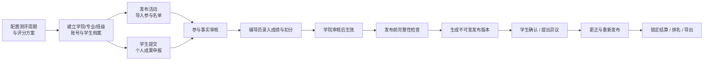

这条流程有两个重要特点：

1. **数据和规则分离**：评分规则由管理员在周期中配置，学生的原始成绩、活动参与、成果申报是另一层输入，最终结果再由评分引擎计算。
2. **过程和结果分离**：审核中的修改不会直接改变已发布成绩；发布后如需更正，必须产生新的发布版本并保留旧版本。

### 2.3 功能需求

#### 2.3.1 身份认证与账号安全

- 使用学校分配的登录账号和密码登录，学生登录账号通常是学号；
- 登录页提供图片验证码，验证码不区分大小写，有有效期；
- 初始账号首次登录必须修改密码，不能直接进入业务；
- 管理员可以创建、编辑、停用账号，重置密码；
- 停用账号、重置密码、角色变化后，旧会话立即失效；
- 登录失败达到阈值后锁定一段时间，避免暴力尝试；
- 所有登录成功、失败、锁定、改密等行为写入审计日志。

#### 2.3.2 组织、账号与学生档案

- 维护学院、专业、班级三级组织；
- 班级可以指定当前责任辅导员，并保留辅导员责任交接历史；
- 学生档案包含学号、姓名、学院、专业、班级等信息；
- 学生班级归属发生变化时保留历史，而不是直接覆盖；
- 支持学生、辅导员、学院管理人员三类账号的批量导入；
- 导入前预览，逐行显示新增、跳过、错误和覆盖情况；
- 任一错误行阻断整批提交，不允许“部分成功”；
- 已提交批次可在满足条件时整批撤销，撤销也会留下记录；
- 有业务记录的账号不能物理删除，只能停用；删除必须做引用检查。

#### 2.3.3 测评周期与评分制度

- 每个学期/学年建立一个测评周期；
- 周期阶段：配置中、进行中、结果核对、已锁定；
- 管理员在配置阶段创建、复制或修改评分方案；
- 评分方案支持多层模块、比例汇总、直接汇总、成绩输入和活动得分；
- 可以配置封顶分、最低分、原始满分折算、必填项、输入范围；
- 可以配置扣分项目、扣分系数和扣分归属节点；
- 保存评分方案前进行完整校验，并可以试算查看逐层结果；
- 已进入业务录入的周期，规则修改要显示影响范围，避免半批数据按新旧口径混算；
- 周期可以归档、作废、软删除和恢复；已锁定结果可以填写理由重开。

#### 2.3.4 活动、参与名单与证明

- 学校或学院可以创建活动，填写名称、主办方、时间、介绍、评分节点、分值；
- 活动受众范围必须三选一：全校、按学院、按班级；
- 同一方式内可以选择多个学院或多个班级，取并集；
- 草稿可以暂时不选范围，但发布前必须选择至少一个；
- 发布是一个事务操作，发布后才对学生可见；
- 发布后如果修改分值、计分节点或受众范围，系统自动撤回发布，需要重新发布；
- 参与名单通过模板导入，学生不能自行报名；
- 名单身份字段严格校验，任何错误阻断整批；
- 活动证明独立上传，支持版本化和授权下载；
- 参与事实按“活动 + 学生”唯一，不能因为重复上传证明而重复计分；
- 参与审核分为辅导员初审和学院终审；
- 活动可以手动结束或重新开放，结束只影响“最新活动”的展示，不删除参与和审核记录。

#### 2.3.5 个人成果申报

- 学生直接填写申报标题、发生日期、事实说明，并上传 1～5 份证明；
- 学生不自选申报项目、不自填分数，避免“自己给自己打分”；
- 辅导员查看申报材料，选择当前制度中最底层的可计分节点，填写分数并提交学院；
- 学院进行终审，只能通过、退回重评或退回学生补充材料；
- 学院不能跳过辅导员直接评分，也不能直接修改辅导员填写的分数；
- 退回必须填写理由，并交回原发起人；
- 材料问题退回学生重新提交，纯评分问题退回辅导员重评；
- 学生可以修改重提或放弃；放弃只改变申报状态，不删除已产生的历史事实和材料引用；
- 已通过的申报如需撤销，必须由管理员走受控撤销流程，并记录理由。

#### 2.3.6 成绩、扣分与两级审核

- 辅导员按负责班级查看学生名单和需要录入的成绩项；
- 成绩项来自评分树中的“成绩输入”叶节点，显示允许范围和当前值；
- 提交成绩修改后进入“待学院审核”，审核通过前不改变当前有效成绩；
- 学院审核时可以查看当前值、修改后值、修改原因和提交人；
- 学院可以退回辅导员修改，退回必须填写理由；
- 0 是明确的成绩，缺失是“尚未录入”，两者在计算和导出中区别对待；
- 扣分按扣分项目和发生次数登记，金额必须为正数，实际扣减为金额 × 系数；
- 同一学生同一扣分项目的不同事件分别记录，同一事件不能重复扣；
- 扣分审核通过后才生效，撤销扣分也保留原值和理由；
- 所有成绩和扣分的变更、审核、退回、放弃都保留历史。

#### 2.3.7 结果发布、确认与异议

- 发布前必须检查：没有待审/待补充的申报和参与记录、没有缺失的必填成绩、至少有一名有效参评学生；
- 发布时冻结评分方案、学生身份、组织归属、成绩、扣分、活动和申报输入；
- 每次发布生成递增的版本号，历史版本不会被覆盖；
- 学生可以在核对截止时间前确认当前版本，确认绑定具体结果哈希；
- 学生可以在截止前提出异议，异议必须关联当前发布版本和结果哈希；
- 管理员可以延长核对期限、处理异议、驳回异议或标记已解决；
- 标记“已解决”必须存在实际更正后的新发布版本，不能只写一句“已处理”；
- 锁定结算前必须满足：核对截止已到、要求的确认全部完成、没有未处理异议、没有待审记录、发布版本与当前输入一致；
- 锁定后生成结算快照；如需再次修改，必须填写理由重开，旧快照继续保留。

#### 2.3.8 排名与安全导出

- 排名只基于已发布结果，不能对未发布、未审核完成的成绩排名；
- 默认使用并列排名（竞赛排名）规则；
- 管理员可以按学院、专业、班级筛选排名；
- 学生只能看到本人在当前发布版本中的排名；
- 成绩导出根据评分树动态生成，不依赖固定的表头模板；
- 叶子的成绩、活动分、扣分登记作为值；小计、封顶、折算、比例和总分使用 Excel 公式；
- 导出包含“评分规则”工作表，说明类型、上级、上限、原始满分、折算满分、权重、扣分系数和必填项；
- 正式发布导出使用冻结快照，公式保留但参数和录入内容锁定；
- 导出范围受角色限制：管理员全校，学院本院，辅导员负责班级，学生本人；
- 单次导出学生数量有上限，超限时提示按学院或班级分批；
- 导出文本不能变成 Excel 公式；导入文件如果包含公式会被拒绝。

#### 2.3.9 审计、备份、附件与系统设置

- 操作日志覆盖登录、账号、组织、周期、活动、参与、申报、成绩、扣分、发布、异议、导入、导出和系统设置；
- 日志支持按时间、操作者、分类、动作、对象和结果筛选，支持详情和 CSV 导出；
- 支持按保留期预览和清理过期日志，清理本身也要留痕；
- 数据库备份支持创建、下载、保留策略和分块上传；
- 恢复前先在候选数据库真实还原并预检，显示阻断项和警告；
- 恢复期间进入维护模式，业务页面不可写；成功后原子切换数据库，失败自动回滚；
- 恢复成功后所有旧会话失效，账号必须重新登录；
- 附件管理按活动聚合，支持查看活动附件和学生证明，并按范围导出带清单、哈希和错误记录的 ZIP；
- 系统设置支持学校品牌、Logo、浅色/深色 Logo、浏览器图标、登录背景、玻璃登录卡、登录安全策略和附件上传限制。

### 2.4 非功能需求

| 类别 | 要求 | 实现方式 |
| --- | --- | --- |
| 正确性 | 分数计算不能因浮点误差产生 0.01 分级别的偏差；规则、输入和结果必须可解释 | BigInt 有理数精确计算；统一半入舍入；逐层计算明细；发布前完整性检查 |
| 安全性 | 学生不能看其他学生；学院不能看其他学院；账号停用后旧会话立即失效 | 服务端会话校验；角色 + 组织 + 对象 + 阶段四重校验；会话版本；bcrypt；验证码；登录限流 |
| 一致性 | 审核、发布、导入、恢复等写操作不能出现半成功 | PostgreSQL 事务；行/周期咨询锁；修订号；幂等请求 ID；流程令牌 |
| 可追溯性 | 关键变更必须能回答谁、何时、改了什么、为什么 | 业务 history；操作日志；发布快照；结算快照；删除/撤销快照 |
| 隐私性 | 证明材料、活动附件不能被公共 URL 直接访问 | 私有卷；随机存储键；数据库只存元数据；鉴权下载；哈希校验 |
| 可用性 | 页面要让非技术用户能完成业务，不能只堆技术字段 | 中文业务文案；完整页面；空态/加载/错误/权限提示；分页和筛选；移动端记录卡 |
| 可运维性 | 可部署、可迁移、可备份、可恢复、可健康检查 | Docker 多阶段构建；Compose；迁移入口；`/api/health/live`、`/api/health/ready`；备份卷 |
| 可测试性 | 核心算法不依赖页面和数据库，能单独验证 | 评分引擎纯函数；集成测试使用隔离临时数据库；导出构建器统一复用 |
| 性能边界 | 单次发布检查 2,000 名学生；单次导出最多 10,000 名学生 | 分批读取；导出事务超时；超限时提示缩小范围 |

### 2.5 需求边界与设计取舍

本系统优先解决“核心测评闭环”和“结果可信”，没有把所有学生管理功能都做进来。例如，本系统没有实现活动名单的单学生手动登记，参与名单以导入和更正为主；没有独立的站内消息中心；没有与教务系统实时同步。这些边界不是遗漏，而是在当前毕业设计范围内主动控制复杂度，避免出现“页面很多、核心链路不完整”的情况。

---

## 第 3 章 总体设计

### 3.1 系统总体架构

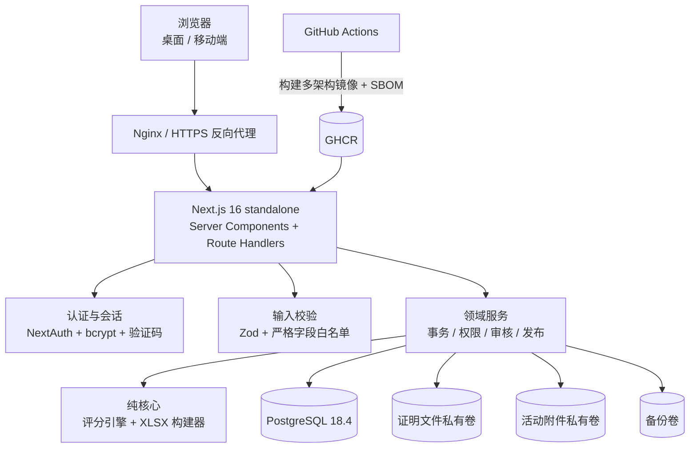

系统采用前后端同仓库、同语言的 Next.js 全栈架构，但并不是把所有逻辑都堆在页面组件里，而是按职责分为四层。

### 3.2 分层职责

| 层次 | 主要职责 | 典型实现 |
| --- | --- | --- |
| 页面与交互层 | 组织页面布局、表单、表格、抽屉、筛选、分页和状态提示 | `src/app/(workspace)` 下的 Server Components 和客户端交互组件 |
| 接口与读取层 | 接收 HTTP 请求，解析参数，返回业务数据或错误 | `src/app/api` 下的 Route Handlers；服务端只读查询服务 |
| 领域服务层 | 权限判断、业务状态机、事务、审核、审计、文件、导入、发布 | `src/server/*.ts`，如 `claims.ts`、`grade-changes.ts`、`publications.ts`、`backup.ts` |
| 纯核心层 | 与数据库和会话无关的计算、校验、Excel 构建 | `src/lib/scoring/*`、`src/lib/xlsx/*` |
| 数据与文件层 | 持久化业务数据、私有文件、备份 | PostgreSQL、`EVIDENCE_DIR`、`ACTIVITY_ATTACHMENT_DIR`、`BACKUP_DIR` |

这种分层的直接好处是：业务规则不只存在于某个页面里；页面换一种交互方式，服务端仍然会做同样的权限和状态校验；评分引擎可以脱离数据库进行单元/集成测试；Excel 导出和页面查询可以使用同一棵评分树。

### 3.3 功能模块划分

| 模块 | 核心内容 | 主要服务/组件 |
| --- | --- | --- |
| 认证与账号 | 登录、验证码、改密、停用、重置、会话撤销、首次登录强制改密 | `auth.ts`、`login-captcha.ts`、`rate-limit.ts` |
| 组织与档案 | 学院、专业、班级、辅导员责任、学生归属、学号更正、重复身份 | `organizations.ts`、`students.ts`、`account-duplicates.ts` |
| 周期与制度 | 周期生命周期、评分树、试算、引用检查、归档/作废/重开 | `terms.ts`、`scheme-references.ts` |
| 活动与参与 | 活动发布、受众范围、名单导入、参与审核、活动附件、结束/重开 | `activities.ts`、`activity-participants.ts`、`activity-attachments.ts`、`recognitions.ts` |
| 成果申报 | 学生申报、证明关联、辅导员评分、学院终审、退回重评、放弃/撤销 | `claims.ts`、`evidence.ts` |
| 成绩与扣分 | 成绩修改申请、扣分登记、学院审核、更正历史、成绩导入 | `grade-changes.ts`、`deduction-changes.ts`、`grade-import.ts`、`grades.ts` |
| 结果与异议 | 发布预检、不可变发布、学生确认、延长核对期、异议处理、锁定/重开 | `publications.ts`、`appeals.ts`、`publication-window.ts` |
| 排名与导出 | 并列排名、范围筛选、动态 XLSX、公式、保护、容量限制 | `rankings.ts`、`class-grade-export.ts`、`src/lib/xlsx/*` |
| 审计与运维 | 操作日志、日志导出/清理、数据库备份、恢复预检、维护模式、附件治理 | `audit.ts`、`audit-query.ts`、`backup.ts`、`restore.ts`、`attachments-admin.ts` |
| 系统设置 | 品牌、Logo、登录背景、玻璃卡、登录安全、附件限制 | `settings.ts`、`src/app/(workspace)/settings` |

### 3.4 技术选型与理由

| 技术 | 版本/位置 | 选择理由 |
| --- | --- | --- |
| Next.js | 16.4 App Router | 同一仓库组织页面和接口；Server Components 减少不必要的客户端数据加载；Route Handlers 适合业务 API；standalone 输出便于容器部署 |
| React | 19.3 | 与 Next.js 配套；客户端交互组件负责表单、筛选、抽屉和即时反馈 |
| TypeScript | 5.9 | 对评分节点、状态、接口返回值和权限角色建立静态约束，减少字段拼写和分支遗漏 |
| Zod | 4 | 服务端严格校验请求体，拒绝未知字段，保护领域服务不被伪造参数绕过 |
| Prisma | 7.10 + `@prisma/adapter-pg` | 数据模型、迁移和查询统一管理；适合事务化业务写入；类型与数据库结构同步 |
| PostgreSQL | 18.4 | 事务、唯一约束、索引和 JSONB 能力适合本系统；版本化迁移可重复部署 |
| NextAuth | 4 Credentials | 与 Next.js 集成简单；通过会话版本号实现停用/改密后的即时撤销 |
| bcrypt | 密码哈希 | 单向哈希，数据库不保存明文密码 |
| Base UI / shadcn | 组件体系 | 提供可访问、可组合的基础控件；项目在其上实现统一业务组件，而不是每个页面从零造控件 |
| Tailwind CSS | 4 | 统一间距、颜色、响应式和状态样式；便于保持企业级界面一致性 |
| TanStack Table | 9 | 处理排序列、宽表、移动端记录卡等复杂表格场景 |
| TipTap | 3 | 活动介绍使用富文本/Markdown 编辑，限制不安全 HTML |
| Vitest | 测试 | 快速执行集成测试；连接隔离 PostgreSQL，覆盖真实约束和事务 |
| Playwright | 浏览器验收 | 按角色执行端到端页面流程，驱动真实接口，不依赖手工点击 |
| Docker / Compose / GHCR | 交付 | 多阶段构建；固定镜像标签；数据库与应用分离；GitHub Actions 产出可追溯镜像 |
| GitHub Actions | CI/CD | 自动执行类型检查、Lint、测试和构建；构建多架构镜像与 SBOM |

### 3.5 核心设计原则

1. **服务端是唯一可信来源。** 前端提交的是“操作意图”，不是最终业务事实。角色、组织范围、周期阶段、对象归属、修订号都由服务端重新检查。
2. **规则、输入、结果分层。** 评分方案是规则；成绩、活动、扣分、申报是输入；发布结果是某个时点的计算结果快照。三者不混在同一张表里。
3. **发布即冻结。** 一旦发布，学生看到的结果对应一个不可变版本；后续更正产生新版本，而不是原地改写。
4. **写操作事务化。** 审核通过、发布、锁定、导入提交、删除、恢复等操作在同一数据库事务中完成，失败不留下半成品。
5. **历史和事实分开。** “当前有效值”用于计算；“变更历史”用于解释和追溯；删除申请不等于删除历史事实。
6. **私有文件不公开暴露。** 证明和附件只通过鉴权接口读取，数据库只保存元数据、随机存储键和哈希。
7. **导出与页面同源。** 导出表头、公式和计算层级来自同一评分树，避免页面、导出和实际计算三套口径。

---

## 第 4 章 数据库设计

### 4.1 建模思路

系统数据可以按业务生命周期分为五组：

1. **身份与组织**：谁在使用系统、属于哪个学院/专业/班级、谁负责哪个班；
2. **周期与制度**：本学期使用什么评分规则、目前处于哪个阶段；
3. **事实与材料**：活动、参与、成果申报、证明、成绩、扣分；
4. **审核与结果**：成绩/扣分审核、发布版本、学生确认、异议、结算快照；
5. **治理与运维**：导入批次、操作日志、系统设置、品牌资源。

数据库设计遵循三个原则：

- **当前事实与历史记录分表**：例如 `GradeInput` 保存当前生效成绩，`GradeChange` 保存每次修改申请和审核过程；
- **业务事实使用复合唯一约束**：例如同一活动同一学生只能有一条参与记录，同一周期同一学生同一成绩节点只能有一条当前成绩；
- **不可变数据不被覆盖**：发布结果、确认、结算快照只新增，不原地修改。

### 4.2 核心实体关系

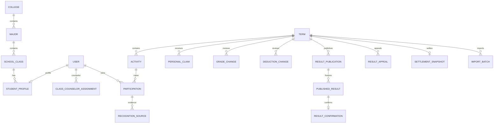

> 说明：上图为了可读性只画了核心关系。`IMPORT_BATCH` 是账号导入、参与名单导入、成绩导入三类导入批次的统称；实际表分别是 `AccountImport`、`ParticipationImport`、`GradeImport`。证明、活动附件、审计日志和系统设置是相对独立的资源表。

### 4.3 关键实体与字段

#### 4.3.1 身份与组织

| 实体 | 关键字段 | 关键约束/说明 |
| --- | --- | --- |
| `User` | `id`、`login`、`name`、`role`、`passwordHash`、`mustChangePassword`、`disabled`、`authVersion`、`collegeId`、`mergedIntoId` | 登录名唯一（不区分大小写由索引保证）；密码只存 bcrypt 哈希；`authVersion` 用于让旧会话失效；教职可关联学院 |
| `StudentProfile` | `userId`、`studentNumber`、`college`、`major`、`className`、`classId` | 学号唯一；`college/major/className` 是建档快照；当前班级以 `classId` 为准 |
| `College` / `Major` / `SchoolClass` | 编码、名称、启用状态、修订号 | 学院编码唯一；专业在学院内编码唯一；班级在专业内编码唯一 |
| `ClassCounselorAssignment` | `classId`、`counselorId`、`startedAt`、`endedAt`、`actorId`、`reason` | 记录辅导员责任区间，不因更换辅导员而抹掉历史 |
| `StudentAffiliation` | `studentId`、`classId`、`identity`、`startedAt`、`endedAt`、`actorId`、`reason` | 学生班级归属历史；转班后保留原区间和身份快照 |
| `AuthSession` | `userId`、`version`、`expiresAt`、`revokedAt` | 会话版本必须等于用户当前 `authVersion`，否则视为失效 |
| `DuplicateIdentityException` | 班级、姓名、学号、操作者、理由 | 同班同名等重复身份的显式核对记录，不能静默合并 |

#### 4.3.2 周期与评分

| 实体 | 关键字段 | 关键约束/说明 |
| --- | --- | --- |
| `Term` | `name`、`phase`、`disposition`、`scheme`、`revision`、`inputRevision`、`publishedResultSetId`、`publicationSequence`、`cohortPublicationId` | 评分树保存在 `scheme` JSON 中；节点引用由服务层按版本校验；周期有独立修订号和输入修订号 |
| `Activity` | `name`、`ownerId`、`collegeId`、`startsAt`、`endsAt`、`endedAt`、`nodeId`、`points`、`confirmed`、`publishedAt`、`audienceScope`、`audienceColleges`、`audienceClasses`、`publishRevision` | 受众范围三选一；发布写 `confirmed=true` 和 `publishedAt`；分值/节点/范围修改会撤回发布 |
| `RecognitionProject` | `termId`、`name`、`nodeId`、`points`、`enabled` | 历史申报项目定义；当前学生申报不再依赖项目配置，写接口被拒绝 |
| `GradeInput` | `termId`、`studentId`、`nodeId`、`value`、`revision` | 唯一键 `(termId, studentId, nodeId)`；保存当前有效值 |
| `DeductionInput` | `termId`、`studentId`、`projectId`、`occurrence`、`amount`、`revoked`、`reason` | 唯一键 `(termId, studentId, projectId, occurrence)`；区分同一项目多次事件 |

#### 4.3.3 活动、参与、申报与证明

| 实体 | 关键字段 | 关键约束/说明 |
| --- | --- | --- |
| `Participation` | `activityId`、`studentId`、`registeredAt`、`registeredBy`、`removedAt`、`removalReason`、`history` | 唯一键 `(activityId, studentId)`；逻辑移除，不物理删除 |
| `RecognitionSource` | `participationId`、`status`、`submitterId`、`reviewReason`、`counselorId`、`collegeReviewerId`、`activityEvidenceId`、`history` | 参与事实的认定来源；一个事实可以有多个来源，但只计一次分 |
| `ActivityEvidence` | `activityId`、`evidenceId`、`version`、`active` | 活动共享证明的版本化引用；唯一键 `(activityId, version)` |
| `Evidence` | `ownerId`、`name`、`mime`、`size`、`sha256`、`storageKey` | 私有证明文件元数据；文件本体在私有卷 |
| `ActivityAttachment` | `activityId`、`uploaderId`、`name`、`mime`、`size`、`sha256`、`storageKey` | 活动附件；可先上传后绑定活动；文件本体不在数据库 |
| `PersonalClaim` | `termId`、`studentId`、`title`、`occurredOn`、`note`、`status`、`scoreNodeId`、`score`、`scorerId`、`reviewerId`、`revision`、`history` | 学生成果申报；分数只能由辅导员填写；历史记录每次状态变化 |
| `ClaimEvidence` / `EvidenceReference` / `AppealEvidence` | 申报/来源/异议与证明的关联 | 多对多关联；证明不被复制，只被引用 |

#### 4.3.4 成绩、扣分与审核

| 实体 | 关键字段 | 关键约束/说明 |
| --- | --- | --- |
| `GradeChange` | `termId`、`studentId`、`nodeId`、`value`、`reason`、`status`、`requestId`、`baseInputId`、`baseRevision`、`baseValue`、`submittedBy`、`reviewerId`、`history` | 成绩修改申请；唯一键 `(termId, submittedBy, requestId)` 保证幂等；审核通过才写 `GradeInput` |
| `DeductionChange` | `termId`、`studentId`、`projectId`、`action`、`amount`、`reason`、`status`、`requestId`、`targetInputId`、`targetRevision`、`history` | 扣分新增/撤销申请；待审不改变生效扣分 |
| `InputChangeStatus` | `PENDING_COLLEGE`、`RETURNED`、`APPROVED`、`ABANDONED` | 成绩和扣分变更的审核状态 |

#### 4.3.5 发布、确认、异议与结算

| 实体 | 关键字段 | 关键约束/说明 |
| --- | --- | --- |
| `ResultPublication` | `termId`、`sequence`、`actorId`、`requestId`、`requestHash`、`scheme`、`termRevision`、`inputRevision`、`studentCount`、`checkingEndsAt`、`requireConfirmation`、`publishedAt` | 唯一键 `(termId, sequence)`、`(termId, requestId)`；保存发布时的评分规则和输入修订 |
| `PublishedResult` | `publicationId`、`studentId`、`login`、`name`、`college`、`major`、`className`、`total`、`resultHash`、`payload` | 唯一键 `(publicationId, studentId)`；冻结身份和归属；`payload` 保存完整计算依据 |
| `ResultConfirmation` | `resultId`、`studentId`、`resultHash`、`confirmedAt` | 一个结果最多一条确认；确认绑定结果哈希 |
| `ResultAppeal` | `termId`、`publicationId`、`studentId`、`resultHash`、`target`、`reason`、`status`、`resolution`、`resolvedPublicationId`、`revision` | 异议绑定具体发布版本；状态为 OPEN/PROCESSING/RESOLVED/REJECTED/WITHDRAWN |
| `SettlementSnapshot` | `termId`、`publicationId`、`actorId`、`requestId`、`payload`、`sha256` | 锁定结算快照，唯一绑定发布版本；内容不可变 |
| `TermReopen` | `termId`、`publicationId`、`snapshotId`、`actorId`、`reason`、`previousPhase` | 周期重开留痕；不覆盖旧快照 |

#### 4.3.6 导入、审计与设置

| 实体 | 关键字段 | 关键约束/说明 |
| --- | --- | --- |
| `AccountImport` / `ParticipationImport` / `GradeImport` | 操作者、周期、目标、原始行、差异、快照、请求 ID、状态、过期时间、提交/撤销结果 | 预览批次不写业务事实；提交时重新预检；15 分钟过期；幂等提交 |
| `AuditEvent` | `actorId`、`action`、`targetId`、`details`、`createdAt` | 追加写入；覆盖登录、组织、周期、活动、申报、成绩、发布、导入、导出、系统设置等 |
| `SiteSettings` | `id="site"`、`content`、`revision` | 单行设置；品牌、登录页、安全策略和附件限制经服务层白名单校验 |
| `BrandAsset` | `mime`、`size`、`bytes`、`sha256` | 品牌资源；公开资源和私有资源使用不同缓存/授权策略 |

### 4.4 关键约束与不变量

数据库约束和业务约束共同保证系统一致性：

1. **同一活动同一学生只有一条参与记录**：`Participation` 的 `(activityId, studentId)` 唯一；证明材料数量不会改变参与事实的唯一性。
2. **同一周期同一学生同一成绩节点只有一条当前值**：`GradeInput` 的 `(termId, studentId, nodeId)` 唯一；修改历史进入 `GradeChange`，不是把多次成绩累加。
3. **同一周期同一学生同一扣分项目同一事件只有一条记录**：通过 `occurrence` 区分不同事件，防止重复扣分。
4. **WEIGHTED 节点的直接下级权重合计必须为 1**：保存评分方案时由服务端精确校验，不能依赖前端百分比显示。
5. **输入节点不能有下级，汇总节点必须有下级**：树结构校验保证计算不会落空。
6. **发布版本全局固定**：同一周期的发布序号递增；同一发布版本中的学生结果、身份和归属不可修改。
7. **确认绑定结果哈希**：学生确认的是具体版本的具体结果，不是“当前总分”这个会变化的概念。
8. **结算快照不可覆盖**：锁定后只能通过重开产生新的流程，旧快照保留用于解释历史。
9. **业务数据不做级联物理删除**：账号、班级、学院有业务引用时只能停用或阻断删除；历史事实不会因为删除申请而消失。
10. **文件不进入数据库正文**：数据库只保存随机存储键、大小、MIME 和 SHA-256；下载时重新校验对象权限和文件哈希。

### 4.5 数据流示例：一次成绩修改

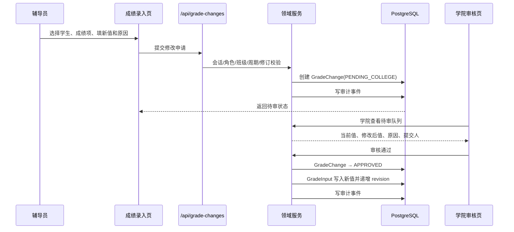

这个流程有两个关键点：

- **审核前不改变当前有效成绩**：学生在结果页看到的仍是已生效的旧值，直到学院审核通过；
- **审核通过是原子操作**：变更状态、当前值、修订号和审计写入在同一事务中，不会出现“状态已通过但成绩没更新”的情况。

### 4.6 数据库迁移与版本管理

系统使用 Prisma Migrate 管理数据库结构。截至 v0.3.1，仓库共有 **28 个迁移目录**。迁移遵循“先扩展、再回填、最后收紧”的原则：

1. 新增可空字段或新表，保证旧版本应用仍能运行；
2. 有界回填数据并记录映射关系；
3. 校验数量、唯一性、关联和业务语义；
4. 再添加 `NOT NULL`、外键和索引；
5. 切换读路径，确认无问题后再移除旧字段。

容器启动时可以执行 `prisma migrate deploy`，但生产环境建议只让一个实例执行迁移，其余实例关闭自动迁移，避免并发迁移竞争。迁移版本和数据库状态会在部署后核对，升级前会先创建数据库备份。

---

## 第 5 章 核心业务设计

### 5.1 测评周期与制度生命周期

测评周期是整个系统的“时间容器”。学院、班级、活动、成绩、扣分、申报和发布结果都归属于某个周期，切换周期后查看的是该周期下的独立数据。

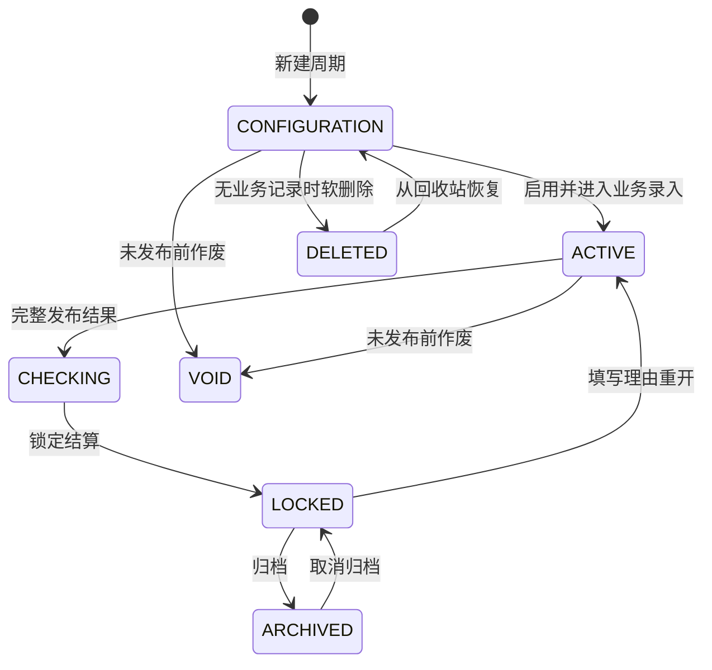

#### 5.1.1 四个阶段

| 阶段 | 用户可见名称 | 主要用途 | 典型可写操作 |
| --- | --- | --- | --- |
| `CONFIGURATION` | 配置中 | 建立制度、评分树、周期基础配置 | 修改评分方案、启用周期；一般业务尚未开放 |
| `ACTIVE` | 进行中 | 正常业务录入和审核 | 维护活动、导入参与名单、学生申报、辅导员评分、成绩/扣分提交、学院审核 |
| `CHECKING` | 结果核对 | 结果已发布，等待学生核对 | 学生确认、提出异议、延长核对期限、处理异议、锁定结算 |
| `LOCKED` | 已锁定 | 结果完成结算，进入归档 | 查询历史、排名、导出；如需修改必须填写理由重开 |

需要特别说明：**“查询”与“写入”的权限不同**。例如成绩列表在多个阶段都可以查看，但新增成绩修改只允许在“进行中”；活动列表可以查看历史，但活动维护只允许在“进行中”；发布只能在“进行中”发起，发布成功后周期自动进入“结果核对”。

#### 5.1.2 周期的其他状态

除阶段外，周期还有“处置状态”：

- `NORMAL`：正常使用；
- `ARCHIVED`：已归档，通常用于历史学期，仍可查询；
- `VOID`：作废，表示该周期不再作为正式业务周期，未发布且未结算的周期才能作废；
- `DELETED`：软删除，进入回收站，只有完全没有业务记录的配置周期才能删除，之后可以恢复。

这些状态让“历史周期”和“误建周期”都有合理出口，而不是直接删除数据库记录。

#### 5.1.3 重开与版本延续

已锁定周期如果要更正，不是把锁定状态偷偷改掉，而是：

1. 管理员填写重开理由；
2. 系统创建 `TermReopen` 记录，保存原发布版本、原结算快照和重开前阶段；
3. 周期回到“进行中”，保留旧的 `cohortPublicationId` 作为参评名单基线；
4. 管理员完成更正后重新发布，生成新的发布序号；
5. 新版本与旧版本同时存在，旧版本仍可追溯。

这样既允许业务修正，又不会让“已经通知给学生的历史成绩”消失。

### 5.2 组织模型与数据范围

#### 5.2.1 三级组织

系统使用“学院 → 专业 → 班级”三级组织：

```text
学院（College）
  └── 专业（Major）
        └── 班级（SchoolClass）
              └── 学生（StudentProfile）
```

学生的学院、专业、班级既有建档时的文本快照，也有当前班级外键。这样做的原因是：

- 学生转班后，历史材料仍能说明“当时属于哪个班”；
- 当前成绩、审核和导出使用当前班级；
- 已发布结果冻结身份快照，不会因为后来转班而改变历史结果。

#### 5.2.2 责任辅导员

班级通过 `counselorId` 指向当前责任辅导员，同时用 `ClassCounselorAssignment` 保存责任区间。辅导员只能处理“当前由自己负责的班级”的学生。更换辅导员时，旧辅导员不再获得该班的业务权限，但历史审核记录仍保留其姓名和操作。

#### 5.2.3 权限判断顺序

服务端处理一次业务请求时，按以下顺序判断：

```text
会话有效
  → 角色允许
    → 周期阶段允许
      → 数据范围允许（全校 / 本院 / 负责班级 / 本人）
        → 对象归属允许（学生是否属于该范围）
          → 业务前置条件允许（状态、修订号、截止时间、幂等键）
            → 在事务内再次校验并写入
```

这就是“四重校验”的具体含义：**角色、组织、对象、阶段**。例如：

- 学院管理员即使知道其他学院的学生 ID，也不能查看或审核该学生；
- 辅导员只能处理当前负责班级，不能用请求体伪造其他班级；
- 学生只能读取自己的结果，不能通过替换 URL 参数读取他人成绩；
- 锁定周期不能通过直接调用接口新增成绩；
- 过期的会话、已停用账号、首次登录未改密账号都会被拒绝。

### 5.3 评分模型与计算引擎

评分引擎是整个系统最核心、也最需要保证正确性的部分。

#### 5.3.1 评分树的四种节点

| 节点类型 | 中文名称 | 含义 | 是否可以是叶子 |
| --- | --- | --- | --- |
| `SUM` | 汇总 | 把直接下级分数相加，不使用下级权重 | 否，必须有下级 |
| `WEIGHTED` | 比例汇总 | 把直接下级分数乘以各自权重后相加，下级权重合计必须为 1 | 否，必须有下级 |
| `GRADE` | 成绩输入 | 直接读取辅导员录入/审核通过的成绩 | 是 |
| `ACTIVITY` | 活动得分 | 读取活动参与、成果申报等已经确认的得分 | 是 |

一个评分方案必须满足：

- 有且仅有一个根节点；
- 所有节点 ID 唯一；
- 没有环，也没有游离节点；
- 汇总节点必须有下级，输入节点不能有下级；
- 比例汇总节点的直接下级权重合计严格等于 1；
- 扣分项目必须指向存在的节点，系数不能为负。

#### 5.3.2 节点可配置字段

| 字段 | 作用 | 说明 |
| --- | --- | --- |
| `name` | 模块名称 | 最长 80 个字符；根节点名称通常为“综合测评总分” |
| `parentId` | 上级节点 | 根节点为空 |
| `order` | 同级排序 | 用于稳定展示和导出 |
| `kind` | 计分方式 | SUM / WEIGHTED / GRADE / ACTIVITY |
| `weight` | 相对上级的权重 | 只有当上级是 WEIGHTED 时才参与乘法 |
| `cap` | 封顶分 | 节点汇总后超过封顶值时截断 |
| `floor` | 最低计入分 | 扣分后如果低于最低分，拉到最低分 |
| `normalize` | 是否折算 | 将原始满分折算到目标满分 |
| `rawMaximum` | 折算前满分 | 折算时必须大于 0 |
| `targetMaximum` | 折算后满分 | 折算时必须大于 0 |
| `minimum` / `maximum` | 输入允许范围 | 只对叶子输入有意义 |
| `required` | 是否必填 | 只允许配置在可录入的叶子节点上 |

#### 5.3.3 计算顺序

评分引擎从叶子向上计算，严格按下面的顺序执行：

1. **读取或汇总原始值（gross）**
   - 如果有下级：`gross = Σ(子节点得分 × 权重)`；父节点是 WEIGHTED 时乘子权重，父节点是 SUM 时乘 1；
   - 如果没有下级：读取该叶子的原始分；
   - 必填叶子没有值时，标记该分支“不完整”，并加入缺失清单。

2. **封顶（cap）**
   - 如果配置了封顶且 `gross > cap`，取 `cap`；
   - 否则保持 `gross`。

3. **折算（normalize）**
   - 如果启用折算：`normalized = capped ÷ rawMaximum × targetMaximum`；
   - 折算发生在封顶之后，因此封顶是对“原始汇总值”生效，折算是对“封顶后的值”生效。

4. **扣分（deduction）**
   - 该节点上所有扣分项目按 `扣分金额 × 扣分系数` 汇总；
   - `beforeFloor = normalized - deduction`。

5. **最低分（floor）**
   - 如果配置了最低分且 `beforeFloor < floor`，取 `floor`；
   - 最终该节点得分 `score = max(beforeFloor, floor)`。

6. **向上传递**
   - 父节点把自己的 `score` 乘以父节点要求的权重（若为 WEIGHTED）或直接相加（若为 SUM）；
   - 一直计算到根节点。

7. **完整性判断**
   - 如果根节点所有必需输入都齐全，`total` 为最终总分；
   - 如果存在必需输入缺失，`total` 为 `null`，同时保留 `provisionalTotal`（暂计分）和缺失节点列表。

#### 5.3.4 一个完整的计算示例

假设某学期的评分方案如下：

```text
综合测评总分（WEIGHTED，根节点）
├── 基础素质（WEIGHTED，占 70%）
│   ├── 学业成绩（GRADE，占基础素质的 60%，0～100，必填）
│   └── 体育素质（GRADE，占基础素质的 40%，0～100，必填）
└── 发展素质（SUM，占 30%，封顶 30 分，原始满分 40 折算为 30）
    ├── 活动积分（ACTIVITY，18 分）
    └── 成果积分（ACTIVITY，12 分）
```

输入值：学业成绩 92，体育素质 86；活动积分 18，成果积分 12；根节点有“违纪扣分”2 分，扣分系数为 1。

| 节点 | 原始汇总 gross | 封顶后 capped | 折算后 normalized | 扣分 deduction | 节点得分 score | 向上贡献 |
| --- | ---: | ---: | ---: | ---: | ---: | ---: |
| 学业成绩 | 92.00 | 92.00 | 92.00 | 0.00 | 92.00 | 55.20（×60%） |
| 体育素质 | 86.00 | 86.00 | 86.00 | 0.00 | 86.00 | 34.40（×40%） |
| 基础素质 | 89.60 | 89.60 | 89.60 | 0.00 | 89.60 | 62.72（×70%） |
| 活动积分 | 18.00 | 18.00 | 18.00 | 0.00 | 18.00 | 18.00（SUM） |
| 成果积分 | 12.00 | 12.00 | 12.00 | 0.00 | 12.00 | 12.00（SUM） |
| 发展素质 | 30.00 | 30.00 | 22.50 | 0.00 | 22.50 | 6.75（×30%） |
| 综合测评总分 | 69.47 | 69.47 | 69.47 | 2.00 | 67.47 | 67.47 |

拆开写就是：

```text
基础素质 = 92 × 60% + 86 × 40%
         = 55.20 + 34.40
         = 89.60

基础素质贡献 = 89.60 × 70% = 62.72

发展素质 = 18 + 12 = 30.00
发展素质封顶 = min(30.00, 30.00) = 30.00
发展素质折算 = 30.00 ÷ 40 × 30 = 22.50
发展素质贡献 = 22.50 × 30% = 6.75

扣分前总分 = 62.72 + 6.75 = 69.47
根节点扣分 = 2.00 × 1 = 2.00
最终总分 = 69.47 - 2.00 = 67.47
```

这个例子同时展示了比例汇总、直接汇总、封顶、折算、扣分和最低分（最低分为 0）的作用顺序。

#### 5.3.5 缺失、零分与暂计分

这是综合测评中非常容易被误解的一点：

- **明确填写 0**：是学生真实得了 0 分，数据完整，`complete=true`；
- **必填项没有填写**：不是 0，而是“缺失”，`complete=false`，正式总分为 `null`，页面显示“待补齐”；
- **选填项没有填写**：按 0 参与计算，完整性不受影响；
- **活动类节点没有记录**：没有活动记录按 0 处理，因此活动节点不允许配置“必填原始输入”；
- **暂计分**：为了帮助管理员在数据未齐时预览，引擎仍会计算一个 `provisionalTotal`，但它不能作为正式发布结果。

例如上例中如果“学业成绩”缺失：

```text
学业成绩按 0 参与暂计
基础素质 = 0 × 60% + 86 × 40% = 34.40
基础素质贡献 = 34.40 × 70% = 24.08
发展素质贡献 = 6.75
根节点扣分 = 2.00
暂计分 = 24.08 + 6.75 - 2.00 = 28.83
```

此时 `provisionalTotal = 28.83`，但 `total = null`、`missing = ["学业成绩"]`。发布检查会发现缺失项并阻断正式发布。

#### 5.3.6 扣分规则

扣分不是简单地从最终总分里减一个数字，而是有明确的归属节点和系数：

- 扣分项目配置在某个评分节点上；
- 每次扣分登记金额必须为正数；
- 实际扣减额为 `金额 × 系数`；
- 扣分发生在该节点的“封顶/折算”之后、“最低分”之前；
- 同一扣分项目的不同事件用 `occurrence` 区分，可以累计；
- 同一事件不能重复登记；
- 撤销扣分保留原记录和理由，不物理删除；
- 子节点的扣分已经包含在子节点得分中，父节点只处理归属于父节点的扣分，避免重复扣减。

例如：某学生晚归扣 2 分，系数 1；另一项违纪扣 1 分，系数 2。若两项都挂在根节点，则根节点扣分合计为 `2×1 + 1×2 = 4`。

#### 5.3.7 精确计算

综合测评对精度很敏感，尤其是“59.995 应不应该变成 60.00”这类边界。系统没有使用 JavaScript 的二进制浮点数进行中间计算，而是使用“有理数（分数）”实现：

- 输入以十进制字符串保存，例如 `"92"`、`"86.5"`；
- 解析为 BigInt 分子和分母；
- 加减乘除都用分数进行，避免 `0.1 + 0.2 !== 0.3`；
- 最终显示和保存时按“四舍五入（half-up）”保留两位小数；
- 数据库中的成绩值使用高精度 Decimal，发布总分使用两位 Decimal；
- 每次计算都保留精确值（`exact`）和格式化值，便于复核。

伪代码可以表示为：

```text
score = Rational(0)
for child in children:
  score += child.score * (parent.kind == WEIGHTED ? child.weight : 1)
capped = cap != null ? min(score, cap) : score
normalized = normalize ? capped / rawMaximum * targetMaximum : capped
beforeFloor = normalized - deduction
final = floor != null ? max(beforeFloor, floor) : beforeFloor
```

这段逻辑就是 [`src/lib/scoring/calculate.ts`](../../src/lib/scoring/calculate.ts) 的核心。它不依赖 Next.js、Prisma 或当前登录用户，因此可以独立测试，也可以在导出时复用计算顺序。

#### 5.3.8 制度变更的影响

评分方案的变化可能影响已有输入。系统采用以下策略：

- 保存方案前进行结构校验、数值校验和引用校验；
- 已被业务引用的节点不能随意删除；
- 修改权重、封顶、折算、扣分归属等会影响成绩的配置时，先显示影响预览；
- 已发布版本的评分方案保存在发布快照中，不随后续制度修改而变化；
- 需要按新制度重算时，通过重开、更正、重新发布形成新版本。

这样既支持每学期调整制度，也保证历史成绩可以按当时的规则解释。

### 5.4 活动与参与事实

#### 5.4.1 活动状态

活动没有单独的“状态枚举”，而是由几个字段共同表达：

| 状态 | 判断依据 | 学生是否可见 |
| --- | --- | --- |
| 草稿 | `publishedAt` 为空 | 否 |
| 已发布、未开始 | 已发布，当前时间早于开始时间 | 在“活动”列表中可查看，具体以页面规则为准 |
| 进行中 | 已发布，处于开始和结束时间之间，且未手动结束 | 是 |
| 已结束 | 超过计划结束时间，或手动结束 | 参与记录仍可查看；不再出现在“最新活动” |
| 已撤回 | 修改了分值、计分节点或受众范围后自动撤回 | 否，需要重新发布 |

活动发布时会校验受众范围。受众范围只能是以下三种之一：

1. **全校（ALL）**：全校学生；
2. **按学院（COLLEGE）**：选择一个或多个学院，取并集；
3. **按班级（CLASS）**：选择一个或多个班级，取并集。

同一活动不能同时使用两种范围方式，避免“既是全校又是某班”的歧义。草稿可以暂不选择，但发布会要求至少选择一个有效范围。

#### 5.4.2 发布事务与撤回

活动发布不是简单地把 `publishedAt` 写上去，而是在一个事务中：

1. 重新校验操作者是否属于活动主办方/管理范围；
2. 校验活动属于当前周期且周期处于进行中；
3. 校验受众范围方式合法、至少有一个有效对象；
4. 校验评分节点是当前制度中有效的活动得分节点；
5. 写入 `confirmed=true`、`publishedAt`，递增发布版本；
6. 写审计日志。

发布之后，如果管理员修改了以下三类字段，系统会自动撤回发布：

- 活动分值；
- 计分节点；
- 受众范围。

只修改名称、时间、介绍、附件等描述信息，不会影响已有的参与事实，因此不会自动撤回。撤回后必须重新发布，学生才能重新看到活动。

#### 5.4.3 参与名单

参与名单以活动为单位维护：

- 学生不能自行报名，避免“自己给自己加活动分”；
- 名单通过 CSV/XLSX 导入，身份字段严格匹配；
- 一个活动只能有一份正式名单，后续补充或更正需要说明理由并保留差异；
- 导入先预览，列出新增、已存在、跳过和错误；
- 只要有错误行，整批不写入；
- 每个参与事实使用 `(activityId, studentId)` 唯一键，重复导入不会造成重复计分；
- 移除参与也是逻辑移除，保留原记录、移除人和移除原因；
- 审核分为辅导员初审和学院终审，只有审核通过的参与事实才计入活动得分。

#### 5.4.4 活动证明与附件

活动的证明和附件是两种不同的资源：

- **活动附件**：活动本身的材料，例如通知、规程、签到表；
- **学生证明**：学生个人成果申报时上传的证书、截图、证明文件。

两者都存放在私有卷中，数据库只保存文件名、MIME、大小、SHA-256 和随机存储键。下载时必须经过鉴权接口，服务端会再次检查当前用户是否有权限查看该对象。活动附件还可以按活动、学院、专业、班级范围导出 ZIP，ZIP 中包含清单、哈希和失败记录。

#### 5.4.5 手动结束与重新开放

活动可以提前手动结束：

- 写入 `endedAt`，保留原计划 `endsAt`；
- 递增活动修订号；
- 记录 `ACTIVITY_ENDED` 审计；
- 结束只影响学生“最新活动”的展示，不锁定参与名单、审核、成绩或历史详情。

活动也可以重新开放，清空 `endedAt` 并记录审计。名单导入成功、证明上传成功都不等于活动结束；活动是否结束由业务人员明确操作。

### 5.5 个人成果申报

#### 5.5.1 为什么学生不能自填分数

成果申报是最容易出现公平性争议的环节。如果学生可以自己选择计分项目和填写分数，就可能出现：

- 把低价值成果挂到高分节点；
- 同一成果重复申报；
- 学生给自己打高分；
- 辅导员和学院无法判断分数依据。

因此系统规定：

- 学生只填写标题、发生日期、事实说明和证明；
- 学生不自选项目、不填分数；
- 辅导员在初审时选择当前制度中可计分的最底层节点并填写分数；
- 学院只负责终审，不能直接改分；
- 评分和节点绑定到申报的当前修订版本。

#### 5.5.2 申报状态机

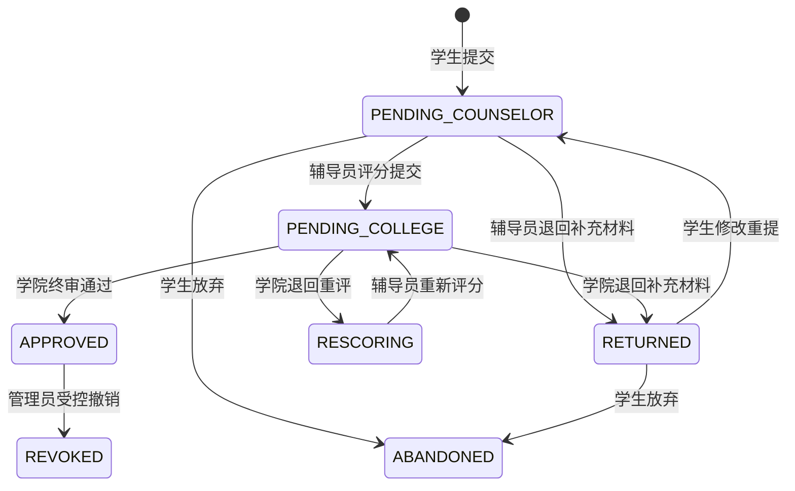

#### 5.5.3 退回规则

退回是本系统重点设计的业务规则：

| 退回场景 | 退回给谁 | 要求 |
| --- | --- | --- |
| 材料缺失、事实描述不清、证明不合格 | 学生 | 必须填写理由，学生补充后可重新提交 |
| 评分明显不合理、节点选择不合适 | 辅导员 | 学院选择“退回重评”，必须填写评分问题理由 |
| 普通成绩/扣分错误 | 原提交辅导员 | 必须填写理由，辅导员修改后重新提交学院审核 |
| 活动名单身份或参与事实有误 | 活动主办方/名单维护人 | 必须填写理由并保留更正历史 |

所有退回都交回“原发起人”，不能把学生材料问题直接退给辅导员，也不能把评分问题直接退给学生重新上传材料。这个规则让每个角色只处理自己职责内的问题。

#### 5.5.4 放弃、重提与撤销

- 学生可以放弃“待辅导员处理”或“已退回”的申报；
- 放弃只改变申报状态，不删除历史材料；
- 修改重提会创建新的修订，重新走辅导员初审和学院终审；
- 已通过的申报不能由学生自己删除，必须由管理员执行受控撤销；
- 撤销保留原申报、原评分和原审核记录，只把状态改为 `REVOKED`。

### 5.6 成绩、扣分与两级审核

#### 5.6.1 成绩输入

成绩项来自评分树中的 `GRADE` 叶节点，页面只显示当前周期有效的成绩项。辅导员提交成绩修改时：

- 显示当前有效值、允许范围和待提交值；
- 修改必须填写原因；
- 提交后生成 `GradeChange`，状态为 `PENDING_COLLEGE`；
- 审核通过前，`GradeInput` 仍是旧值；
- 学院审核通过后，旧值写入历史，当前值更新，输入修订号递增；
- 学院退回后，辅导员可以修改重提或放弃。

#### 5.6.2 缺失与零分

成绩录入页面必须区分：

- **未录入**：数据库没有该成绩项，必填时导致结果不完整；
- **录入 0**：数据库存在值为 0 的记录，是有效的真实成绩；
- **计划删除**：不是把值改成空字符串，而是走“标记缺失/删除”操作，填写理由并检查影响。

这样可以避免把“没有成绩”误当成“0 分”，也可以避免把“0 分”误当成“未录入”。

#### 5.6.3 扣分

扣分是独立于成绩的一类输入：

- 扣分项目由评分方案配置，包括名称、归属节点、系数；
- 辅导员只填写金额和理由，不能修改系数；
- 同一项目可以登记多次不同事件；
- 扣分提交后同样进入待学院审核；
- 撤销扣分不是物理删除，而是新增撤销申请，审核通过后标记为撤销；
- 扣分和成绩的审核都记录提交人、审核人、时间、理由和历史状态。

#### 5.6.4 同一事实只计一次

系统通过业务键避免重复计分：

- 活动参与事实：`(activityId, studentId)` 唯一；
- 成果申报：同一活动、同一学生的有效申报不能重复通过；
- 成绩输入：`(termId, studentId, nodeId)` 唯一；
- 扣分：`(termId, studentId, projectId, occurrence)` 唯一。

“重复提交”与“多个来源”是两件事：一个参与事实可以有多个证明材料或多个认定来源，但事实本身只计一次；系统不按标题、文件名或哈希自动合并，疑似重复由审核人员核实处理。

### 5.7 发布、确认、异议与结算

#### 5.7.1 发布前的完整性检查

发布是结果从“内部审核”走向“学生可见”的关键节点。系统在发布前检查：

1. 当前周期是否处于“进行中”；
2. 是否存在有效参评学生（最多 2,000 人的完整性检查容量）；
3. 是否有待辅导员处理、待学院审核或已退回未处理的参与认定；
4. 是否有待处理的个人申报；
5. 是否有学生缺少必需成绩；
6. 当前评分方案、输入修订号和学生名单是否仍然一致；
7. 发布操作是否带有有效的预检令牌，防止预检后数据变化。

只要存在阻断项，发布就不会发生，并会明确告诉管理员是哪一类、多少项。

#### 5.7.2 发布快照

发布成功时，系统在同一个事务中：

- 创建 `ResultPublication`，记录发布序号、评分方案、周期修订、输入修订、学生数量、核对截止时间和是否需要确认；
- 为每个学生创建 `PublishedResult`，冻结学号、姓名、学院、专业、班级、总分、结果哈希和完整计算依据；
- 把周期阶段切换为“结果核对”；
- 写审计日志。

发布后，即使管理员修改了学生姓名、班级、成绩或评分方案，已发布版本中的内容也不会被直接改写。下一位学生看到的是当时冻结的结果；需要变更时，必须走重开/更正/重新发布。

#### 5.7.3 学生确认

学生确认不是点一个“我知道了”按钮，而是：

- 确认动作绑定当前发布版本和该学生的 `resultHash`；
- 结果哈希由该学生的身份、成绩、扣分、活动和申报等计算依据生成；
- 如果结果已经变化，学生不能确认旧哈希；
- 每个学生对于每个结果最多一条确认记录；
- 确认后仍然可以在截止前提出异议，确认不等于放弃异议权。

#### 5.7.4 异议处理

异议流程：

1. 学生在核对期内选择具体结果项目、填写理由、可选上传证明；
2. 系统校验异议针对当前发布版本，且该结果哈希没有被替换；
3. 管理员可以开始处理、直接驳回或标记已解决；
4. 标记“已解决”必须存在该学生实际更正后的新发布版本，且新版本结果哈希与异议时不同；
5. 学生只能在“待处理”阶段撤回，进入“处理中”后不能撤回；
6. 所有处理结论和理由都保留。

#### 5.7.5 锁定结算

锁定结算前，系统再次检查：

- 周期处于“结果核对”；
- 核对截止时间已到；
- 需要确认的版本已经全部确认；
- 没有未处理完毕的异议；
- 没有待审或待补充的申报；
- 当前周期输入和评分方案与发布版本一致。

全部满足后，系统生成 `SettlementSnapshot`，保存排名、发布结果、确认、异议、延长记录和 SHA-256 校验值，并把周期改为“已锁定”。锁定后如需更正，必须填写理由重开，生成新的发布和新的结算版本。

### 5.8 排名与成绩导出

#### 5.8.1 排名规则

排名只针对已发布结果。系统使用并列排名（竞赛排名）：

- 先按总分从高到低排序；
- 总分相同的学生名次相同；
- 下一名次按“当前排序位置 + 1”计算，例如两个并列第 1 名，下一名是第 3 名；
- 显示排序时用登录名做稳定次序，但不改变并列名次。

管理员可以按学院、专业、班级筛排名；学生只能看到本人在当前发布版本中的一条记录。

#### 5.8.2 为什么导出不能使用固定模板

评分制度每学期可能变化：模块名称、层级、权重、封顶、折算、扣分项目都可能不同。如果导出使用固定模板，就会出现：

- 表头与评分树不一致；
- 权重列写死，换制度后算错；
- 新增模块无处显示；
- 学校要求的正式表格无法直接使用。

因此系统根据评分树动态生成“成绩明细”工作表：

- 模块层级决定分组表头；
- 叶子分数是录入值；
- 比例列只在真正乘法发生的地方出现，并在表头写明“模块名 × 乘数”；
- 小计、封顶、折算、扣分、总分等计算单元格写入 Excel 公式；
- 同时写入服务端计算的缓存值，保证不重算的查看器也能看到结果；
- 另建“评分规则”工作表，列出每个节点的类型、上级、上限、原始满分、折算满分、权重、扣分系数和必填项；
- 当前周期导出保留可编辑录入格和黄色标识，正式发布导出锁定参数和录入内容，并启用工作表保护。

#### 5.8.3 导出范围与安全

不同角色的导出范围不同：

| 角色 | 允许范围 |
| --- | --- |
| 学校管理员 | 全校，可按学院筛选；可导出全校排名 |
| 学院管理人员 | 本学院 |
| 辅导员 | 本人当前负责的班级 |
| 学生 | 本人成绩单 |

单次导出最多 10,000 名学生；发布检查单周期最多 2,000 名学生。超过上限时返回明确提示，要求按学院或班级分批，不会悄悄截断数据。

导出文本按普通文本单元格写入，公式只由受信任的评分树构建器生成；导入文件如果包含公式、宏或外链会被拒绝，避免把用户输入当作可执行公式。

### 5.9 批量导入

系统有三类导入：

1. **账号导入**：学生、辅导员、学院管理人员；
2. **活动参与名单导入**：活动、学生、参与状态；
3. **成绩导入**：成绩项、学生、成绩值。

统一流程是：

```text
下载模板/确认字段
  → 上传文件
  → 解析并预览逐行差异
  → 修正错误
  → 提交（事务内重新预检）
  → 返回结果
```

关键机制：

- 预览只创建批次，不写账号、事实或成绩；
- 预览有 15 分钟有效期，过期后必须重新上传；
- 提交时重新校验操作者、阶段、归属、快照和过期时间；
- 有任一错误行时整批拒绝；
- 同一请求重复提交返回原结果，不重复写入；
- 已提交批次支持查看历史和整批撤销；
- 撤销时只要有一个账号已有业务记录或身份变化，整批阻断；
- 原始批次结果不因撤销而抹掉，历史仍能说明该批创建过哪些账号。

导入的设计目标不是“快”，而是“**整批成功或整批不动**”，避免出现一半学生导入成功、另一半失败且难以核对的情况。

### 5.10 审计、备份、附件与设置

#### 5.10.1 操作日志

操作日志覆盖：

- 登录成功/失败/锁定、改密；
- 账号创建、停用、重置、角色变化；
- 组织创建/修改/删除、辅导员交接；
- 周期创建、修改、启用、发布、锁定、重开、归档、作废；
- 活动创建/发布/撤回/结束/重开；
- 名单导入、参与审核、申报提交/评分/审核/退回/撤销；
- 成绩/扣分提交、审核、退回、更正；
- 结果发布、确认、异议处理、结算；
- 导入、导出、系统设置和数据库备份/恢复。

日志支持按分类、动作、操作者、对象、结果、时间筛选，支持详情和 CSV 导出。日志清理有保留期策略，清理前可预览，清理行为本身也写审计。

#### 5.10.2 数据库备份与恢复

系统提供两条备份路径：

- 运维层面：使用 `pg_dump` 生成数据库转储；
- 应用层面：管理员在“数据库备份”页面创建备份、下载、上传和设置保留策略。

恢复不是直接覆盖生产库，而是：

1. 上传或选择备份；
2. 在候选数据库真实还原；
3. 预检迁移版本、数据完整性和影响；
4. 进入维护模式，业务写入停止；
5. 原子切换到恢复后的数据库；
6. 校验失败自动回滚；
7. 恢复后清空旧会话，所有用户重新登录。

数据库备份只包含数据库，不包含证明和活动附件文件；附件必须与数据库一起纳入运维备份计划，这一点在系统界面和部署文档中都有明确说明。

#### 5.10.3 附件治理

附件管理按活动聚合：

- 一个活动一行，显示活动附件数量、学生证明数量和范围；
- 可以按学院、专业、班级筛选；
- 可以导出某范围的活动附件或学生证明 ZIP；
- ZIP 中包含清单、文件哈希和错误记录；
- 下载需要再次验证密码或权限，不能仅凭页面入口；
- 辅导员、学院、管理员的范围不同，跨院访问返回 403。

#### 5.10.4 系统设置

系统设置包括：

- 学校名称、品牌文字、浅色 Logo、深色 Logo、浏览器图标；
- 登录页背景、玻璃卡片模糊度、默认外观；
- 登录安全策略（验证码、失败锁定等）；
- 活动附件大小、类型和数量限制；
- 备份和运维相关设置。

公开品牌资源可以长缓存（例如 Logo、登录背景），私有证明和附件使用 `no-store`，避免公共缓存泄露隐私；公开/私有资源通过明确白名单区分。

---

## 第 6 章 关键实现

### 6.1 登录、会话与账号安全

系统使用 NextAuth Credentials 完成登录，但登录流程不只是“校验密码”：

1. 用户提交身份、账号、密码和图片验证码；
2. 服务端先校验验证码是否有效、是否过期、是否匹配；
3. 根据账号查询用户，检查是否停用、是否存在；
4. 使用 bcrypt 校验密码；
5. 检查是否首次登录，若需要改密则只允许进入改密页；
6. 创建会话，记录会话版本；
7. 后续每次请求都会检查会话是否存在、是否过期、是否被撤销、用户是否停用、会话版本是否等于用户当前 `authVersion`。

`authVersion` 的作用是“让旧会话立刻失效”：当管理员停用账号、重置密码或改变角色时，服务端递增 `authVersion`，之前签发的会话即使还没到期，也会因为版本不一致而失效。这样不需要等待 JWT 过期。

图片验证码只保存答案哈希，不保存明文；验证码有有效期，使用后失效；登录失败按策略计数，达到阈值后锁定一段时间。验证码和登录失败状态都写入数据库，多实例部署时也能共享。

### 6.2 服务端授权与事务模式

系统把大多数关键写入放进一个统一的周期事务入口。可以把它理解为：

```text
开启数据库事务
  → 获取账号咨询锁（共享）
  → 获取当前周期咨询锁（独占）
  → 查询会话和用户
  → 校验会话、停用、首次改密、角色
  → 查询周期
  → 校验周期存在、处置状态、阶段
  → 执行业务回调
  → 回调内再次检查对象归属、修订号、业务状态
  → 写业务记录
  → 写审计事件
  → 提交事务
```

具体实现位于 [`src/server/terms.ts`](../../src/server/terms.ts) 的 `termTransaction`。它带来几个效果：

- **身份和管理操作互斥**：账号管理写操作会获取账号锁，避免在发布或结算过程中同时改身份/范围；
- **同一周期的写入串行化**：周期锁避免两个管理员同时发布、同时审核或同时重开；
- **事务内重新校验**：预检时看到的状态可能在提交时已经变化，服务端会以事务内最新状态为准；
- **失败自动回滚**：任何一步抛错，都不会留下部分业务数据。

除了锁，系统还使用：

- **修订号（revision）**：每次修改递增，客户端必须携带当前修订号；修订号不匹配返回 409，提示刷新；
- **幂等请求 ID（requestId）**：发布、导入、结算等操作使用请求 ID，重复提交返回原结果，不重复写入；
- **流程令牌（flow token）**：发布和结算前先预检，令牌绑定操作者、周期和预检内容；预检后数据变化，令牌失效；
- **HMAC 签名**：结算预检令牌带签名，防止客户端伪造预检结果。

### 6.3 评分引擎的实现结构

评分引擎位于 [`src/lib/scoring`](../../src/lib/scoring)：

| 文件 | 职责 |
| --- | --- |
| `types.ts` | 定义节点结构、评分方案结构、十进制字符串规则 |
| `validate.ts` | 校验唯一根、无环、无游离、比例合计、封顶/折算/最低分、扣分引用 |
| `rational.ts` | BigInt 有理数的解析、加减乘除、比较和定点格式化 |
| `calculate.ts` | 从叶子到根计算，输出总分、暂计分、缺失项和逐节点明细 |
| `score-tree.ts` | 共享评分树辅助逻辑，供导出构建器复用 |

引擎的输入不包括用户、会话或数据库连接，只包括：

- 评分方案（节点和扣分项目）；
- 原始输入值（成绩、活动得分等）；
- 扣分值（按扣分项目 ID）。

输出包括：

```ts
{
  total: string | null,        // 正式总分；必填缺失时为 null
  provisionalTotal: string,    // 暂计分
  complete: boolean,           // 是否完整
  missing: { id, name }[],     // 缺失的必填节点
  details: [                   // 每个节点的逐层明细
    {
      id, name, kind, weight,
      gross, capped, normalized,
      deduction, beforeFloor, score,
      exact: { ... },
      normalization: { rawMaximum, targetMaximum } | null,
      parentContribution
    }
  ]
}
```

这种纯函数设计让评分逻辑可以：

- 用固定输入做单元测试；
- 在页面试算、发布计算、成绩导出中复用；
- 在导出测试中用独立实现逐格核对；
- 不因为页面改版或数据库变化而改变计算口径。

### 6.4 Excel 导出构建器

导出使用自己实现的轻量 XLSX 写入器（[`src/lib/xlsx`](../../src/lib/xlsx)），没有引入重量级表格库。它可以：

- 写入多工作表；
- 合并单元格、设置列宽、冻结窗格、设置打印区域；
- 写入公式 `<f>` 和缓存值 `<v>`；
- 设置单元格样式、边框、数字格式；
- 对工作表设置保护，使正式发布文件不可随意编辑；
- 通过 ZIP 写入 XLSX 所需 XML。

成绩明细表的生成过程：

1. 读取发布版本或当前周期的评分方案；
2. 根据节点层级和顺序生成列模型；
3. 生成分组表头、实际分列、比例列、扣分列和结果列；
4. 对需要计算的单元格写公式；
5. 同时用评分引擎计算缓存值；
6. 写入学生行，按学院、专业、班级、学号排序；
7. 写入“评分规则”工作表；
8. 设置保护、冻结、列宽和打印布局；
9. 生成文件名，区分“当前阶段”和“正式发布”。

正式发布导出时，评分参数和录入值被锁定，但公式仍然保留，便于复核；文件里还会写明“正式发布快照”和发布时间。当前周期导出则允许编辑录入格，用颜色区分录入区和计算区。

### 6.5 私有文件安全

证明和活动附件的处理流程：

1. 上传时检查文件大小、MIME、扩展名和数量限制；
2. 生成随机存储键，不把原文件名直接作为磁盘路径；
3. 计算 SHA-256，写入数据库；
4. 文件放到私有卷，不放到 `public/` 目录；
5. 下载时先验证会话和对象权限；
6. 读取文件时再次核对哈希，防止文件被替换；
7. 对公开品牌资源单独白名单，允许长缓存，但不包括证明和活动附件。

这种设计的原因是：文件 URL 一旦公开，很难撤回；把文件放在公共静态目录，等于绕过了业务权限。私有卷 + 鉴权接口 + 哈希校验可以让文件访问与业务权限保持一致。

### 6.6 页面与交互实现

前端使用 Next.js App Router：

- **Server Components** 负责读取当前用户、周期、列表和详情，减少客户端重复请求；
- **Client Components** 负责表单、筛选、抽屉、对话框、分页和即时状态；
- 页面通过 URL 保存周期、筛选和分页，刷新后保持上下文；
- 列表在桌面端使用表格，移动端使用记录卡，避免横向滚动；
- 表单使用真实标签、必填校验、提交中状态和可读错误；
- 空态不是空白页，而是说明当前没有数据、原因和有权限的下一步操作；
- 危险操作（删除、撤销、重开、恢复）需要理由和二次确认；
- 权限不足时返回明确的 403 页面或提示，而不是假装成功；
- 未实现的功能不提供假按钮，避免“点了没反应”或“看似完成但实际没有业务”。

视觉上采用 Linear 风格的企业后台基线：白色内容面、浅灰侧栏、细分割线、紫色主操作、紧凑表格和清晰的信息层级。前端基于 MIT 许可的 Next.js shadcn 管理后台模板进行业务适配，保留成熟的侧栏、顶栏、表格、筛选、详情和响应式结构，同时替换为真实的中文业务页面；许可文本保留在 [`docs/licenses/dashboard-baseui-MIT.txt`](../licenses/dashboard-baseui-MIT.txt)。

登录页还做了可靠性处理：

- 未配置背景图时显示默认渐变背景；
- 背景图加载中先显示渐变，加载成功后再淡入；
- 图片加载失败时不显示浏览器“破图”图标，而是保持渐变；
- 只有图片实际加载成功，覆盖层和文字对比度才切换到图片模式；
- 公开品牌资源使用长缓存，私有资源使用 `no-store`。

这类细节不是核心业务，但会直接影响用户对系统是否“可用、可信”的第一印象。

## 第 7 章 核心功能截图与讲解

### 7.1 截图选择原则

系统页面较多，如果把每个页面都放进报告，反而会削弱重点。本章只选择 **8 个能够串起核心业务链路的界面**：登录、管理员工作台、周期详情、辅导员成绩录入、学院成绩审核、结果发布、学生成绩核对、成绩导出。它们分别回答八个问题：

| 序号 | 截图 | 对应问题 | 业务环节 |
| --- | --- | --- | --- |
| 1 | 统一登录 | 谁可以进入系统，怎样证明身份 | 认证 |
| 2 | 管理员工作台 | 当前周期是什么，哪里在等待处理 | 总览 |
| 3 | 周期详情 | 这个周期做到哪一步，下一步做什么 | 周期管理 |
| 4 | 辅导员成绩录入 | 原始成绩怎样提交，什么时候生效 | 成绩输入 |
| 5 | 学院成绩审核 | 谁对成绩负责，退回怎样处理 | 两级审核 |
| 6 | 结果发布 | 结果怎样冻结，什么时候可以锁定 | 发布与结算 |
| 7 | 学生成绩核对 | 学生怎样看自己的分，怎样确认或异议 | 学生端 |
| 8 | 成绩导出 | 结果怎样变成可复核的 Excel | 排名与导出 |

本章截图来自 2026-10-24 至 10-25 的隔离验收环境，常规页面视口为 1280×800，登录页为 1280×889；页面中的姓名、学号、学院、活动、成绩均为虚构验收数据，不对应真实个人或机构。截图中的数字是当时场景的状态，不代表系统固定值；例如“0 条待办”表示当时没有待办，不表示系统没有数据。

---

### 7.2 统一登录：一个入口，服务端识别身份


**这张图看什么：**

- 左侧是学校品牌区，显示系统名称“序衡 · 高校综合测评管理”和学校 Logo；
- 中间是登录卡片，包含“学号或账号”“密码”“图片验证码”三个输入项；
- 图片验证码是 5 位英文字母，不区分大小写，右侧可以“换一张”；
- 右上角提供外观切换，登录页也支持浅色/深色偏好；
- 页面底部写明“账号由学校统一分配。如忘记密码，请联系管理员重置。”

**为什么这样设计：**

系统没有为管理员、学院、辅导员、学生分别做四套登录页。四类角色共用一套账号体系和同一个认证入口，登录后由服务端根据账号真实角色加载不同的工作台和菜单。这样做有三个好处：

1. **账号唯一**：一个人只有一个账号，不会出现“学生账号”和“教师账号”两套密码；
2. **入口简单**：用户不需要记住不同角色的网址；
3. **授权集中**：登录时不选择角色，服务端直接以账号在数据库中的真实角色作为授权依据，所有页面入口和接口权限都在服务端校验。

登录页不要求先选择身份。账号本身唯一，角色由管理员在账号管理中确定；减少一步选择，也避免用户因选错身份而看到与密码无关的失败提示。前端提交的只有账号、密码和验证码，篡改请求也无法改变角色；后续每次请求仍会重新校验角色、组织范围、对象归属和周期阶段。

**登录不只是比对密码。** 服务端依次完成：

1. 校验图片验证码是否存在、是否过期、是否与答案匹配；
2. 查询账号，检查是否停用；
3. 使用 bcrypt 校验密码；
4. 检查是否需要首次修改密码；
5. 创建服务端会话，记录会话版本；
6. 后续请求检查会话是否被撤销、是否过期、账号是否停用、会话版本是否与账号当前版本一致。

登录失败会计数，达到阈值后锁定一段时间；验证码答案只保存哈希，使用一次后失效。这些措施用于降低暴力尝试和脚本撞库的风险。

**背景图的可靠性处理：**

登录页默认显示渐变背景。如果管理员配置了背景图，页面会先显示渐变，图片真正加载成功后再淡入；如果图片加载失败，则卸载图片，不显示浏览器的“破图”图标，也不让深色遮罩压住空白背景。只有图片实际加载成功，文字和主题控件才切换到适合图片的对比度。公开品牌资源使用长缓存，私有资源使用 `no-store`，避免把证明、附件等隐私资源放进公共缓存。

这个细节不改变业务，但它体现了系统对“失败状态”的处理原则：**加载失败也要保持可用、可读、可信，而不是把技术错误直接暴露给用户。**

---

### 7.3 管理员工作台：先看全局，再进入待办

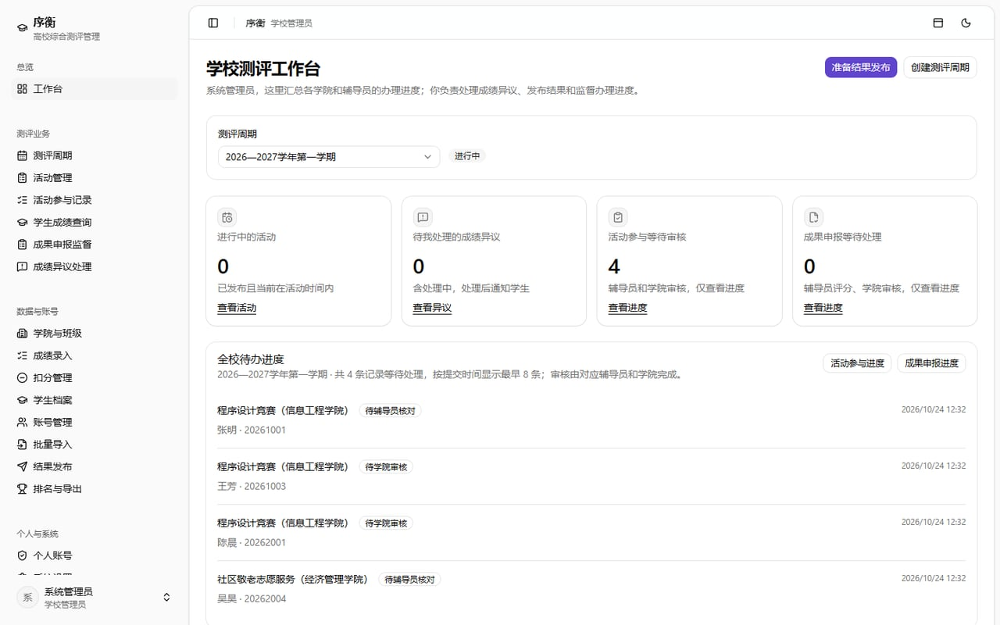

**这张图看什么：**

- 顶部是当前测评周期“2026—2027学年第一学期”，右侧标注“进行中”；
- 第一行是四个真实指标：
  - 进行中的活动：0；
  - 待我处理的成绩异议：0；
  - 活动参与等待审核：4；
  - 成果申报等待处理：0；
- 每个指标下方都有对应入口，例如“查看活动”“查看异议”“查看进度”；
- 中间是“全校待办进度”，说明“共 4 条记录等待处理，按提交时间显示最早 8 条”；
- 待办行显示活动名称、主办学院、学生姓名、学号、当前状态和处理时间；
- 右上角提供“准备结果发布”和“创建测评周期”两个主操作。

**这张图背后的业务：**

管理员打开系统后，最需要的不是一张漂亮的统计图，而是三个问题的答案：

1. **现在做的是哪个周期？**
2. **有什么在等我处理？**
3. **点进去以后能做什么？**

工作台把这三个问题放在同一屏：周期选择器确定上下文，四个指标给出待办数量，下方队列给出具体记录，入口直接跳到对应的处理页面。零值不是假数据：截图中的“进行中的活动 0”表示当时没有已发布且在活动时间内的活动；“待我处理的成绩异议 0”表示当时没有打开状态的异议，而不是系统没有数据。

**为什么待办按提交时间排序：**

审核和异议都带有时间责任。按提交时间从早到晚显示，可以避免早提交的记录长期被压在列表底部；页面只显示最早的一批记录，既控制了首屏长度，也提示还有多少待处理。管理员不需要先学会复杂的报表，就能按队列推进工作。

**“全校待办进度”有两个标签页：**

- 活动参与进度：查看活动参与记录的审核状态；
- 成果申报进度：查看学生个人成果申报的审核状态。

两类业务的责任人不同、处理页面不同，因此不在一个列表中混合操作，而是用标签页区分，避免误点。这个设计也符合“职责单一”的页面原则：工作台负责发现问题，具体处理进入各自的业务页面。

---

### 7.4 周期详情：阶段、方案版本与下一步工作

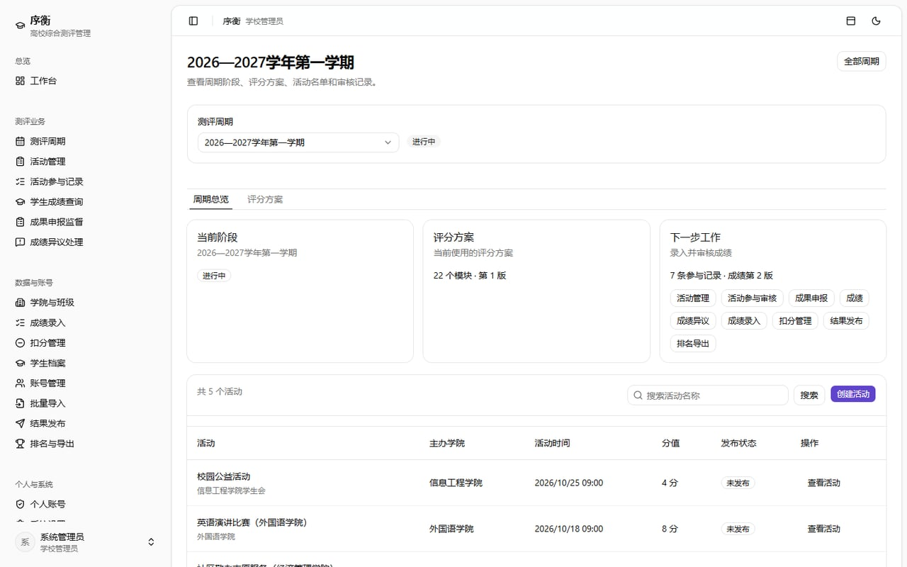

> 说明：这张截图对应“测评周期详情”的“周期总览”标签页，不是评分树编辑弹窗。它展示的是一个周期的阶段、方案版本、下一步工作和活动列表；评分方案的具体节点在“评分方案”标签中查看和配置。

**这张图看什么：**

- 页面标题是“2026—2027学年第一学期”，副标题说明可以查看周期阶段、评分方案、活动名单和审核记录；
- “当前阶段”卡片显示“进行中”；
- “评分方案”卡片显示“22 模块 · 第 1 版”；
- “下一步工作”卡片提示“录入并审核成绩”，副标题显示“7 条参与记录 · 成绩第 2 版”，下方给出活动管理、活动参与审核、成果申报、成绩、成绩异议、成绩录入、扣分管理、结果发布、排名导出等入口；
- 下方是活动列表，显示活动名称、主办学院、活动时间、分值、发布状态和操作；
- 活动状态有“未发布”，操作是“查看活动”，说明当前周期中活动可以先创建、后发布。

**这张图背后的业务：**

测评周期不是一个“学期名称”字段，而是整个系统的业务边界。一个周期包含：

- 当前阶段（配置中、进行中、结果核对、已锁定）；
- 一套评分方案；
- 一批活动；
- 一批成绩、扣分、申报和异议；
- 一次或多次结果发布；
- 一套组织范围和参评名单。

周期详情页把这些内容收在一个上下文里。管理员从工作台点进某个周期后，不会因为跳到“活动管理”而丢失周期；页面上的“下一步工作”也不是装饰，而是根据当前阶段和待办状态给出的真实入口。

**评分方案的“版本”是什么意思：**

评分方案是结构化的节点树，不是一张固定 Excel。节点可以配置名称、类型、权重、封顶分、折算比例、最低分、必填项和扣分项目。页面上的“第 N 版”对应周期修订号，周期发生受控变更时递增。发布结果时，系统会把当时的方案完整写入发布快照，之后即使方案继续调整，已经发布的那一版仍然按原方案解释。

截图中的“22 模块 · 第 1 版”是验收数据。它的意义不是“系统只能有 22 个模块”，而是说明方案由若干可配置模块组成，并且对应明确的周期修订号。

**活动列表为什么放在周期详情里：**

活动属于周期，活动的分值和计分节点必须与当前方案匹配。管理员在周期详情里可以直接看到“这个周期有哪些活动、是否发布、什么时候进行”，再进入活动详情维护名单和附件。活动状态“未发布”意味着学生端暂时看不到或不能参与；发布后才会出现在学生的活动入口中。

---

### 7.5 辅导员成绩录入：当前值和待审值分开

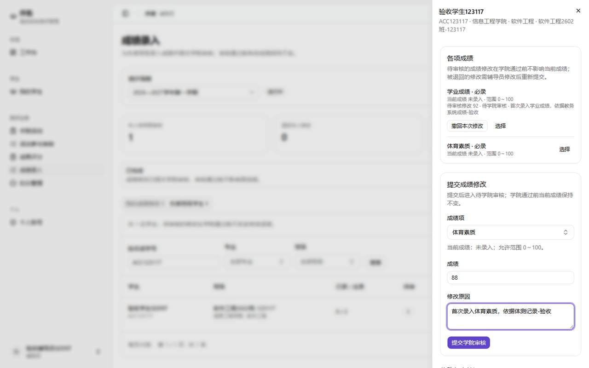

**这张图看什么：**

- 背景是辅导员的学生名单，右侧打开一个成绩提交抽屉；
- 抽屉顶部显示学生姓名、学号和班级；
- “各项成绩”区域列出：
  - 学业成绩（必录）：当前成绩“未录入”，范围 0～100，待审核修改“92 待学院审核”，首次录入学业成绩，依据教务系统成绩；
  - 体育素质（必录）：当前成绩“未录入”，范围 0～100；
- 下方“提交成绩修改”区域包含：
  - 成绩项：体育素质；
  - 当前成绩：未录入，允许范围 0～100；
  - 成绩：88；
  - 修改原因：首次录入体育素质，依据体测记录；
  - “提交学院审核”按钮；
- 页面上还有“撤回本次修改”和“选择”等操作。

**这张图最重要的业务点：当前成绩和待审成绩是两回事。**

辅导员提交 92 分后，页面仍然显示“当前成绩：未录入”，因为这笔修改还在“待学院审核”状态，尚未生效。只有学院审核通过，系统才会把 92 写入正式成绩输入，并递增输入版本。这样设计的意义是：

- 辅导员可以提交修改，但不能单方面改变已经生效的成绩；
- 学院可以在看到“当前值 → 修改值”和修改理由后作决定；
- 审核期间学生看到的仍是当前有效成绩，不会因为一笔未通过的修改而提前变化；
- 如果学院退回，辅导员会收到理由，可以修正后重新提交或放弃。

**“未录入”和“0 分”不是一回事。**

- “未录入”表示这个必录项没有值，计算时会导致结果不完整；
- “0 分”是一个明确的输入值，表示学生确实得了 0 分。

系统在数据层把空值和 0 分开处理，不能用空字符串或 0 互相代替。页面显示“必录”和允许范围，是为了让辅导员在提交前就知道这项不能跳过、分数必须落在规则范围内。

**为什么用右侧抽屉，而不是跳到新页面：**

辅导员通常要连续处理一个班的多个学生。抽屉保留左侧名单和当前学生上下文，提交后可以关闭抽屉继续下一个学生，不必反复进入列表、再返回。移动端会把抽屉转换为更适合窄屏的详情布局，避免表格横向滚动。

**提交时服务端还会检查什么：**

- 当前用户是否真的是该班的辅导员；
- 学生是否在本人负责范围内；
- 该成绩节点是否是可录入的叶子节点；
- 分数是否在方案允许的最小值和最大值之间；
- 同一学生同一成绩项是否已有待审修改；
- 客户端携带的修订号是否仍是最新；
- 当前周期是否处于允许录入的阶段。

页面上的“撤回本次修改”只对尚未被学院审核的修改有效；一旦学院通过，修改已经成为正式输入，不能通过撤回覆盖，后续更正必须走新的修改流程。所有提交、撤回、审核和生效都会写入审计。

---

### 7.6 学院成绩审核：只看本院，决定是否生效

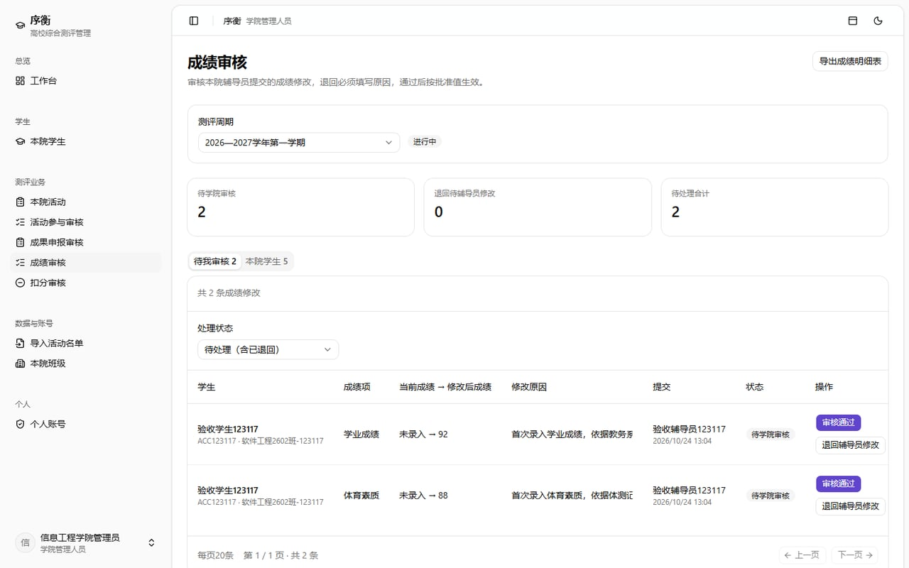

**这张图看什么：**

- 页面标题“成绩审核”，副标题写明“审核本院辅导员提交的成绩修改，退回必须填写原因，通过后按批准值生效”；
- 顶部统计：待学院审核 2、退回待辅导员修改 0、待处理合计 2；
- 标签显示“待我审核 2”“本院学生 5”；
- 处理状态筛选可以选择“待处理（含已退回）”等；
- 表格列包括：学生、成绩项、当前成绩 → 修改后成绩、修改原因、提交人/提交时间、状态、操作；
- 两行记录分别是：
  - 学业成绩：未录入 → 92，理由“首次录入学业成绩，依据教务系统成绩”，状态“待学院审核”；
  - 体育素质：未录入 → 88，理由“首次录入体育素质，依据体测记录”，状态“待学院审核”；
- 每行有“审核通过”和“退回辅导员修改”两个操作。

**这张图背后的两级审核：**

成绩不是辅导员提交后立刻生效，而是经过“辅导员提交 → 学院审核 → 生效”的两级流程。这样安排的原因是：

- 辅导员最了解班级情况，负责录入和说明依据；
- 学院负责跨班级、跨专业的口径一致性，确认分数和理由符合要求；
- 学院不直接改分，避免“既录入又审批”失去制衡；如果分数有问题，学院退回，由原辅导员修正后重新提交；
- 每一步都有提交人、审核人、时间和理由，出现问题可以追溯。

**“当前成绩 → 修改后成绩”为什么重要：**

审核人看到的不是孤立的“92 分”，而是“当前没有值，准备变成 92”。如果已有当前值，页面会显示“原值 → 新值”，审核人可以直接判断变化是否合理。系统还会记录这笔修改基于哪个输入版本，防止审核的是旧数据。

**退回为什么必须填理由：**

退回不是“拒绝”，而是把工作交回原提交人继续处理。没有理由，辅导员不知道要改什么，学生也无法得到解释。因此系统要求退回必须填写原因，并把状态改为“退回待辅导员修改”。辅导员可以修正后重新提交，也可以放弃这笔修改。

**学院能看到谁：**

学院管理人员只能看到本院学生的成绩修改。服务端会根据学院归属计算范围，而不是相信前端传入的学院 ID。跨院查询、跨院审核都会被拒绝，即使直接调用接口也不行。

**通过以后发生什么：**

学院点击“审核通过”后，系统在同一个事务中：

1. 再次检查这笔修改仍是待审核状态、修订号未变化；
2. 将批准值写入正式成绩输入（不存在则创建，存在则更新）；
3. 递增周期的输入版本 `inputRevision`；
4. 记录审核人、审核时间、审核意见；
5. 写入操作日志。

从这一刻起，新的成绩才会参与计算。学生如果已经看到旧结果，旧结果仍然对应旧发布版本；新成绩要在下一次发布或更正流程中才会形成新的正式结果。这个边界保证了“审核生效”和“结果发布”不会被混为一谈。

---

### 7.7 结果发布：检查、发布、确认、锁定

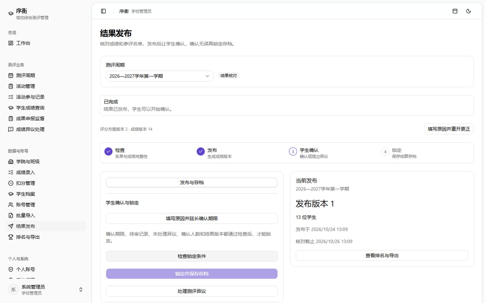

**这张图看什么：**

- 页面标题“结果发布”，副标题“核对成绩和参评名单，发布后让学生确认，确认无误再锁定存档”；
- 当前周期处于“结果核对”阶段；
- 顶部显示“已完成：结果已发布，学生可以开始确认”；
- 版本信息：“评分方案版本 2 · 成绩版本 14”；
- 四个步骤条：
  1. 检查：名单与成绩完整性；
  2. 发布：生成成绩版本；
  3. 学生确认：确认或提出异议；
  4. 锁定：保存结算存档；
- 左侧操作区包括“发布与存档”“填写原因并延长确认期限”“检查锁定条件”“锁定并保存存档”“处理测评异议”；
- 右侧“当前发布”卡片显示：
  - 发布版本 1；
  - 13 位学生；
  - 发布于 2026/10/24 13:09；
  - 核对截止 2026/10/26 13:09；
  - “查看排名与导出”入口。

**这张图背后的发布流程：**

结果发布不是把当前数据库中的分数直接展示给学生，而是一次有前置条件、有版本、有快照的操作：

1. **检查**：确认参评名单非空、没有待审或退回的申报/参与记录、所有必填成绩都已录入；
2. **发布**：为当前周期生成一个新的发布版本，写入每名学生的结果、结果哈希、评分方案快照、身份快照和输入版本；
3. **学生确认**：学生在核对截止时间前查看自己的结果，确认或提出异议；
4. **锁定**：在截止时间到达、确认完成、异议处理完毕、输入和方案版本未变化等条件满足后，生成结算快照并锁定周期。

截图中的状态是“检查完成、已经发布、正在等待学生确认”，所以发布步骤已完成，但锁定条件尚未满足。按钮是否可用取决于服务端实时检查，不是页面上画一个按钮就能跳过条件。

**为什么发布后不能直接改分：**

发布版本是成绩对外生效的边界。如果允许在发布后直接改数据库，学生昨天看到的分数和今天看到的分数会无法解释，排名、评奖和异议也会失去依据。因此系统把发布结果做成不可变版本：

- 发布版本有递增的序号；
- 每名学生的结果有结果哈希，学生确认时绑定这个哈希；
- 管理员不能在原版本上直接改分；
- 如果确实需要更正，必须填写理由、重开周期、重新审核和重新发布；
- 旧版本、旧确认、旧异议仍然保留，用于解释历史。

**“延长确认期限”为什么需要理由：**

核对截止时间不是普通表单字段，它影响学生是否还有机会确认或提出异议。延长必须说明原因并写入审计，避免为了赶进度随意压缩或延长时间。延长的是当前发布版本的核对窗口，不会改变已经发布的结果内容。

**锁定的意义：**

锁定不是“页面上的最后一步”，而是把一个周期的结果固定为结算存档：生成包含排名、结果、确认、异议、方案和发布信息的快照，并计算 SHA-256 摘要。之后即使数据库中的业务数据继续变化，也可以根据快照复核当时的结算状态。锁定条件包括：

- 周期处于结果核对阶段；
- 当前发布版本存在，且输入版本和评分方案没有变化；
- 核对截止时间已经到达；
- 需要确认的版本已完成确认；
- 没有未处理完毕的异议；
- 没有待审或待补充的申报/参与记录。

只要有一项不满足，系统就会列出阻断原因，而不是允许“带病锁定”。

---

### 7.8 学生成绩核对：看得懂，才能确认或异议

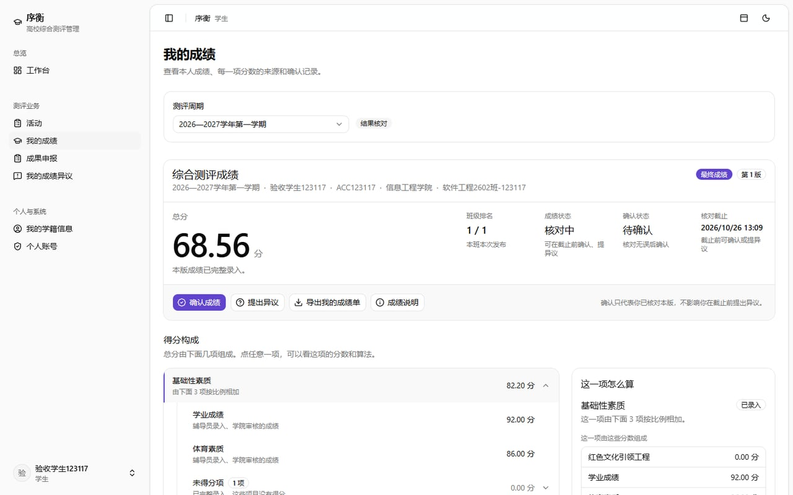

**这张图看什么：**

- 页面标题“我的成绩”，副标题“查看本人成绩、每一项分数的来源和确认记录”；
- 当前周期“2026—2027学年第一学期”，阶段“结果核对”；
- 成绩卡片显示：
  - 总分 **68.56 分**；
  - 班级排名 **1 / 1**；
  - 成绩状态“核对中”；
  - 确认状态“待确认”；
  - 核对截止 2026/10/26 13:09；
- 操作按钮包括“确认成绩”“提出异议”“导出我的成绩单”“成绩说明”；
- 右侧提示“确认只代表你已核对本版，不影响你在截止前提出异议”；
- 下方“得分构成”显示“基础性素质 82.20 分”，展开后可以看到学业成绩 92.00、体育素质 86.00、未得分项 0.00 等；
- 右侧“这一项怎么算”面板显示当前选中模块的计算说明和组成项。

> 注意：这张验收截图的总分是 68.56，第 5 章手算示例的 69.47 是另一组独立数据，两者不是同一个评分方案或同一组输入，不能用截图数字去校验手算示例。

**这张图背后的学生视角：**

学生最关心的不是系统有多少功能，而是三个问题：

1. **我得了多少分？**
2. **这个分是怎么来的？**
3. **我有没有看错，能不能提出疑问？**

页面把总分、排名、状态、截止时间和操作放在首屏；下方按评分树展开得分构成；右侧解释当前模块怎样由子项、权重、封顶、折算和扣分得到。学生不需要看到整个学校的评分规则，只需要看到与自己有关的节点和计算依据。

**“未得分项 0.00”说明了什么：**

截图中的“未得分项 1 项，0.00 分”不是因为缺数据，而是这一项本身没有得分，系统把它作为明确的 0 计入，并在页面上说明“已完整录入”。这与“未录入的必填项”不同：后者会让结果不完整，页面会显示缺失提示，而不是悄悄按 0 计算。

**确认和异议的区别：**

- **确认成绩**：学生表示“我已经看过这一版结果”。确认会绑定当前结果版本和结果哈希，但不会剥夺学生在截止时间前提出异议的权利；
- **提出异议**：学生认为某个结果项有问题，选择异议对象、填写理由并附上本人证明。异议绑定当前发布版本和结果哈希，防止针对旧版本提交；
- **换版后要重新确认**：如果管理员更正并发布了新版本，旧版本的确认不再代表新版本，学生需要重新核对；
- **截止后不能提交**：异议和确认都以核对截止时间为边界，服务端会再次检查，不能靠修改本地时间绕过。

**排名怎样显示：**

学生只能看到自己的排名信息，不能看到别人的成绩。截图中的“1 / 1”表示该验收数据中只有一名参评学生，因此排名是 1/1；实际数据中，排名按发布结果计算，同分采用并列名次，学号只用于稳定显示顺序，不用来改变同分学生的名次。

**导出自己的成绩单：**

“导出我的成绩单”只导出本人数据，范围由服务端根据当前会话确定，不能通过修改参数导出其他学生。导出内容来自当前发布版本，包含成绩构成和必要说明，便于学生保存或打印。

---

### 7.9 成绩导出：把结果变成可复核的 Excel

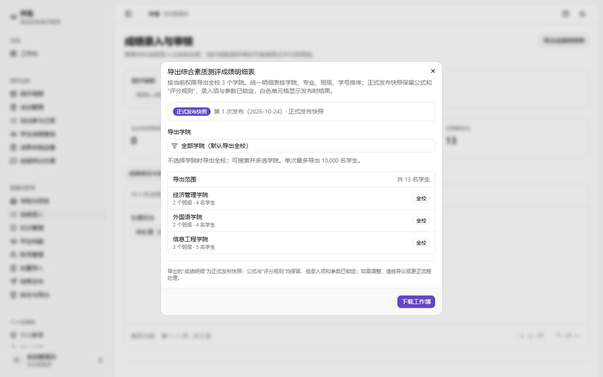

**这张图看什么：**

- 弹窗标题“导出综合素质测评成绩明细表”；
- 顶部说明：按当前权限导出全校 3 个学院；统一明细表按学院、专业、班级、学号排序；正式发布快照保留公式和“评分规则”；录入项与参数已锁定；白色单元格显示发布时结果；
- 当前选择“正式发布快照 · 第 1 次发布（2026-10-24）”；
- “导出学院”默认“全部学院（默认导出全校）”，支持搜索并多选；
- “导出范围”显示共 13 名学生，并按学院列出班级数、学生数：
  - 经济管理学院：2 个班级、4 名学生；
  - 外国语学院：2 个班级、4 名学生；
  - 信息工程学院：3 个班级、5 名学生；
- 说明“单次最多导出 10,000 名学生”；
- 底部按钮“下载工作簿”。

**为什么不直接导出一张普通表格：**

综合测评成绩不是单纯的“姓名 + 总分”。学校通常需要看到每个模块、每个子项、权重、原始分、封顶、折算、扣分和最终得分之间的计算关系。如果导出的只是最终数字，复核时无法解释；如果导出的公式和系统计算不一致，又会出现“系统一个数、Excel 另一个数”的问题。

系统的做法是：

1. 根据当前评分树生成列模型，而不是使用固定表头；
2. 叶子输入和参数写成数值，汇总、封顶、折算、比例和总分写成 Excel 公式；
3. 同时写入服务端计算的缓存值，打开文件就能看到结果，不必先重算；
4. 增加“评分规则”工作表，说明每个模块的类型、权重、范围、封顶、折算和扣分；
5. 正式发布导出使用发布快照，锁定输入项和参数；
6. 对工作表设置保护，保留公式但避免随意修改；
7. 按学院、专业、班级、学号排序，并在表头保留筛选和打印布局。

**“正式发布快照”与“当前阶段导出”的区别：**

- **正式发布快照**：用于对外报送、归档和复核。它冻结发布时的方案、输入和结果，公式仍然保留，但录入区和参数区受保护；即使当前数据库后续发生变化，导出的仍是那一版结果。
- **当前阶段导出**：用于过程核对和内部检查。它允许编辑录入格，用颜色区分录入区和计算区，便于工作人员在发布前检查数据。

截图中的导出对象是“第 1 次发布”的正式快照，因此导出的是已经对学生发布的那一版，而不是当前数据库中的临时状态。

**范围与权限：**

- 管理员可以按权限导出全校，也可以选择部分学院；
- 学院只能导出本院范围；
- 辅导员只能导出本人负责班级；
- 学生只能导出本人成绩单；
- 单次导出最多 10,000 名学生，超过上限会拒绝并提示缩小范围，避免一次性生成过大文件导致内存或浏览器失败。

范围筛选使用当前组织权限，成绩内容来自发布快照。这样既能按最新组织关系找到学生，又不会改变历史发布时的成绩字段。导出文件不包含登录凭据、证明附件正文或其他与成绩明细无关的隐私内容。

**为什么导出上限是 10,000 人：**

导出需要同时构建工作表、公式、缓存值、样式和压缩包。10,000 人是一个经过容量评估的边界：既能覆盖大多数高校单次导出需求，又能避免单个请求耗尽内存。超过上限时系统明确拒绝，而不是生成一个不完整或损坏的文件。发布时的单周期处理上限是 2,000 名学生，两个上限分别对应“计算与发布”和“文件导出”两种不同负载。

---

### 7.10 八张图怎样连成一条业务链

| 截图 | 输入 | 处理 | 输出 | 对应设计点 |
| --- | --- | --- | --- | --- |
| 统一登录 | 账号、密码、验证码、身份 | 认证、锁定、会话 | 角色化工作台 | 统一身份 + 服务端授权 |
| 管理员工作台 | 当前周期 | 汇总待办、分派入口 | 待办队列 | 以任务为中心的总览 |
| 周期详情 | 周期、方案、活动 | 阶段控制、方案版本 | 下一步工作 | 周期是业务边界 |
| 辅导员录入 | 学生、成绩项、分数、理由 | 提交待审修改 | 待学院审核 | 当前值/待审值分离 |
| 学院审核 | 待审修改 | 通过或退回 | 正式成绩、理由留痕 | 两级审核、职责分离 |
| 结果发布 | 完整输入、方案 | 检查、发布、确认、锁定 | 不可变发布版本、结算快照 | 版本化与冻结 |
| 学生成绩 | 本人发布结果 | 查看、确认、异议 | 确认记录、异议记录 | 可解释、可申诉 |
| 成绩导出 | 发布快照、导出范围 | 动态表头、公式、规则表 | Excel 工作簿 | 可复核交付 |

这八张图对应的不是八个孤立页面，而是同一条链路上的八个责任点：**身份 → 总览 → 周期 → 输入 → 审核 → 发布 → 核对 → 交付**。任何一个点缺少约束，后面的结果都不可信；系统通过状态机、修订号、两级审核、发布快照和审计把这条链路串起来。

## 第 8 章 测试与验收

### 8.1 测试策略：不是“点一遍页面”

综合测评系统的错误代价很高：一个成绩算错、一个学院看到别的学院数据、一次发布后还能改分，都会影响评奖评优的公平性。因此测试不能只靠人工点几条主流程，而要分成不同层次，分别回答不同问题：

| 层次 | 主要工具 | 回答的问题 | 本项目的做法 |
| --- | --- | --- | --- |
| 静态检查 | TypeScript、ESLint | 类型是否一致，代码是否有明显错误 | `tsc --noEmit` 全项目类型检查；ESLint 检查代码规范、未使用变量和常见 React/Next 问题 |
| 集成测试 | Vitest + 真实 PostgreSQL | 服务端业务规则、数据库约束、事务和权限是否按预期工作 | 每次创建临时数据库，执行全部迁移，运行 33 个测试文件、152 项测试，结束后删除临时库 |
| 浏览器场景 | Playwright | 真实页面上的跳转、表单、下载、响应式布局是否可用 | 登录、活动结束、导入入口、快速评分方案、学生成绩、角色页面巡检等 12 个场景 |
| 角色验收 | 独立验收环境 + 截图 | 四类角色能否在真实业务链路上完成各自工作 | 114 个唯一用例、125 次执行、85 张截图，覆盖正常、异常和越权场景 |
| 部署冒烟 | HTTP 检查、Docker 健康检查 | 镜像能否启动，数据库能否连接，迁移是否完成，登录是否可达 | 生产 standalone 构建、`/api/health/live`、`/api/health/ready`、登录页和认证接口检查 |

这五层不是互相替代，而是互相补足：静态检查发现不了数据库约束问题，集成测试发现不了页面布局问题，浏览器场景覆盖不了所有权限组合，角色验收不能替代真实部署检查。

**测试命令：**

```bash
npm run typecheck   # 类型检查
npm run lint        # ESLint
npm test            # 集成测试，自动创建临时数据库并执行迁移
npm run test:e2e    # Playwright 浏览器场景
npm run build       # 生产构建，同时生成 standalone 输出
```

`npm test` 不是简单的单元测试脚本。它由 [`scripts/test-integration.ts`](../../scripts/test-integration.ts) 驱动：

1. 读取本地测试数据库连接；
2. 确认主机是 `127.0.0.1`，拒绝连接外部数据库；
3. 创建名为 `campus_test_<随机串>` 的临时数据库；
4. 在临时库上执行 Prisma 迁移；
5. 运行 Vitest；
6. 无论成功还是失败，最后删除临时数据库。

这样测试不会写入开发库或真实库，也不会因为上一次测试残留数据而出现“这次刚好通过”的假象。

---

### 8.2 测试数据隔离：真实库不参与验收

本项目对数据库隔离有明确要求：

| 环境 | 用途 | 处理原则 |
| --- | --- | --- |
| 开发库 `127.0.0.1:55432/campus_dev` | 日常开发数据 | 验收和自动化测试不连接、不迁移、不清空、不写入 |
| 隔离验收库 `127.0.0.1:55433` | 2026-10-24 角色验收 | 独立集群、独立端口、独立数据目录，使用虚构数据和测试账号 |
| 临时测试库 `campus_test_*` | 集成测试 | 每次运行临时创建，迁移后执行测试，结束后删除 |

隔离不是一句说明，而是通过启动参数和脚本约束落实的：

- 测试运行器只允许本地地址，避免误连远程库；
- 集成测试只操作自己创建的临时库；
- 验收使用独立端口和独立数据目录，不启动开发集群；
- 测试账号、密码、连接串只放在被 Git 忽略的本地文件或环境变量中，不写入报告、不提交仓库；
- 验收截图使用虚构姓名、学号、学院和成绩，不包含真实学生材料。

这套隔离方式的价值在于：**测试可以大胆造数据、造异常、造越权请求，而不会污染真实业务数据。** 对一个涉及成绩和评奖的系统来说，这是测试能够可信的前提。

---

### 8.3 验收覆盖了什么

2026-10-24 的角色验收按四类角色组织，覆盖登录、组织、账号、活动、申报、成绩、扣分、发布、异议、排名、导出、导入和异常权限等场景。代表性覆盖如下：

| 业务域 | 代表性场景 | 关键断言 |
| --- | --- | --- |
| 认证 | 正确登录、错误密码、验证码错误、账号停用、身份不匹配、首次改密 | 不泄露具体失败原因；错误身份被拒绝；会话可撤销；停用后旧会话失效 |
| 权限 | 学生调用管理员接口、学院跨院导出、辅导员访问非本人班级、未登录访问受限页 | 返回 403 或重定向；不返回其他组织数据；前端绕过无效 |
| 组织与账号 | 学院—专业—班级维护、账号创建、停用、重置密码、重复账号处置 | 引用中的组织不能被随意删除；账号操作递增会话版本；范围校验生效 |
| 周期与方案 | 创建周期、复制方案、阶段切换、非法方案校验、快照与恢复 | 无环、无游离、权重合计为 1、封顶/折算/最低分合法；非法方案被拒绝 |
| 活动与参与 | 活动发布、三种受众范围、名单导入、参与审核、活动结束/重开 | 受众只能三选一；名单和附件受权限保护；结束后学生入口隐藏但记录保留 |
| 成果申报 | 学生提交、辅导员评分、学院终审、退回、重评、放弃、撤销 | 学生不能自报分数；辅导员必须选择合法计分模块；学院不能跳过辅导员；退回有理由 |
| 成绩与扣分 | 辅导员提交、学院审核、退回重提、撤回、扣分撤销 | 审核前当前值不变；通过后写入正式输入；空值不等于 0；并发旧修订返回 409 |
| 发布与异议 | 完整性检查、发布、学生确认、异议、处理、重开、锁定 | 发布必须有快照；确认绑定哈希；异议只针对当前版本；锁定条件逐项检查 |
| 排名与导出 | 全校排名、学院筛选、班级导出、学生本人导出 | 排名只在发布结果上计算；范围受限；Excel 公式与系统结果一致；超过上限被拒绝 |
| 导入 | 账号、名单、成绩导入的预览、提交、过期、撤销 | 预览不写业务数据；提交原子化；同一请求幂等；撤销保留历史 |
| 运维 | 操作日志查询/导出/清理、数据库备份、上传、恢复预检、附件导出 | 敏感操作有审计；恢复前有维护模式；失败可回滚；附件与数据库边界清楚 |

验收不仅测“正常能完成”，也测“异常不能绕过”。例如：

- 学生直接调用管理接口，必须被服务端拒绝，而不是只把按钮藏起来；
- 学院修改成其他学院的学生 ID，必须返回 403 或空结果；
- 辅导员提交非本人班级的学生，必须被拒绝；
- 使用过期的修订号提交，必须返回 409，不能覆盖新值；
- 在核对截止后提交确认或异议，必须被拒绝；
- 在发布条件未满足时点击发布，必须列出阻断原因；
- 在锁定条件未满足时锁定，必须失败，不能生成不完整快照。

---

### 8.4 验收中发现并修复的缺陷

这轮验收最终 **114 个唯一用例全部通过**，但过程中发现了 3 个真实产品缺陷。它们不是测试脚本问题，而是用户实际操作会遇到的错误。把它们写进报告，是因为“发现问题—定位根因—修复—回归”比“全部通过”更能说明测试是否真实。

| 编号 | 现象 | 根因 | 修复 | 回归 |
| --- | --- | --- | --- | --- |
| D1 | 辅导员通过页面提交成绩或扣分时，请求体同时携带路由用 `termId`，服务端严格校验把它当成伪造字段，提交流程报错 | 提交函数把整个请求体直接交给 `.strict()` schema，没有区分“路由上下文字段”和“业务字段” | 在严格校验前只剥离 `termId`，其余未知字段仍然拒绝，保持防伪造能力 | 成绩、扣分提交和审核链路重新执行，全部通过 |
| D2 | 新增扣分提交成功后，页面出现 `Cannot read properties of null (reading 'reset')`，表单状态没有正确重置 | `form.reset()` 在 `await` 之后调用，此时 React 合成事件的 `event.currentTarget` 已经变成 `null` | 在提交前捕获表单元素；只在成功结果返回后重置，并刷新扣分项目下拉 | 类型检查、Lint、集成测试、生产构建通过；验收周期已进入核对阶段，新增扣分表单不再显示，因此无法在 UI 重放，已如实记录 |
| D3 | 学生已经确认成绩，页面底部仍显示“本版不要求确认”，与顶部状态矛盾 | 底部说明没有根据确认记录区分“已确认”和“确实无需确认” | 根据确认记录返回“本版已确认，如有疑问可在截止前提出异议”；确实无需确认时才显示“不要求确认” | 类型检查、Lint、构建通过；确认状态已固定，未再单独重放 UI 文案切换，已如实记录 |

**D1 的启示：** 严格校验本身是对的，问题在于边界没有分清。系统既要拒绝客户端伪造 `termId`、`projectId`、`score` 等字段，又要允许路由上下文合法传递 `termId`。修复不是“放宽校验”，而是“在正确的边界做正确的剥离”。

**D2 的启示：** 前端错误不一定表现为页面崩溃，也可能只是一个未处理的 Promise 拒绝。用户看到的是“提交成功但表单没清空”，开发者看到的是控制台异常。验收时同时检查服务端日志和浏览器控制台，才能发现这类问题。

**D3 的启示：** 状态展示必须和真实记录一致。页面上“待确认”“已确认”“不要求确认”是三种不同含义，不能用同一句文案兜底。对成绩确认这种敏感操作，文案错误会直接影响学生是否再次操作。

此外，验收中还有 9 次初次执行失败，原因是测试脚本的标题定位、字段名断言、Excel 解析结构、移动端隐藏元素等待和 SQL 字段名不一致。这些问题修正的是测试代码，不计为产品缺陷；把它们和产品缺陷分开记录，是为了避免夸大或掩盖问题。

---

### 8.5 质量门禁与最终结果

需要区分两个时间点：2026-10-24 角色验收当日的测试门禁是 **29 个文件、133 项测试**；验收之后补充了操作日志、数据库备份恢复和附件管理，到 v0.3.1 发布前的门禁提升为 **33 个文件、152 项测试**。本报告采用最终发布版本的数据。

v0.3.1 发布前的自动化质量门禁结果：

| 检查 | 结果 |
| --- | --- |
| 集成测试 | 33 个测试文件、152 项测试全部通过，耗时约 62.57 秒 |
| 类型检查 | `tsc --noEmit` 退出码 0 |
| Lint | ESLint 退出码 0 |
| 生产构建 | `next build` 退出码 0，standalone 输出和静态资源同步完成 |
| 角色验收 | 114 个唯一用例全部 PASS；125 次执行；3 个产品缺陷修复并回归 |
| 验收截图 | 85 张 PNG，1440×900，按角色、功能、场景编号归档 |
| 部署冒烟 | `/api/health/live`、`/api/health/ready`、`/login` 返回 200；应用容器 healthy；数据库迁移 27 → 28 |

**关于“全部通过”的正确理解：**

“114 个用例全部通过”表示这 114 个场景在当前代码和数据下符合预期，不表示系统没有缺陷。测试的价值在于：

- 把关键业务规则固化成可重复执行的断言；
- 把越权、并发、过期、重复提交等异常变成可验证的场景；
- 在修改代码后快速发现回归；
- 把“口头说没问题”变成可以复查的证据。

验收期间服务端日志没有出现 5xx；出现的 4 条 `destination stream errored while writing data` 来自浏览器导航或下载中断，不是业务请求失败。这个区分很重要：日志里出现错误字样，不等于业务失败，必须结合请求上下文判断。

---

### 8.6 备份恢复演练

除了业务功能，系统还验证了数据库备份和恢复能力。恢复不是“把 SQL 文件导回去”这么简单，因为恢复期间如果有用户继续写入，会出现一半旧数据、一半新数据的混合状态。系统采用以下流程：

1. 管理员创建数据库备份，或上传已有备份文件；
2. 上传采用分块方式，单块 16 MB，避免大文件一次性占用内存；
3. 恢复前先做预检：检查文件格式、数据库连接、目标库状态和必要空间；
4. 进入维护模式，阻止新的业务写入；
5. 将备份恢复到候选数据库，而不是直接覆盖当前库；
6. 预检候选库的表结构、关键数据和迁移状态；
7. 通过原子切换把应用指向候选库；
8. 如果切换失败，回滚到原数据库；
9. 恢复完成后使旧会话失效，要求重新登录；
10. 全过程写入审计，记录操作者、备份文件、结果和时间。

系统还设置了恢复保护：如果上一次恢复没有完成，应用启动时会进入维护模式，不自动执行迁移或初始化管理员，避免在不确定的数据库状态上继续写入。这个保护逻辑位于 [`docker/restore-guard.cjs`](../../docker/restore-guard.cjs) 和恢复相关服务中。

**备份的边界：**

数据库备份不包含证明和活动附件的二进制文件。附件通过独立的私有卷保存，附件管理页面可以按范围导出 ZIP。这样设计的原因是：

- 数据库备份可以更小、更快，恢复数据库不必等待大量文件；
- 附件文件有自己的生命周期和权限，不应该混在 SQL 备份里；
- 灾难恢复时需要同时准备数据库备份和附件备份，两者缺一不可。

这个边界必须在运维文档和答辩中讲清楚，不能把“数据库备份成功”说成“所有数据都已备份”。

---

### 8.7 测试的已知限制

诚实地说明测试没有覆盖什么，和说明测试通过了什么同样重要：

1. **没有做万人并发压测。** 系统按单周期 2,000 名学生发布、单次 10,000 名学生导出设计了容量边界，并验证了边界拒绝行为，但这不等于在真实全校规模下做过并发压力测试。
2. **没有做正式渗透测试。** 系统做了角色越权、对象归属、会话撤销、文件访问、公式注入等场景检查，但没有委托第三方安全机构做完整渗透测试。
3. **验收数据规模较小。** 截图中的验收周期只有 13 名学生，适合验证流程和边界，不代表真实全校的数据分布；真实规模的性能需要用生产数据或压测数据评估。
4. **D2、D3 修复后没有 UI 重放。** 验收周期已经进入核对阶段，扣分新增表单不再显示、确认状态已经固定，因此这两项只做了代码核对、类型检查、Lint、集成测试和构建验证，没有声称完成 UI 重放。
5. **截图是功能验收视口，不是最终视觉验收。** 85 张截图用于证明功能和状态，间距、字体、颜色、信息层级和真实窗口下的视觉判断仍需使用者自行验收。
6. **自动化不能证明“没有缺陷”。** 它只能证明已覆盖的场景通过；未覆盖的业务组合、极端数据和外部环境变化仍可能暴露问题。

把这些限制写进报告，不是降低项目评价，而是让答辩时的结论更可信：**系统在当前范围内经过了可重复的验证，但仍有明确的边界和后续工作。**

---

## 第 9 章 部署与运维

### 9.1 部署拓扑

系统按“单所学校、一套应用、一套数据库”的方式部署。生产环境通过反向代理提供 HTTPS，应用容器只监听本机回环地址，数据库不对外暴露端口。

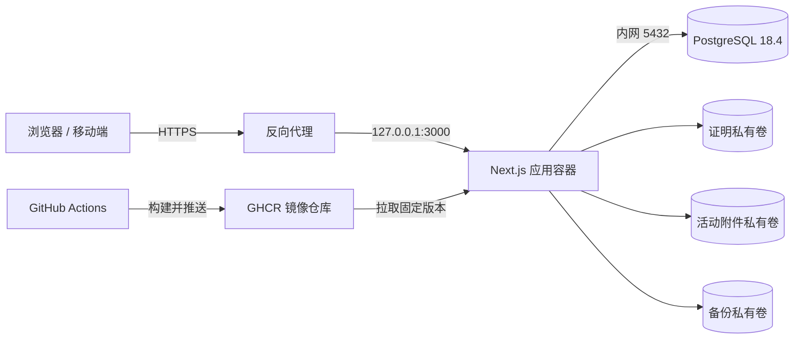

这个拓扑有几个关键点：

- **数据库不暴露公网端口**：只有应用容器能通过内部网络访问数据库；
- **应用只绑定回环地址**：外部请求必须经过反向代理，便于统一 TLS、访问日志和限流；
- **私有文件放在卷里**：证明、活动附件和备份不放在应用镜像或 `public/` 目录；
- **镜像来自镜像仓库**：服务器不现场编译代码，而是拉取 GitHub Actions 构建好的固定版本镜像；
- **应用和数据库分离**：更新应用时可以只重建应用容器，不重启数据库。

### 9.2 镜像构建

镜像使用多阶段构建（[`Dockerfile`](../../Dockerfile)）：

| 阶段 | 作用 | 关键点 |
| --- | --- | --- |
| `deps` | 安装依赖 | 只复制 `package.json` 和锁文件，执行 `npm ci`，利用 Docker 层缓存 |
| `builder` | 生成 Prisma Client、执行 `next build` | 使用构建期占位环境变量，不写入真实密钥；输出 standalone 和静态资源 |
| `runner` | 生产运行 | 只保留运行所需文件；非 root 用户；安装 PostgreSQL 客户端用于备份恢复；配置健康检查 |

运行镜像的关键设置：

- 基础镜像为 Node.js 24 Debian slim；
- 使用 Next.js standalone 输出，避免把完整源码和开发依赖带入生产；
- 安装 `postgresql-client-18`，用于数据库备份和恢复；
- 全局安装固定版本的 Prisma CLI 和 bcryptjs，供容器启动脚本使用；
- 创建 UID/GID 1001 的 `nextjs` 用户，应用不以 root 运行；
- 数据目录 `/data/evidence`、`/data/activity-attachments`、`/data/backups` 归应用用户所有，备份目录权限为 `0700`；
- 使用 `dumb-init` 作为入口，正确处理信号和子进程；
- 定义 `HEALTHCHECK`，定期访问 `/api/health/ready`；
- 使用 `SIGTERM` 停止信号，配合 `stop_grace_period` 优雅退出。

**构建期占位变量不是密钥。** Dockerfile 中出现的数据库 URL、NextAuth URL 和 secret 只是为了让 `next build` 能完成，构建产物运行时会被真实环境变量覆盖；真实凭据不会写进镜像层。

### 9.3 容器编排与运行保护

[`compose.yaml`](../../compose.yaml) 定义两个服务：

**数据库服务 `db`：**

- 镜像 `postgres:18.4-bookworm`；
- 数据保存在命名卷 `db-data`；
- 使用 UTF-8 编码；
- 配置 `pg_isready` 健康检查；
- 只加入内部 `backend` 网络，不发布端口；
- 设置 `no-new-privileges`；
- 日志按 10 MB × 3 个文件轮转。

**应用服务 `app`：**

- 镜像来自 `APP_IMAGE`，默认 GHCR 地址；
- 依赖数据库健康后再启动；
- 端口绑定在 `127.0.0.1:3000`，由反向代理对外；
- 挂载证明、活动附件和备份三个命名卷；
- 配置数据库连接、认证地址、认证密钥、迁移开关、管理员初始化、可信来源和反向代理信任；
- `cap_drop: ALL`，移除 Linux capabilities；
- `no-new-privileges:true`；
- 健康检查访问 `/api/health/ready`；
- 日志轮转和优雅停止时间。

**为什么数据库不发布端口：**

如果 PostgreSQL 直接暴露公网，攻击者可以绕过应用层直接尝试数据库认证；即使数据库密码很强，也增加了暴露面。把数据库放在内部网络，只允许应用访问，是最简单也最有效的边界。

### 9.4 配置与密钥

系统运行需要以下配置（这里只列名称和用途，不列真实值）：

| 配置 | 用途 | 处理原则 |
| --- | --- | --- |
| `DATABASE_URL` | 应用连接 PostgreSQL | 通过环境变量注入，不写入镜像和仓库 |
| `POSTGRES_DB` / `POSTGRES_USER` / `POSTGRES_PASSWORD` | 数据库初始化 | 通过本地 `.env.docker` 或部署环境注入 |
| `NEXTAUTH_URL` | 认证回调地址 | 与对外访问地址一致 |
| `NEXTAUTH_SECRET` | 会话签名、验证码和结算令牌签名 | 使用足够长的随机值，不提交、不打印 |
| `APP_TRUSTED_ORIGINS` | 允许的可信来源 | 按实际域名配置，避免开放过多来源 |
| `TRUST_PROXY` | 是否信任反向代理头 | 仅在确实位于反向代理后时开启 |
| `RUN_MIGRATIONS` | 启动时是否执行迁移 | 正常为 `true`；恢复未完成时由保护逻辑阻止 |
| `BOOTSTRAP_ADMIN_*` | 首次初始化管理员 | 只在需要时临时设置，初始化后移除 |

**密钥管理的原则：**

- 真实密码、数据库连接串、会话密钥和部署密钥不写入报告、不提交 Git、不出现在截图；
- `.local/` 目录和本地环境文件被 Git 忽略；
- CI 使用 CI 专用临时密钥，生产使用独立密钥；
- 备份文件包含数据库内容，必须按敏感数据管理，不能随意下载或转发；
- 日志中不记录密码、验证码答案、会话令牌和完整连接串。

### 9.5 持续集成与镜像发布

项目有两个 GitHub Actions 工作流：

**CI（[`.github/workflows/ci.yml`](../../.github/workflows/ci.yml)）：**

- 触发：推送到 `main`、Pull Request、手动触发；
- 运行环境：Ubuntu 24.04，Node.js 24，PostgreSQL 18.4 服务容器；
- 步骤：安装依赖 → 生成 Prisma Client → 类型检查 → Lint → 集成测试 → 生产构建；
- 同一分支的旧运行会被取消，避免重复占用资源；
- 任何一步失败，工作流失败，应在修复并重新通过 CI 后再打标签发布镜像。

**镜像发布（[`.github/workflows/docker-publish.yml`](../../.github/workflows/docker-publish.yml)）：**

- 触发：推送 `main`、推送 `v*` 标签、手动触发；
- 使用 Docker Buildx 构建 `linux/amd64` 和 `linux/arm64` 多架构镜像；
- 推送到 GHCR；
- 标签包括语义化版本、主次版本、分支、短 SHA，正式标签额外生成 `latest`；
- 使用 GitHub Actions 缓存加速；
- 生成 provenance 和 SBOM，便于追溯镜像来源和依赖组成；
- 额外导出一份 amd64 离线镜像 tar.gz 和 SHA-256 校验文件，保留 14 天，供无法直接拉取镜像的环境使用。

**为什么镜像只从 Actions 发布：**

服务器现场构建会受到 Node 版本、系统库、网络和缓存影响，容易出现“这台机器能构建，那台机器不能”的问题。由 Actions 统一构建、测试、打标签，服务器只负责拉取固定版本，可以保证开发、验收和生产使用同一份产物。

### 9.6 v0.3.1 的发布与部署结果

v0.3.1 是本报告对应的版本，发布过程如下：

| 步骤 | 结果 |
| --- | --- |
| 提交与标签 | 提交 `72b22db`，标签 `v0.3.1` |
| CI | 运行成功，类型检查、Lint、集成测试、生产构建全部通过 |
| 镜像发布 | `v0.3.1` 和 `main` 的镜像构建成功，多架构镜像推送到 GHCR |
| 服务器更新 | 只重建应用容器到 0.3.1，数据库容器和原有数据卷未动 |
| 数据库迁移 | 迁移数量从 27 增加到 28，启动时自动执行 |
| 健康检查 | 应用容器 `healthy`；`/api/health/live`、`/api/health/ready`、`/login` 返回 200 |
| 线上资源 | 公开品牌资源保留长缓存头；未引用资源返回 404 且不缓存 |

这次发布同时上线了 0.3.0 完成的操作日志、数据库备份恢复和附件管理功能。发布采用“固定标签 + 只更新应用容器”的方式，没有重启数据库，也没有修改其他 Compose 项目或反向代理配置。

**应用只更新、数据库不动的原因：**

- 数据库容器重启会中断所有连接，增加恢复风险；
- 数据卷是持久化资产，不应该因为应用版本变化而重建；
- 迁移由应用启动入口执行，先等待数据库就绪，再执行 `prisma migrate deploy`；
- 如果迁移失败，应用不会进入正常服务状态，健康检查会失败，便于回滚。

**回滚方式：**

如果新版本应用出现问题，可以把 `APP_IMAGE` 切回上一个固定标签，重新创建应用容器。数据库迁移采用向前兼容的增量方式；如果迁移本身不可回退，则使用发布前的数据库备份恢复。回滚不是“重新构建”，而是“切回已知可用的镜像和必要的数据快照”。

### 9.7 健康检查：活着不等于可用

系统有两个健康端点：

| 端点 | 检查内容 | 用途 |
| --- | --- | --- |
| `/api/health/live` | 进程能否响应请求 | 判断应用是否存活；不检查数据库，避免数据库短暂抖动导致容器被误杀 |
| `/api/health/ready` | 执行 `SELECT 1`、查询用户表、检查是否有未完成的迁移 | 判断应用是否可以接收业务流量 |

`ready` 端点如果数据库不可用、用户表不可查或存在未完成迁移，会返回 503 `not_ready`，并设置 `Cache-Control: no-store`。Docker 健康检查每 30 秒访问一次，启动宽限期 90 秒，连续失败 3 次标记为 unhealthy；Compose 中应用依赖数据库健康后再启动。

**为什么区分 live 和 ready：**

- 如果 live 也检查数据库，数据库短暂不可用时容器会被重启，但重启并不能修复数据库，反而增加抖动；
- 如果 ready 只检查进程，容器可能已经连不上数据库却仍然接收请求，用户会看到大量 500；
- 分开以后，编排系统可以判断“进程还活着但暂时不能服务”，为恢复和流量切换留出空间。

### 9.8 备份与恢复

系统提供管理员使用的数据库备份和恢复能力：

**备份：**

- 管理员可以创建数据库备份，也可以上传已有备份文件；
- 上传采用分块方式，单块 16 MB，避免大文件一次性占用内存；
- 备份文件保存在私有卷，权限受限；
- 支持下载、保留和清理；
- 备份记录写入审计，包含操作者、时间、文件大小和结果。

**恢复：**

1. 选择备份文件，执行恢复预检；
2. 预检检查文件、数据库连接、目标状态和必要空间；
3. 进入维护模式，停止接受新的业务写入；
4. 将备份恢复到候选数据库；
5. 检查候选库的表结构、迁移状态和关键数据；
6. 原子切换到候选库；
7. 失败则回滚到原数据库；
8. 成功则使旧会话失效，要求用户重新登录；
9. 记录恢复结果和操作者。

**恢复保护：**

如果上次恢复没有完成，应用启动时会检测恢复状态并进入维护模式，不执行迁移和初始化管理员。这可以避免在“恢复了一半”的数据库上继续写入，导致数据状态更复杂。

**备份边界：**

数据库备份不包含证明和活动附件的二进制文件；附件需要通过附件管理单独导出。完整的灾难恢复方案需要同时管理数据库备份、附件备份和配置/密钥，三者缺一不可。

### 9.9 日志、审计与日常运维

系统把“操作日志”作为独立能力，而不是只依赖容器日志：

- 记录操作者、角色、动作、对象、结果、时间、请求 ID、路由、方法、IP 和 User-Agent；
- 对登录成功/失败、账号变更、成绩审核、扣分、发布、异议、锁定、重开、备份恢复等关键动作写入审计；
- 支持按时间、操作者、动作、结果等条件查询；
- 支持导出 CSV，便于检查和归档；
- 支持按保留策略清理过期日志；
- 审计写入与业务写入在同一事务中，避免“业务成功但日志丢失”。

**日常运维关注点：**

| 项目 | 关注内容 |
| --- | --- |
| 健康检查 | `live` 和 `ready` 是否正常，数据库连接是否稳定 |
| 磁盘 | 数据库卷、证明卷、附件卷、备份卷的剩余空间 |
| 日志 | 认证失败、5xx、备份/恢复、迁移异常 |
| 备份 | 最近一次成功备份时间、备份文件可读性、恢复演练 |
| 账号 | 离校或调岗账号及时停用，管理员账号最小化 |
| 版本 | 镜像标签、迁移版本、应用版本是否一致 |
| 附件 | 孤儿文件、超大附件、未引用资源清理 |

**维护模式：**

恢复、重大迁移或紧急维护时，系统可以进入维护模式，向前端返回维护提示，阻止业务写入。维护模式不是简单地把页面藏起来，而是由服务端统一控制，避免用户通过直接调用接口绕过。

### 9.10 交付状态

| 项目 | 状态 |
| --- | --- |
| 代码仓库 | 私有 GitHub 仓库，主分支 `main` |
| 版本 | v0.3.1 |
| 在线演示 | `https://demo.spacedo.org` |
| 数据库迁移 | 28 个迁移，启动时自动执行 |
| 容器镜像 | GHCR 多架构镜像，固定标签发布 |
| 部署方式 | Docker Compose，应用 + PostgreSQL，私有卷 |
| 健康检查 | live / ready 两个端点，容器健康检查 |
| 备份恢复 | 创建、上传、下载、预检、维护模式、原子切换、回滚 |
| 已知边界 | 单学校部署；备份不含附件文件；导出单次最多 10,000 人；发布单周期最多 2,000 人 |

## 第 10 章 项目特点与工程亮点

### 10.1 把“规则、输入、结果”分成三层

很多成绩管理系统把评分公式直接写在代码里，或者把最终结果和原始分数放在同一张表。这样做短期省事，长期会带来三个问题：

- 规则一改，历史结果无法解释；
- 原始分数被覆盖后，不知道总分是怎么来的；
- 发布后仍能改数据，学生看到的成绩不稳定。

本项目把数据分成三层：

| 层次 | 内容 | 特点 |
| --- | --- | --- |
| 规则层 | 评分方案：节点、类型、权重、封顶、折算、最低分、必填、扣分项目 | 按周期配置，有版本；发布时冻结到快照 |
| 输入层 | 学业成绩、体育成绩、活动参与、个人申报、扣分 | 独立审核，记录来源、修订和审计；未审核的修改不生效 |
| 结果层 | 计算结果、发布版本、学生确认、异议、结算快照 | 发布后不可变；更正必须产生新版本 |

三层分开以后，系统可以回答三类不同的问题：

- “按照当时的规则，这个分应该怎么算？”——查规则和计算明细；
- “这个原始分是谁录的、什么时候审的、依据是什么？”——查输入和审核记录；
- “学生当时看到的是哪一版、有没有确认、有没有异议？”——查发布版本和确认/异议记录。

这也是系统能够支持“更正但不覆盖历史”的基础。

### 10.2 精确计算：为什么不用普通浮点数

JavaScript 的 `number` 使用二进制浮点数，无法精确表示很多十进制小数。例如：

```js
0.1 + 0.2 // 0.30000000000000004
```

在单次计算中，这个误差很小；但综合测评会反复做加法、乘法、除法、封顶、折算和扣分，误差可能累积，最后出现“系统算 89.99，手工算 90.00”的情况。对评奖评优来说，0.01 分的差异也可能影响排名。

本项目使用自己实现的 `Rational` 有理数类型（[`src/lib/scoring/rational.ts`](../../src/lib/scoring/rational.ts)）：

- 用 BigInt 保存分子和分母；
- 从十进制字符串解析，不经过二进制浮点；
- 支持加、减、乘、除、比较；
- 在最终输出时按“四舍五入到两位小数”格式化；
- 中间计算保持精确，不提前舍入。

评分引擎（[`src/lib/scoring/calculate.ts`](../../src/lib/scoring/calculate.ts)）按“从叶子到根”的顺序计算：

1. 叶子节点读取原始输入；
2. 汇总节点把子节点分数按权重相加；
3. 应用封顶；
4. 应用折算（原始满分 → 目标满分）；
5. 减去扣分；
6. 应用最低分；
7. 把结果作为父节点的输入，继续向上；
8. 根节点得到总分。

每个节点都会输出明细：原始汇总值、封顶后、折算后、扣分、最低分前、最终分数、父节点贡献。这样不仅得到总分，还能解释每一步。

**必填缺失的处理：**

如果某个必填叶子没有输入，系统不会把它当成 0，而是：

- 标记该节点不完整；
- 把缺失项加入 `missing` 列表；
- 总分 `total` 为 `null`；
- 仍然计算一个 `provisionalTotal`（暂计分），供预览和排查使用；
- 页面显示“暂计成绩”和缺项，而不是给出一个看似正式的总分。

这个设计避免了“缺一项就按 0 算”的隐蔽错误，也让学生和审核人能看到到底缺什么。

### 10.3 并发与一致性：多个管理员同时操作怎么办

成绩发布、审核、导入和更正都可能被多人同时操作。如果只靠页面提示“请勿重复提交”，无法阻止两个浏览器同时提交。系统使用多种机制组合：

| 机制 | 解决的问题 | 具体做法 |
| --- | --- | --- |
| 数据库事务 | 业务写入和审计必须一起成功或一起失败 | 关键操作在事务中完成；任一步失败全部回滚 |
| 咨询锁 | 同一周期的并发写入互相覆盖 | `termTransaction` 获取周期锁；账号管理获取账号锁 |
| 修订号 `revision` | 客户端基于旧数据提交 | 每次修改递增；客户端必须携带当前修订号；不匹配返回 409 |
| 输入版本 `inputRevision` | 发布后输入又变化 | 成绩、扣分、申报等影响计算的变更递增输入版本；发布和锁定检查版本一致 |
| 幂等请求 ID `requestId` | 网络重试导致重复发布/导入 | 同一请求 ID 返回原结果，不重复写入 |
| 流程令牌 | 预检后业务状态变化 | 发布/结算预检生成令牌，绑定操作者、周期和预检内容；状态变化则令牌失效 |
| 唯一约束 | 同一对象重复记录 | 数据库唯一索引作为最后一道防线，例如同一活动同一学生、同一发布同一学生 |
| 审计同事务 | 业务成功但日志丢失 | 审计写入与业务写入在同一事务中完成 |

**一个典型的并发场景：**

1. 管理员 A 打开成绩审核页，看到修订号为 5；
2. 管理员 B 先提交了修改，修订号变为 6；
3. 管理员 A 仍然提交修订号 5；
4. 服务端在事务内发现当前修订号是 6，返回 409；
5. 页面提示“数据已变化，请刷新”；
6. 管理员 A 刷新后看到 B 的修改，再决定是否继续。

这比“后提交覆盖先提交”安全得多，因为后提交的人不会在不知情的情况下覆盖别人的工作。

### 10.4 权限与隐私：服务端多层校验

系统的权限不是“前端隐藏按钮”。每个请求先经过会话认证，确认用户已登录、会话未过期未被撤销、账号未停用；然后进入四层授权校验：

1. **角色层**：当前角色是否允许执行这个动作；
2. **范围层**：当前角色能访问哪些学院、班级、学生；
3. **对象层**：这条具体记录是否属于当前用户/范围；
4. **阶段层**：当前周期阶段是否允许该动作。

只有四层都通过，操作才会执行。最终校验在服务端，即使绕过页面直接调用接口，也不能越权。

**隐私保护的具体做法：**

- 学生只能看到本人成绩、本人申报、本人异议；
- 辅导员只能看到本人负责班级；
- 学院只能看到本院；
- 管理员可以看全校，但关键操作有审计；
- 证明和活动附件放在私有卷，下载前校验会话和对象权限；
- 文件名不直接作为磁盘路径，使用随机存储键；
- 文件记录 SHA-256，读取时核对，防止文件被替换；
- 公开品牌资源和私有资源分开缓存策略，私有资源 `no-store`；
- 导入文件限制类型、大小和数量，拒绝公式、宏和外部链接等不安全内容；
- 日志和报告中不出现密码、会话令牌、验证码答案和完整连接串。

### 10.5 可解释与可追溯：每个结果都能回答“为什么”

系统不仅保存最终分数，还保存形成过程：

| 问题 | 系统中对应的记录 |
| --- | --- |
| 这个学生为什么是这个总分？ | 评分方案、逐节点计算明细、原始输入、扣分记录 |
| 这个原始分是谁录的？ | 成绩输入/修改记录、提交人、审核人、时间和理由 |
| 这个活动分为什么算？ | 活动、参与名单、参与审核记录、计分节点和分值 |
| 这个申报为什么通过？ | 学生材料、辅导员评分、学院终审、审核历史和理由 |
| 学生看到的是哪一版？ | 发布版本、发布时间、核对截止时间、结果哈希 |
| 学生确认了吗？ | 确认记录，绑定结果哈希 |
| 学生有异议吗？怎么处理？ | 异议记录、理由、证明材料、处理状态、结论和关联的新版本 |
| 最终结算是什么状态？ | 结算快照、SHA-256、锁定时间和操作者 |
| 谁在什么时候改了什么？ | 操作日志，包含操作者、动作、对象、前后状态和请求上下文 |

**结果哈希的作用：**

发布时，系统对每名学生的结果内容计算哈希。学生确认时提交这个哈希；服务端检查当前发布版本和结果哈希是否一致。如果结果已经变化，确认会被拒绝，提示重新核对。异议也绑定结果哈希，防止学生针对旧版本提交异议，或者管理员用新结果处理旧异议。

哈希不是“加密”，它不能隐藏内容；它的作用是**发现变化**。只要内容有一处不同，哈希就会变化，系统就能判断“你确认的不是当前这一版”。

**结算快照的作用：**

锁定结算时，系统生成包含排名、结果、确认、异议、方案、发布信息和有效截止时间的快照，并计算 SHA-256。快照是结算时刻的完整证据：即使之后数据库中的业务记录继续变化，也可以根据快照复核当时的排名和结果。

### 10.6 工程化：能运行、能测试、能交付

这个项目的工程化体现在几个方面：

**代码组织：**

- 服务端业务逻辑集中在 `src/server`，页面和组件在 `src/app`，评分算法在 `src/lib/scoring`，导出在 `src/lib/xlsx`；
- 评分引擎是纯函数，不依赖数据库、会话或 React，便于测试和复用；
- 服务端统一使用 Zod 校验输入，避免“页面校验了，接口没校验”；
- TypeScript 全项目类型检查，减少字段拼写和类型错误；
- 数据库结构通过 Prisma schema 和 28 个迁移管理，部署时自动执行。

**测试与交付：**

- 33 个集成测试文件、152 项测试，使用真实 PostgreSQL 临时库；
- Playwright 覆盖登录、活动结束、导入入口、快速评分方案、学生成绩等浏览器场景；
- CI 执行类型检查、Lint、集成测试和生产构建；
- GitHub Actions 构建多架构镜像，生成 SBOM 和 provenance；
- Docker Compose 提供应用 + 数据库的完整运行环境；
- 健康检查区分 live 和 ready；
- 备份、恢复预检、维护模式和回滚流程有文档和演练。

**前端适配：**

前端基于 MIT 许可的 Next.js shadcn 管理后台模板进行业务适配，保留成熟的侧栏、顶栏、表格、筛选、详情和响应式结构，替换为真实中文业务页面；许可文本保留在 [`docs/licenses/dashboard-baseui-MIT.txt`](../licenses/dashboard-baseui-MIT.txt)。页面遵循 Linear 风格的企业后台基线：白色内容面、浅灰侧栏、细分割线、紫色主操作、紧凑表格和清晰信息层级；移动端把表格转换为记录卡，避免横向滚动。

**文档：**

项目保留了产品规范、架构设计、数据模型、接口约定、功能设计、验收记录、部署文档和运维手册。文档不是为了“凑数量”，而是为了让接手的人能知道：当前实现了什么、边界在哪里、怎样验证、出问题怎样恢复。

### 10.7 这个项目难在哪里

如果只看页面，这是一套常见的管理后台：列表、表单、详情、审核、导出。真正的难点不在“页面数量”，而在下面这些容易被忽略的地方：

| 难点 | 普通 CRUD 的做法 | 本项目的做法 |
| --- | --- | --- |
| 评分规则 | 公式写死或直接存总分 | 可配置评分树、版本化、发布快照、逐节点明细 |
| 计算精度 | JavaScript 浮点数 | BigInt 有理数、统一舍入、独立公式核对 |
| 审核责任 | 一个管理员直接改 | 辅导员提交、学院审核、退回理由、审计 |
| 发布后修改 | 直接改数据库 | 不可变发布版本、重开理由、新版本、旧版本保留 |
| 并发 | 后提交覆盖 | 事务、咨询锁、修订号、幂等请求 ID、流程令牌 |
| 权限 | 前端隐藏菜单 | 会话认证 + 角色、范围、对象、阶段四层授权 |
| 文件 | 放到 `public/` 直接访问 | 私有卷、随机键、鉴权下载、哈希校验 |
| 导出 | 固定模板复制 | 按评分树动态生成表头、公式、规则工作表并保护 |
| 运维 | 手动改数据库 | 迁移、健康检查、备份恢复、维护模式、回滚 |
| 验证 | 手工点几条 | 152 项集成测试 + 浏览器场景 + 114 个角色验收用例 |

这些点单独看都不新鲜，但放在同一个系统里，并且要保证它们互相一致，就形成了项目的复杂度。例如：

- 评分规则改变后，导出公式要跟着变；
- 成绩审核通过后，输入版本要递增，发布和锁定要发现版本变化；
- 发布后重开，旧的确认和异议不能丢，新的发布要能解释历史；
- 学院范围变化后，导出范围要按当前组织过滤，但历史结果的字段不能被改写；
- 备份恢复后，旧会话必须失效，否则用户可能继续操作已经不存在的会话。

这些问题不是靠一个框架或一个组件库能解决的，必须在业务建模、数据约束和流程设计上一起考虑。

### 10.8 可量化结果

| 指标 | 结果 |
| --- | --- |
| 正式角色 | 4 类：学校管理员、二级学院管理人员、辅导员、学生 |
| 组织层级 | 学院—专业—班级三级，支持责任辅导员和学生归属历史 |
| 周期阶段 | 4 个：配置中、进行中、结果核对、已锁定；支持重开 |
| 数据库迁移 | 28 个 |
| 集成测试 | 33 个文件、152 项测试 |
| 浏览器场景 | 12 个 Playwright 场景 |
| 角色验收 | 114 个唯一用例、125 次执行、85 张截图 |
| 验收缺陷 | 3 个产品缺陷，全部修复并回归 |
| 发布容量 | 单周期最多 2,000 名学生 |
| 导出容量 | 单次最多 10,000 名学生 |
| 部署方式 | Docker Compose + GHCR 多架构镜像 |
| 健康检查 | live / ready 两个端点 |
| 报告截图 | 8 张核心功能截图 |

这些数字不是“越大越好”的堆砌，而是说明项目覆盖了从业务建模到部署运维的完整链路。对一个毕业设计来说，能够把一个真实业务闭环做完整、把关键边界讲清楚，比单纯追求页面数量更有价值。

---

## 第 11 章 不足与展望

### 11.1 当前不足

系统已经覆盖了核心业务闭环，但仍有一些明确的边界和不足。把它们写出来，是为了避免把“当前版本”说成“所有场景都已完成”。

| 维度 | 当前不足 | 影响 | 当前的处理方式 |
| --- | --- | --- | --- |
| 外部集成 | 未与教务系统、学工系统、一卡通系统自动对接 | 成绩和名单仍需要导入或录入 | 提供模板导入、预览和校验；保留人工核对环节 |
| 统一认证 | 使用本地账号密码，未接入学校 SSO | 用户需要单独记住一套账号 | 账号由学校统一分配；支持改密、停用、会话撤销 |
| 通知 | 没有短信、邮件、站内消息中心 | 审核退回、发布、截止提醒需要用户主动查看 | 工作台和列表展示待办与状态；关键操作留痕 |
| 多校区/多学校 | 当前按单所学校部署 | 不能直接服务多个学校或独立租户 | 数据模型保留组织层级，但未实现租户隔离 |
| 原生移动端 | 只有响应式 Web 页面 | 没有独立 App、推送和离线能力 | 移动端适配列表、表单和详情 |
| 统计分析 | 以业务查询和 Excel 导出为主 | 没有大屏 BI、趋势分析和自定义报表 | 导出后在 Excel 中分析；后续可增加统计模块 |
| 活动名单补录 | 名单以批量导入为主，未提供单人增补的独立入口 | 临时增加一名学生需要走导入流程 | 使用导入模板和预览提交；后续可增加单人补录 |
| 备份范围 | 数据库备份不包含附件文件 | 灾难恢复需要同时准备附件备份 | 附件管理支持按范围导出 ZIP；运维文档明确边界 |
| 容量 | 发布 2,000 人、导出 10,000 人的单次上限 | 超大规模需要拆分或异步处理 | 明确拒绝超限请求；后续可引入后台任务 |
| 性能验证 | 未做万人并发压测 | 真实峰值性能未知 | 有容量边界和基础健康检查；后续补充压测 |
| 安全验证 | 未做第三方渗透测试 | 可能存在未覆盖的安全问题 | 代码级权限校验、越权场景测试、依赖审计 |
| 视觉验收 | 截图只覆盖功能视口 | 最终视觉细节需要人工确认 | 由使用者在本机/线上按角色自行验收 |
| 国际化 | 界面以中文为主 | 不能直接支持多语言 | 当前面向中文高校场景 |

### 11.2 后续改进方向

如果继续迭代，可以按“可用性—集成能力—数据价值”三个阶段推进：

**第一阶段：补齐日常使用体验**

1. **消息提醒**：审核退回、结果发布、核对截止、异议处理等节点，增加站内消息或邮件/短信提醒；
2. **单人补录**：活动名单支持在导入之外增加单个学生，仍然保留审批和审计；
3. **异步任务**：把大规模导出、批量导入、备份等操作放入后台任务队列，页面显示进度，避免请求超时；
4. **备份增强**：支持定时备份、异地备份和附件文件一起备份，提供恢复演练报告；
5. **可访问性**：完善键盘操作、屏幕阅读器标签、对比度和错误提示；
6. **移动端优化**：针对辅导员和学生的高频操作做更细的窄屏交互。

**第二阶段：增强集成与组织能力**

1. **统一身份认证**：接入学校 SSO（如 CAS/OAuth2/OIDC），减少独立账号；
2. **教务/学工数据对接**：通过接口或定时同步获取学生、班级、成绩和学籍异动，减少手工导入；
3. **多校区/多租户**：如果面向多所学校，需要增加租户隔离、独立配置和数据边界；
4. **更细的权限**：支持按业务类型、组织、时间窗口配置更细的操作权限；
5. **可观测性**：增加指标、链路追踪、错误聚合和告警，提升运维效率。

**第三阶段：提升数据价值**

1. **统计分析**：按学院、专业、班级、模块分析成绩分布、扣分原因、活动参与率；
2. **异常检测**：发现异常分数、重复申报、异常修改、集中撤回等风险；
3. **公平性分析**：分析不同学院、专业的评分分布和审核差异，为制度调整提供依据；
4. **移动端/小程序**：为学生提供更轻量的成绩查看、确认和异议入口；
5. **可配置工作流**：在保持业务规则可审计的前提下，支持不同学校配置审核节点。

这些方向不是当前版本的承诺，而是系统继续演进时可以考虑的空间。毕业设计阶段最重要的是把核心闭环做扎实，而不是把所有愿望都写成已完成功能。

### 11.3 总结

“序衡 · 高校综合测评管理”解决的不是“把表格搬到网页上”的问题，而是把高校综合测评中**规则、组织、事实、证据、审核、发布、异议和历史**组织成一条可解释、可追溯、可控制的业务链路。

系统的主要工作可以概括为五句话：

1. **规则可配置**：评分树支持模块、权重、封顶、折算、最低分、必填和扣分，发布时冻结为版本；
2. **输入可审核**：成绩、扣分、活动参与和个人申报分别有提交、审核、退回和审计；
3. **结果可解释**：每个分数都能展开到子项、原始值、计算步骤和依据；
4. **发布可追溯**：发布版本、结果哈希、学生确认、异议、结算快照形成完整证据链；
5. **系统可交付**：精确计算、权限校验、并发控制、测试、容器部署、健康检查、备份恢复共同支撑系统运行。

从工程实践的角度，这个项目覆盖了需求分析、领域建模、数据库设计、算法实现、权限与安全、并发一致性、文件管理、Excel 生成、自动化测试、CI/CD 和运维恢复等较完整的环节。它不是一个“只有页面的演示”，也不是一个“只有后端的原型”，而是一套在当前范围内可以运行、可以验证、可以部署、也可以继续演进的系统。

---

## 附录 A 术语表

| 术语 | 英文/代码名 | 含义 |
| --- | --- | --- |
| 综合测评 | Comprehensive Evaluation | 按学校规则把学业、体育、活动、申报、扣分等汇总为学生综合素质成绩的过程 |
| 测评周期 | Term | 一次完整的测评组织单位，通常对应一个学期或学年 |
| 阶段 | Phase | 周期的业务阶段：配置中、进行中、结果核对、已锁定 |
| 周期处置 | Disposition | 周期在业务上的状态：正常、归档、作废、删除；与阶段不同，它描述周期是否还作为正常业务对象存在 |
| 评分方案 | Scheme | 由节点树、权重、封顶、折算、最低分、必填和扣分项目组成的规则集合 |
| 评分树 | Score Tree | 评分方案的树形结构，只有一个根节点，子节点逐层汇总到根 |
| 节点 | Node | 评分树中的一个模块，可为汇总节点、加权节点、活动节点或成绩节点 |
| 叶子节点 | Leaf Node | 没有子节点的节点，是实际接收输入的地方 |
| 权重 | Weight | 子节点在父节点汇总时所占比例；加权节点的子节点权重合计必须为 1 |
| 封顶 | Cap | 某个节点汇总后允许的最高分 |
| 折算 | Normalize | 把原始满分映射到目标满分，例如 40 分制折算为 30 分制 |
| 原始满分 | Raw Maximum | 折算前的满分 |
| 目标满分 | Target Maximum | 折算后的满分 |
| 最低分 | Floor | 扣分后允许的最低分 |
| 必填 | Required | 该叶子节点必须有输入；缺失会导致结果不完整，不等于 0 |
| 扣分项目 | Deduction Project | 制度中定义的扣分事项，包含名称、系数等参数 |
| 扣分记录 | Deduction Input | 某学生某周期某扣分项目的当前扣分值，可撤销并保留历史 |
| 原始输入 | Raw Input | 学业成绩、体育成绩、活动参与、个人申报、扣分等参与计算的数据 |
| 暂计分 | Provisional Total | 必填项缺失时仍可计算的参考总分；不能作为正式结果 |
| 结果完整 | Complete | 所有必填项都有输入，正式总分可以生成 |
| 修订号 | `revision` | 业务对象的版本号，每次修改递增；用于防止基于旧数据覆盖 |
| 输入版本 | `inputRevision` | 周期内影响计算的所有输入变更版本；用于判断发布结果是否过期 |
| 参与事实 | Participation | 学生在某个活动中参与并形成的事实记录 |
| 活动受众 | Audience | 活动面向的范围，三选一：全校、按学院、按班级 |
| 个人申报 | Personal Claim | 学生提交的个人成果申报，包含标题、日期、说明和证明 |
| 认定来源 | Recognition Source | 参与事实或申报在审核链中的来源记录 |
| 初审 | Counselor Review | 辅导员对申报进行材料核对、选择计分模块并评分 |
| 终审 | College Review | 学院对辅导员提交的申报或成绩进行最终审核 |
| 证明 | Evidence | 学生提交的证书、证明等私有文件 |
| 发布版本 | Publication | 一次正式结果发布，包含序号、方案快照、输入版本、学生结果和截止时间 |
| 结果哈希 | `resultHash` | 对学生结果内容计算的 SHA-256，用于确认和异议绑定当前版本 |
| 学生确认 | Confirmation | 学生表示已核对当前发布版本，记录绑定结果哈希 |
| 异议 | Appeal | 学生对当前发布结果的某个项目提出疑问，需在核对截止前提交 |
| 结算快照 | Settlement Snapshot | 锁定时生成的完整结算数据及 SHA-256 摘要 |
| 重开 | Reopen | 已发布或已锁定周期重新回到进行中，以便更正并重新发布 |
| 幂等 | Idempotency | 同一请求重复提交不会产生重复业务结果 |
| 请求 ID | `requestId` | 一次操作的唯一标识，用于幂等和审计关联 |
| 流程令牌 | Flow Token | 预检时签发、绑定操作者/周期/预检内容的令牌，防止跳过预检 |
| 审计事件 | Audit Event | 记录操作者、动作、对象、结果、时间和请求上下文的事件 |
| 维护模式 | Maintenance Mode | 恢复或重大维护期间阻止业务写入的系统状态 |
| 迁移 | Migration | 数据库结构的版本化变更脚本；本项目当前有 28 个迁移 |
| 备份 | Backup | 数据库的结构和数据导出文件；不包含附件二进制文件 |
| 恢复 | Restore | 从备份恢复数据库，包含预检、维护模式、候选库、切换和回滚 |
| 历史发布者 | `PUBLISHER` | 旧版本中的活动发布者角色，仅用于解释历史数据，不再新建 |

---

## 附录 B 角色与权限矩阵

**图例：**

- **可**：在该角色职责范围内可以执行；
- **限**：可以执行，但范围受限（本人、本班、本院或仅查询）；
- **—**：系统不提供该入口，服务端也会拒绝。

| 能力 | 学校管理员 | 二级学院管理人员 | 辅导员 | 学生 |
| --- | --- | --- | --- | --- |
| 登录、修改本人密码 | 可 | 可 | 可 | 可 |
| 查看角色化工作台 | 可（全校） | 可（本院） | 可（本班） | 可（本人） |
| 创建周期、切换阶段、重开、归档/作废 | 可 | — | — | — |
| 配置评分方案 | 可 | — | — | — |
| 查看评分规则和成绩说明 | 可 | 可 | 可 | 可（本人结果相关） |
| 维护学院、专业、班级 | 可（全校） | 限（本院） | 限（只读组织信息） | — |
| 查看学生档案 | 可（全校） | 限（本院） | 限（本班） | 限（本人学籍） |
| 管理账号、停用、重置密码 | 可 | — | — | —（仅本人账号） |
| 创建、编辑、发布活动 | 可（全校） | 限（本院） | — | — |
| 查看活动、参与活动 | 可 | 可 | 可 | 可（符合受众范围） |
| 审核活动参与 | 可 | 限（本院） | 限（本班） | — |
| 导入活动参与名单 | 可 | 限（本院） | — | — |
| 提交、修改本人成果申报 | — | — | — | 限（本人） |
| 查看申报 | 可（全校） | 限（本院） | 限（本班） | 限（本人） |
| 申报评分初审 | — | — | 限（本班） | — |
| 申报终审、退回重评 | 限（监督/撤销已通过） | 限（本院） | — | — |
| 录入成绩、提交成绩修改 | 可（全校） | — | 限（本班） | — |
| 审核成绩修改 | 限（查询/监督） | 限（本院） | 限（本人提交的修改：撤回/重提） | — |
| 登记扣分、提交扣分修改 | 可（全校） | — | 限（本班） | — |
| 审核扣分修改 | 限（查询/监督） | 限（本院） | 限（本人提交的修改：撤回/重提） | — |
| 发布结果、延长核对期限、锁定 | 可 | — | — | — |
| 确认本人成绩、提出异议 | — | — | — | 限（本人） |
| 处理成绩异议 | 可（全校） | — | — | — |
| 查看排名 | 可（全校） | — | — | 限（本人排名） |
| 导出成绩明细 | 可（全校） | 限（本院） | 限（本班） | 限（本人成绩单） |
| 查看操作日志 | 可 | — | — | — |
| 数据库备份、恢复 | 可 | — | — | — |
| 附件管理、批量导出附件 | 可 | — | — | — |
| 系统设置、品牌与登录策略 | 可 | — | — | — |
| 进入维护模式 | 可 | — | — | — |

**说明：**

1. 矩阵描述的是主要业务能力，具体按钮还会受周期阶段、对象状态、修订号和业务前置条件影响；例如“可发布结果”仍要求周期处于进行中、完整性检查通过。
2. “限（只读组织信息）”表示辅导员可以在业务页面看到自己班级所属的学院/专业/班级，但没有组织维护入口。
3. 管理员对成绩/扣分审核的“查询/监督”不等于可以直接批准；最终审核由学院完成，管理员不能绕过两级审核直接改分。
4. 历史角色 `PUBLISHER` 不在矩阵中列出；它只用于解释旧数据，当前不再新建账号。
5. 任何角色都不能通过修改前端参数越过范围；服务端会重新计算可访问对象集合。

---

## 附录 C 主要页面与业务入口

### C.1 公共页面

| 页面 | 路径 | 用途 |
| --- | --- | --- |
| 登录 | `/login` | 账号、密码、身份、验证码登录 |
| 修改密码 | `/change-password` | 首次登录或主动修改密码 |
| 维护提示 | `/maintenance` | 恢复或维护期间显示系统维护状态 |
| 存活检查 | `/api/health/live` | 进程存活检查 |
| 就绪检查 | `/api/health/ready` | 数据库、用户表和迁移状态检查 |

### C.2 学校管理员

| 页面 | 路径 | 主要用途 |
| --- | --- | --- |
| 工作台 | `/` | 当前周期、指标、全校待办 |
| 测评周期 | `/terms` | 周期列表、创建、阶段管理 |
| 周期详情 | `/terms/[id]` | 阶段、评分方案、下一步工作、活动列表 |
| 活动管理 | `/activities` | 活动列表、创建、发布、结束 |
| 活动详情 | `/activities/[id]` | 活动内容、受众、名单、附件、参与记录 |
| 活动参与记录 | `/recognitions` | 参与审核与认定来源 |
| 学生成绩查询 | `/results` | 按学生查看已发布/当前结果 |
| 成果申报监督 | `/claims` | 查看全校申报、审核状态和材料 |
| 成绩异议处理 | `/appeals` | 处理学生异议、关联更正版本 |
| 学院与班级 | `/organizations` | 学院、专业、班级、责任辅导员 |
| 成绩录入 | `/grades` | 管理员录入/维护成绩 |
| 扣分管理 | `/deductions` | 扣分项目与扣分记录 |
| 学生档案 | `/students` | 学生名册、归属、账号状态 |
| 账号管理 | `/accounts` | 创建、停用、重置、导入账号 |
| 批量导入 | `/imports` | 账号、成绩、参与名单导入 |
| 结果发布 | `/publication` | 检查、发布、确认、锁定、重开 |
| 排名与导出 | `/rankings` | 排名查看、成绩明细导出 |
| 操作日志 | `/audit-logs` | 查询、导出、清理审计日志 |
| 数据库备份 | `/backups` | 备份、上传、下载、恢复预检、维护模式 |
| 附件管理 | `/attachments` | 证明/附件查询、导出、清理 |
| 系统设置 | `/settings` | 品牌、登录页、安全策略、附件限制 |
| 个人账号 | `/account` | 修改本人密码、查看会话信息 |

### C.3 二级学院管理人员

| 页面 | 路径 | 主要用途 |
| --- | --- | --- |
| 工作台 | `/` | 本院待办和进度 |
| 本院学生 | `/students` | 本院学生档案 |
| 本院活动 | `/activities` | 本院活动查看/维护 |
| 活动参与审核 | `/recognitions` | 本院参与记录审核 |
| 成果申报审核 | `/claims` | 本院申报终审、退回重评 |
| 成绩审核 | `/grades` | 本院成绩修改审核 |
| 扣分审核 | `/deductions` | 本院扣分修改审核 |
| 导入活动名单 | `/imports?kind=participation` | 本院参与名单导入 |
| 本院班级 | `/organizations` | 本院班级与责任辅导员 |
| 个人账号 | `/account` | 修改本人密码 |

### C.4 辅导员

| 页面 | 路径 | 主要用途 |
| --- | --- | --- |
| 工作台 | `/` | 本班待办和进度 |
| 我的学生 | `/students` | 负责班级学生 |
| 本院活动 | `/activities` | 查看本院活动 |
| 活动参与审核 | `/recognitions` | 本班参与记录审核 |
| 成果评分 | `/claims` | 本班申报材料核对、选择计分模块、评分 |
| 成绩录入 | `/grades` | 本班成绩录入、修改、撤回、重提 |
| 扣分管理 | `/deductions` | 本班扣分登记、修改、撤回 |
| 个人账号 | `/account` | 修改本人密码 |

### C.5 学生

| 页面 | 路径 | 主要用途 |
| --- | --- | --- |
| 工作台 | `/` | 我的测评概览、待办和提醒 |
| 活动 | `/my-activities` | 查看本人参与的活动和记录 |
| 我的成绩 | `/results` | 查看总分、构成、排名、确认/异议 |
| 成果申报 | `/claims` | 提交、查看、修改本人申报 |
| 我的成绩异议 | `/appeals` | 查看本人异议和处理进度 |
| 我的学籍信息 | `/profile` | 查看本人学号、班级、学院等 |
| 个人账号 | `/account` | 修改本人密码 |

**页面与权限的关系：**

页面路径是入口，不是权限边界。服务端会在每个请求中检查会话、角色、范围和对象；即使手动输入未授权路径，也会被拒绝或重定向。导航栏只显示当前角色可用的入口，减少误点，但不能替代服务端校验。

---

## 附录 D 核心状态字典

### D.1 周期阶段（TermPhase）

| 状态 | 中文 | 含义 | 允许的主要操作 | 主要出口 |
| --- | --- | --- | --- | --- |
| `CONFIGURATION` | 配置中 | 周期刚创建，正在配置方案、组织和活动 | 配置方案、维护组织、准备活动 | 进入进行中 |
| `ACTIVE` | 进行中 | 活动、申报、成绩、扣分正在录入和审核 | 提交/审核申报、成绩、扣分、参与 | 发布结果进入核对 |
| `CHECKING` | 结果核对 | 已发布结果，学生在截止前确认或异议 | 学生确认/异议、管理员处理异议、延长核对、锁定 | 锁定或重开 |
| `LOCKED` | 已锁定 | 已生成结算快照并归档 | 查看、导出、按理由重开 | 重开回到进行中 |

### D.2 周期处置（TermDisposition）

| 状态 | 中文 | 含义 |
| --- | --- | --- |
| `NORMAL` | 正常 | 周期正常参与业务 |
| `ARCHIVED` | 已归档 | 周期不再作为当前工作对象，但保留查看和导出 |
| `VOID` | 已作废 | 周期被标记作废，不能继续正常业务，但保留历史 |
| `DELETED` | 已删除 | 周期从正常列表移除，保留必要的审计和历史边界 |

### D.3 输入修改审核（InputChangeStatus）

适用于成绩修改和扣分修改。

| 状态 | 中文 | 含义 |
| --- | --- | --- |
| `PENDING_COLLEGE` | 待学院审核 | 辅导员已提交，等待学院决定 |
| `RETURNED` | 退回修改 | 学院退回，原提交人可以修正后重提或放弃 |
| `APPROVED` | 已通过 | 学院批准，修改已写入正式输入并递增输入版本 |
| `ABANDONED` | 已放弃 | 提交人主动放弃，不产生正式输入 |

### D.4 个人申报状态（ClaimStatus）

| 状态 | 中文 | 含义 |
| --- | --- | --- |
| `PENDING_COUNSELOR` | 待辅导员评分 | 学生已提交，等待辅导员核对材料和评分 |
| `PENDING_COLLEGE` | 待学院终审 | 辅导员已评分提交，等待学院终审 |
| `RETURNED` | 退回修改 | 材料问题退回学生修改，或评分问题退回辅导员重评 |
| `RESCORING` | 待重评 | 学院认为评分有问题，退回辅导员重新评分 |
| `APPROVED` | 已通过 | 终审通过，申报计入有效结果 |
| `ABANDONED` | 已放弃 | 学生主动放弃，保留历史 |
| `REVOKED` | 已撤销 | 管理员对已通过申报执行受控撤销，保留记录 |
| `REJECTED` | 已拒绝 | 保留的拒绝语义状态，用于历史或异常场景；当前主流程以退回/重评为主 |

### D.5 参与认定状态（RecognitionStatus）

| 状态 | 中文 | 含义 |
| --- | --- | --- |
| `PENDING_COUNSELOR` | 待辅导员初核 | 参与事实已提交，等待辅导员核对 |
| `PENDING_COLLEGE` | 待学院审核 | 辅导员已通过，等待学院审核 |
| `RETURNED` | 退回修改 | 材料或信息有问题，退回原提交人 |
| `APPROVED` | 已通过 | 参与事实有效 |
| `SUPERSEDED` | 已被替代 | 因名单或版本变化被新记录替代，保留历史 |
| `WITHDRAWN` | 已撤回 | 提交人撤回，保留历史 |
| `REVOKED` | 已撤销 | 受控撤销，保留历史 |
| `REJECTED` | 已拒绝 | 保留的拒绝语义状态，用于历史或异常场景 |

### D.6 成绩异议状态（AppealStatus）

| 状态 | 中文 | 含义 |
| --- | --- | --- |
| `OPEN` | 待处理 | 学生已提交，管理员尚未开始处理 |
| `PROCESSING` | 处理中 | 管理员已受理，正在核对 |
| `RESOLVED` | 已解决 | 管理员认可异议，并关联实际更正后的新发布版本 |
| `REJECTED` | 已驳回 | 管理员核对后认为异议不成立，保留理由 |
| `WITHDRAWN` | 已撤回 | 学生在处理前主动撤回 |

### D.7 导入批次状态

| 状态 | 中文 | 含义 |
| --- | --- | --- |
| `PREVIEW` | 预览中 | 文件已解析，等待确认；尚未写入业务数据 |
| `COMMITTED` | 已提交 | 预览已确认，数据已原子写入 |
| `REVOKED` | 已撤销 | 已提交批次被受控撤销，保留历史 |

导入预览有有效期（通常 15 分钟，参与名单预览可能更长），过期后必须重新上传预览；过期是时间边界，不是单独的状态值。

### D.8 活动状态（派生）

活动没有单独的“活动状态”枚举，页面根据字段派生：

| 页面状态 | 判定条件 | 含义 |
| --- | --- | --- |
| 未发布 | `publishedAt` 为空 | 活动已创建但学生端尚不可见 |
| 已发布 | `publishedAt` 不为空，`endedAt` 为空 | 活动已对学生开放 |
| 已结束 | `endedAt` 不为空 | 活动结束，学生入口隐藏，参与记录保留 |

### D.9 发布与锁定状态（派生）

发布版本没有单独的“发布状态”字段，状态由周期阶段、发布时间、核对截止时间、确认和异议综合派生：

| 页面状态 | 判定条件（简化） | 含义 |
| --- | --- | --- |
| 待发布 | 周期进行中，尚未生成发布版本 | 还在录入和审核 |
| 核对中 | 已发布，未到核对截止 | 学生可以确认或提出异议 |
| 可锁定 | 核对截止已到，确认/异议/审核条件满足 | 可以生成结算快照 |
| 已锁定 | 周期阶段为 `LOCKED` | 已生成结算存档 |
| 已重开 | 周期回到进行中，存在重开记录 | 保留旧发布，准备新版本 |

### D.10 恢复任务状态

| 状态 | 中文 | 含义 |
| --- | --- | --- |
| `READY` | 预检通过 | 备份文件可用，可以进入恢复 |
| `REJECTED` | 预检未通过 | 文件、连接或目标状态不满足条件，未执行恢复 |
| `COMPLETED` | 已完成 | 恢复成功并完成切换 |
| `FAILED` | 失败 | 恢复过程中失败 |
| `ROLLED_BACK` | 已回滚 | 切换失败后回滚到原数据库 |

## 附录 E 答辩讲解提纲

以下提纲按 **12～15 分钟** 设计。如果学校要求 8 分钟，可以删减第 9、10、15 页，保留“背景—架构—评分—发布—测试—总结”；如果要求 20 分钟，可以在第 7、11、14 页展开算法、并发和恢复细节。

| 序号 | 建议页面 | 讲解内容 | 讲解要点 | 建议时长 |
| --- | --- | --- | --- | --- |
| 1 | 封面 | 题目、姓名、专业、指导教师 | 一句话说明系统名称和定位 | 0:30 |
| 2 | 背景与痛点 | Excel、共享盘、线下审核的问题 | 用“一个学生成绩从录入到评奖”的链路引出问题，不铺陈概念 | 0:45 |
| 3 | 目标与角色 | 四类角色、三个目标 | 强调“算得准、管得住、查得清”，不要逐个念功能 | 0:45 |
| 4 | 总体架构 | 浏览器、Next.js、PostgreSQL、私有文件、镜像发布 | 讲清分层和服务端校验，不陷入框架细节 | 0:45 |
| 5 | 数据模型 | 周期、方案、输入、发布、快照 | 重点讲“规则、输入、结果分层”，用一张 ER 图带过表数量 | 0:45 |
| 6 | 周期状态机 | 配置中 → 进行中 → 结果核对 → 已锁定 | 说明每个阶段的边界和重开路径 | 0:45 |
| 7 | 评分树与算法 | 节点类型、权重、封顶、折算、扣分、BigInt 有理数 | 用“从叶子到根”的顺序讲，强调精确计算和必填缺失 | 1:30 |
| 8 | 算例 | 学业 92、体育 86、活动原始 30、扣分 2 → 67.47 | 现场只算关键两步，说明活动先封顶再折算、中间不舍入、最后四舍五入 | 1:00 |
| 9 | 两级审核 | 辅导员提交、学院审核、退回理由 | 说明为什么学院不能直接改分，以及“当前值/待审值”分离 | 0:45 |
| 10 | 活动与申报 | 受众三选一、名单导入、学生申报、辅导员评分 | 选一个活动和一个申报讲完整流程，不逐个页面展示 | 0:45 |
| 11 | 发布与异议 | 检查、发布、确认、异议、锁定、重开 | 用截图讲“发布后不可变”，强调结果哈希和快照 | 1:15 |
| 12 | 权限与安全 | 会话、角色、范围、对象、阶段；私有文件 | 用“学生直接调用管理接口被拒”说明服务端校验 | 0:45 |
| 13 | 导出 | 动态表头、Excel 公式、评分规则表、保护 | 说明“系统算的和 Excel 算的一致”怎样验证 | 0:45 |
| 14 | 测试与验收 | 152 项集成测试、114 个验收用例、3 个缺陷 | 讲测试分层和一个真实缺陷的修复，不逐条念用例 | 0:45 |
| 15 | 部署与运维 | Docker、GHCR、健康检查、备份恢复 | 强调应用与数据库分离、只更新应用、可回滚 | 0:45 |
| 16 | 特点、不足与总结 | 三个亮点、两个不足、下一步 | 亮点讲“分层、精确、可追溯”；不足要坦诚 | 1:00 |

**现场演示建议（约 4～5 分钟）：**

如果答辩允许演示，不建议从登录页开始逐个菜单点。可以按“一个学生的成绩是怎样形成的”选五个画面：

1. 管理员在结果发布页查看版本、截止时间和锁定条件；
2. 辅导员打开一个学生的成绩抽屉，展示“当前值”和“待审值”；
3. 学院审核页展示“未录入 → 92”和退回理由；
4. 学生成绩页展示总分、构成、确认和异议入口；
5. 导出对话框展示正式发布快照、范围和下载。

每个画面只讲一个点，不要在现场等待加载或输入大量数据。演示数据必须是虚构数据；不要展示真实账号、密码、学生材料或数据库连接信息。

**答辩讲述的三个原则：**

1. **先问题，后功能**：先说“如果没有这个约束会发生什么”，再说系统怎样解决；
2. **先主链路，后细节**：评委更关心业务是否闭环，而不是某个组件用了什么属性；
3. **主动说边界**：哪些没做、为什么没做、下一步怎么做，比声称“全部完成”更可信。

---

## 附录 F 常见答辩问题

### F.1 选题与需求

**Q1：为什么选择高校综合测评这个题目？**

因为它同时具备真实业务复杂度和社会价值：规则会变、角色多、组织层级多、材料敏感、结果影响评奖评优。它不是一个可以靠几张表完成的增删改查，能够覆盖需求分析、领域建模、权限、事务、算法、文件和部署等完整工程问题。

**Q2：这个系统和 Excel 最大的区别是什么？**

Excel 能算分，但不能保证“谁在什么时候、基于哪一版规则、改了哪个原始值、学生看到的是哪一版”。系统把规则、输入、审核、发布、确认、异议和历史分开管理，任何结果都能回溯到规则和原始依据；Excel 文件一旦被覆盖或转发，历史链路就断了。

**Q3：为什么不做成通用的工作流平台？**

通用工作流平台看起来灵活，但综合测评的审核责任、成绩计算、发布快照和异议规则都很具体。把业务规则做成可任意拖拽的流程，反而难以保证计算口径和审计边界。本项目选择“按业务类型实现明确流程”，在关键处提供配置，而不是追求万能。

### F.2 技术与算法

**Q4：为什么选择 Next.js、React、Prisma 和 PostgreSQL？**

Next.js 的 App Router 适合同时做服务端读取和客户端交互，页面可以按角色和权限在服务端组装；React 组件化适合复杂的表格、抽屉和表单；Prisma 提供类型安全的数据库访问和迁移；PostgreSQL 支持事务、约束、JSON 字段和可靠的备份恢复。这个组合适合“表单多、状态多、权限多、需要事务”的管理系统。

**Q5：分数怎样保证算得准？**

三层保证：

1. 输入用十进制字符串校验，不直接用二进制浮点；
2. 计算用 BigInt 有理数，中间不舍入，最后统一四舍五入到两位；
3. 评分引擎是纯函数，集成测试和导出公式用独立方式核对结果。

另外，发布前会检查必填项和待审记录，避免用不完整数据发布。

**Q6：为什么不直接用 `decimal.js` 之类的库？**

本项目需要的运算范围明确：加减乘除、比较和定点格式化，且要能在评分引擎和导出构建器中复用。自己实现 `Rational` 可以完全控制解析、约分、舍入和错误处理，减少依赖；同时这是一个很好的算法实践。对于更复杂的数学函数，未来可以引入成熟库，但当前四则运算不需要。

**Q7：必填项缺失为什么不算 0？**

因为“没有录入”和“确实得 0 分”是两种业务事实。把缺失当 0 会悄悄改变总分，而且无法解释。系统让必填缺失导致 `total = null`，同时提供 `provisionalTotal` 和缺失列表，让工作人员看到“还缺什么”，而不是看到一个看似正常但错误的分数。

**Q8：评分规则改了，历史成绩怎么办？**

规则按周期配置并版本化；发布时把当时的完整方案写入发布快照。历史成绩始终按当时的方案解释，不会因为后来改规则而重新计算。新规则只影响后续周期或后续发布版本。

**Q9：为什么学院不能直接改分？**

如果学院既能录入又能审批，就失去了两级审核的制衡。学院的角色是审核辅导员提交的修改是否符合口径；发现问题时退回原辅导员修正，而不是直接覆盖。这样责任清晰：谁录入、谁审核、为什么退回，都有记录。

**Q10：学生不确认成绩怎么办？**

确认是核对记录，不是系统使用的唯一前提。是否必须确认由发布版本的 `requireConfirmation` 决定；如果要求确认，锁定前会检查确认人数并列出阻断原因；管理员可以按理由延长核对期限。即使学生不确认，系统也不会伪造确认记录，而是让管理员看到真实状态并决定是否延期或处理。

**Q11：异议怎样防止针对旧版本？**

异议提交时携带当前发布版本 ID 和该学生结果的哈希。服务端检查版本仍是当前版本、哈希仍匹配；如果结果已经变化，拒绝提交并提示重新核对。处理异议时，如果标记“已解决”，还必须关联实际更正后的新发布版本，不能只改一个状态。

**Q12：多个管理员同时操作怎么办？**

系统用数据库事务保证原子性，用周期咨询锁把同一周期的关键写入串行化，用修订号防止基于旧数据覆盖，用请求 ID 保证重复提交幂等，用流程令牌防止跳过预检。两个人同时发布或审核时，后提交的人会收到 409 或原结果，而不是悄悄覆盖。

### F.3 安全与数据

**Q13：怎样防止学生看到其他学生的成绩？**

服务端根据会话中的用户 ID 计算范围：学生只能查询本人；辅导员只能查询本人负责班级；学院只能查询本院；管理员可以查询全校。页面的列表、详情、导出和接口都使用同一套范围逻辑，不能通过修改 URL 参数或请求体越权。

**Q14：证明和附件怎样保护？**

文件放在私有卷，不放在 `public/`；上传时检查类型、大小和数量，生成随机存储键；数据库保存元数据和 SHA-256；下载时先校验会话和对象权限，再读取文件并核对哈希。公开品牌资源和私有资源使用不同的缓存策略。

**Q15：导出的 Excel 公式会不会和系统算的不一样？**

导出构建器根据同一棵评分树生成列和公式，同时写入服务端计算的缓存值；集成测试使用独立的公式解析器逐格核对。正式发布导出锁定输入和参数，保留公式和规则工作表，便于复核。这样既能“打开就看到结果”，又能“点开公式看依据”。

**Q16：为什么导出上限是 10,000 人？**

导出要同时构建工作表、公式、缓存值、样式和 ZIP，内存和浏览器下载都有成本。10,000 人是经过容量评估的边界，超过上限会明确拒绝并提示缩小范围，避免生成不完整文件。发布上限 2,000 人则对应服务端计算和数据库写入，两者是不同的负载。

**Q17：数据库备份能保证不丢数据吗？**

备份能降低风险，但不能保证“绝对不丢”。系统提供备份、上传、下载、恢复预检、候选库、维护模式、原子切换和回滚；备份不包含附件文件，所以完整恢复需要同时准备数据库备份和附件备份。真正的灾备还需要异地存储、定期演练和监控。

**Q18：测试会不会污染真实数据库？**

不会。集成测试由脚本创建 `campus_test_*` 临时库，执行迁移后运行，结束后删除；脚本只允许本地地址。角色验收使用独立端口和独立数据目录，不连接开发库或真实库。测试账号和密码只放在被 Git 忽略的本地文件中。

### F.4 项目评价与展望

**Q19：这个项目最难的地方是什么？**

不是页面数量，而是让多个约束同时成立：规则可配置但历史可解释；成绩可更正但发布不可变；多人可协作但写入不互相覆盖；导出要带公式但不能泄露越权数据；系统要能恢复但不能在恢复一半时继续写入。这些约束互相影响，必须在数据模型和流程设计阶段一起考虑。

**Q20：项目有哪些不足？**

外部系统对接、统一认证、消息通知、多校区、原生移动端、统计分析和万人级性能验证都还没有完成；活动名单单人补录、附件随数据库一起备份也还没有做；安全方面没有第三方渗透测试。系统当前是一个可运行、可验证的单学校版本，不是一个已经覆盖所有高校场景的成熟商业产品。

**Q21：如果接入学校教务系统，应该怎样做？**

先定义学生、班级、成绩和学籍异动的数据契约，再选择同步方式：定时拉取、事件推送或人工导入兜底。外部数据进入系统后仍然要走校验和审核，不能因为“来自教务系统”就跳过成绩审核。需要处理重复、缺失、延迟和撤回，并保留外部数据来源和同步日志。

**Q22：前端使用了开源模板，算不算自己的作品？**

模板提供的是通用后台骨架和交互基础，本项目在其上完成了业务页面改造、中文业务文案、字段和状态、权限入口、数据对接、表单校验、审核流程、导出和响应式适配；模板来源、修改边界和 MIT 许可都记录在项目文档中。使用成熟骨架可以把精力集中在业务和工程问题上，但业务实现和系统设计仍然是本项目的主体。

**Q23：操作日志能被篡改吗？**

应用层不修改历史审计，查询、导出和按保留策略清理都设置管理员权限；结算快照还有独立的 SHA-256 摘要，可以检测内容变化。但如果有人拥有数据库超级管理员权限，仍可能直接修改数据；系统没有实现区块链或 WORM 存储。对普通业务用户和误操作，审计提供可追溯性；对最高权限的运维人员，需要依靠数据库权限、备份和外部审计共同约束。

**Q24：为什么当前只支持单所学校？**

单学校部署可以让组织、账号、周期和备份边界更清晰，符合本项目当前的使用场景。多学校需要租户隔离、独立配置、跨租户查询防护和更复杂的运维，这些不是简单加一个 `schoolId` 字段就能完成；把它作为后续方向比在当前版本里做一个不完整的多租户更稳妥。

---

## 附录 G 文档与证据索引

### G.1 核心项目文档

| 文档 | 路径 | 内容 |
| --- | --- | --- |
| 项目说明 | [`README.md`](../../README.md) | 项目定位、功能、技术栈、运行方式、目录结构 |
| 产品开发基线 | [`docs/product/产品开发基线.md`](../product/产品开发基线.md) | 当前交付范围和简化条款 |
| 学院职责与统一审核规范 | [`docs/product/学院职责与统一审核规范.md`](../product/学院职责与统一审核规范.md) | 四类角色、两级审核、退回、删除和导出规范 |
| 系统架构 | [`docs/architecture/系统架构.md`](../architecture/系统架构.md) | 分层架构、服务端校验、事务和评分引擎原则 |
| 数据模型 | [`docs/data/数据模型.md`](../data/数据模型.md) | 实体、字段、约束和关系说明 |
| 接口约定 | [`docs/api/接口约定.md`](../api/接口约定.md) | HTTP 接口和请求/响应约定 |
| 已核查接口与兼容边界 | [`docs/api/已核查接口与兼容边界.md`](../api/已核查接口与兼容边界.md) | 当前可用接口和已知边界 |
| 界面设计规范 | [`docs/design/界面设计规范.md`](../design/界面设计规范.md) | Linear 风格、页面职责和信息层级 |
| 模板来源与适配清单 | [`docs/design/模板来源与适配清单.md`](../design/模板来源与适配清单.md) | 前端模板来源、页面适配和修改边界 |
| 验证证据与测试隔离 | [`docs/quality/验证证据与测试隔离.md`](../quality/验证证据与测试隔离.md) | 测试隔离、质量门禁和证据说明 |
| 部署文档 | [`docs/deploy/docker.md`](../deploy/docker.md) | Docker、Compose、环境变量和部署步骤 |
| 运行维护与恢复 | [`docs/operations/运行维护与恢复.md`](../operations/运行维护与恢复.md) | 健康检查、备份、恢复和故障处理 |
| 前端模板 MIT 许可 | [`docs/licenses/dashboard-baseui-MIT.txt`](../licenses/dashboard-baseui-MIT.txt) | 模板许可证全文 |

### G.2 验收与实施记录

| 文档 | 路径 | 内容 |
| --- | --- | --- |
| 全局验收测试 | [`docs/audit/全局验收测试-2026-10-24.md`](../audit/全局验收测试-2026-10-24.md) | 114 个用例、125 次执行、3 个缺陷、85 张截图 |
| 操作日志与备份恢复 | [`docs/audit/操作日志与数据库备份恢复实施与验证-2026-10-24.md`](../audit/操作日志与数据库备份恢复实施与验证-2026-10-24.md) | 审计、备份、恢复演练和附件边界 |
| 导出公式与模块比例 | [`docs/audit/导出公式与模块比例适配-2026-10-23.md`](../audit/导出公式与模块比例适配-2026-10-23.md) | 动态表头、公式、规则工作表和发布保护 |
| 删除与导入撤销 | [`docs/audit/删除与导入撤销实施-2026-10-24.md`](../audit/删除与导入撤销实施-2026-10-24.md) | 受控删除、导入历史和原子撤销 |
| 登录背景与品牌缓存 | [`docs/audit/登录背景回退与品牌资源缓存修复-2026-10-25.md`](../audit/登录背景回退与品牌资源缓存修复-2026-10-25.md) | 登录背景失败回退、公开/私有资源缓存 |
| Docker 部署与服务器验证 | [`docs/audit/Docker部署与服务器验证-2026-10-24.md`](../audit/Docker部署与服务器验证-2026-10-24.md) | 镜像发布、服务器更新、健康检查和迁移 |
| 学院流程实施与验证 | [`docs/audit/学院流程实施与验证-2026-10-20.md`](../audit/学院流程实施与验证-2026-10-20.md) | 学院职责、审核流程和组织基础实施记录 |

### G.3 报告使用的核心截图

| 截图 | 文件 | 本章用途 |
| --- | --- | --- |
| 统一登录 | [`login.jpg`](../assets/screenshots/login.jpg) | 登录、验证码、背景回退 |
| 管理员工作台 | [`admin-dashboard.jpg`](../assets/screenshots/admin-dashboard.jpg) | 周期、指标、待办 |
| 周期详情 | [`admin-scoring-scheme.jpg`](../assets/screenshots/admin-scoring-scheme.jpg) | 阶段、方案版本、下一步工作 |
| 辅导员成绩录入 | [`counselor-grade-entry.jpg`](../assets/screenshots/counselor-grade-entry.jpg) | 当前值/待审值、提交理由 |
| 学院成绩审核 | [`college-grade-review.jpg`](../assets/screenshots/college-grade-review.jpg) | 两级审核、通过/退回 |
| 结果发布 | [`admin-publication.jpg`](../assets/screenshots/admin-publication.jpg) | 发布版本、确认、锁定 |
| 学生成绩 | [`student-results.jpg`](../assets/screenshots/student-results.jpg) | 成绩构成、确认、异议 |
| 成绩导出 | [`admin-export.jpg`](../assets/screenshots/admin-export.jpg) | 发布快照、范围、工作簿 |

其他归档截图（未全部放入本报告）：

| 截图 | 文件 | 说明 |
| --- | --- | --- |
| 活动管理 | [`admin-activities.jpg`](../assets/screenshots/admin-activities.jpg) | 活动列表 |
| 学生成绩查询 | [`admin-grade-details.jpg`](../assets/screenshots/admin-grade-details.jpg) | 管理员查看学生成绩 |
| 账号管理 | [`admin-accounts.jpg`](../assets/screenshots/admin-accounts.jpg) | 账号列表和维护 |
| 学生活动入口 | [`student-activities.jpg`](../assets/screenshots/student-activities.jpg) | 学生工作台/活动入口 |

截图完整目录：[`docs/assets/screenshots/`](../assets/screenshots/)。截图均为 1440×900 的隔离验收数据；本报告不包含真实个人材料、账号密码、数据库连接串或附件正文。

### G.4 关键源码入口

| 模块 | 路径 | 说明 |
| --- | --- | --- |
| 评分树校验 | [`src/lib/scoring/validate.ts`](../../src/lib/scoring/validate.ts) | 唯一根、无环、权重、封顶、折算、最低分校验 |
| 评分计算 | [`src/lib/scoring/calculate.ts`](../../src/lib/scoring/calculate.ts) | 从叶子到根计算、缺失项、暂计分、逐节点明细 |
| 有理数 | [`src/lib/scoring/rational.ts`](../../src/lib/scoring/rational.ts) | BigInt 精确运算和定点格式化 |
| 周期事务与权限 | [`src/server/terms.ts`](../../src/server/terms.ts) | 咨询锁、会话/角色/阶段校验、事务包装 |
| 发布与结算 | [`src/server/publications.ts`](../../src/server/publications.ts) | 发布、确认、锁定、重开、延长核对 |
| 成绩修改 | [`src/server/grade-changes.ts`](../../src/server/grade-changes.ts) | 提交、审核、退回、重提、撤回 |
| 扣分修改 | [`src/server/deduction-changes.ts`](../../src/server/deduction-changes.ts) | 扣分登记、撤销、审核 |
| 个人申报 | [`src/server/claims.ts`](../../src/server/claims.ts) | 学生提交、辅导员评分、学院终审 |
| 结果与排名 | [`src/server/results.ts`](../../src/server/results.ts)、[`src/server/rankings.ts`](../../src/server/rankings.ts) | 结果汇总、发布排名、同分处理 |
| 导出 | [`src/lib/xlsx`](../../src/lib/xlsx)、[`src/server/grade-export.ts`](../../src/server/grade-export.ts) | XLSX 写入、公式、表头、范围 |
| 数据模型 | [`prisma/schema.prisma`](../../prisma/schema.prisma) | 实体、枚举、索引和约束 |
| 容器构建 | [`Dockerfile`](../../Dockerfile)、[`compose.yaml`](../../compose.yaml) | 多阶段镜像、运行保护、卷和健康检查 |
| CI/CD | [`.github/workflows/ci.yml`](../../.github/workflows/ci.yml)、[`.github/workflows/docker-publish.yml`](../../.github/workflows/docker-publish.yml) | 类型检查、测试、构建、镜像发布 |

### G.5 版本与发布证据

| 项目 | 记录 |
| --- | --- |
| 版本 | v0.3.1 |
| 提交 | `72b22db` |
| 标签 | `v0.3.1` |
| CI | 成功（类型检查、Lint、152 项集成测试、生产构建） |
| 镜像 | GHCR 多架构镜像；`v0.3.1` 和 `main` 构建成功 |
| 服务器 | 应用容器 0.3.1 healthy；数据库容器和数据卷未重建 |
| 迁移 | 27 → 28 |
| 线上检查 | live、ready、登录页、认证接口返回 200 |
| 本地验收 | 隔离库 55433；114 个唯一用例；125 次执行；85 张截图 |
| 本地证据 | `.local/acceptance-20261024-123117/`（被 Git 忽略，不提交仓库） |

---

## 参考资料

**书籍与规范：**

1. Roger S. Pressman. *Software Engineering: A Practitioner's Approach*. McGraw-Hill.
2. Abraham Silberschatz, Henry F. Korth, S. Sudarshan. *Database System Concepts*. McGraw-Hill.
3. Martin Fowler. *Patterns of Enterprise Application Architecture*. Addison-Wesley.
4. OWASP Foundation. *OWASP Application Security Verification Standard*（用于权限、会话、输入校验和文件安全的参考）.

**官方文档：**

5. Next.js Documentation. https://nextjs.org/docs
6. React Documentation. https://react.dev/learn
7. Prisma Documentation. https://www.prisma.io/docs
8. PostgreSQL 18 Documentation. https://www.postgresql.org/docs/18/
9. NextAuth.js Documentation. https://next-auth.js.org/getting-started/introduction
10. shadcn/ui Documentation. https://ui.shadcn.com/docs
11. Tailwind CSS Documentation. https://tailwindcss.com/docs
12. Base UI Documentation. https://base-ui.com/

**前端模板与许可：**

13. arhamkhnz. *next-shadcn-admin-dashboard-baseui*. https://github.com/arhamkhnz/next-shadcn-admin-dashboard-baseui
14. 模板 MIT 许可全文：[`docs/licenses/dashboard-baseui-MIT.txt`](../licenses/dashboard-baseui-MIT.txt)

**说明：** 以上链接为公开官方文档或项目来源，访问日期为 2026-10-25；报告中的系统行为以本项目当前代码、数据库迁移和验收记录为准，不以外部文档替代实现证据。
